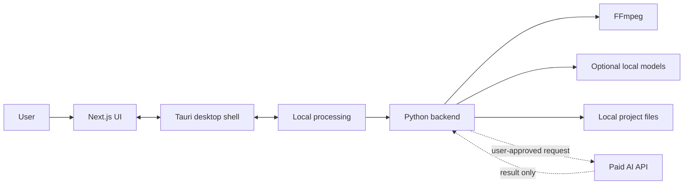
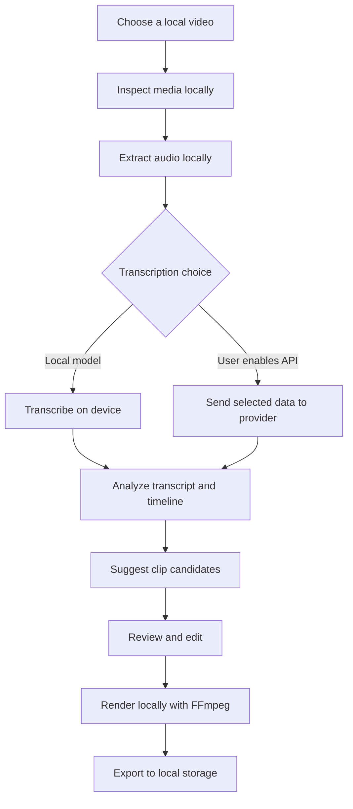

# Clip Robin

> Open-source, local-first video clipping for creators who want automation without surrendering their media workflow to the cloud.

Clip Robin is a Windows desktop application for finding, shaping, and exporting short-form video clips. It is being built around a straightforward idea: your computer should do the heavy work, while paid AI services should be optional tools for the moments where semantic intelligence is worth paying for.

That means lower recurring costs, more privacy, and more control over the files, models, providers, and workflow behind every clip.

## Why Clip Robin?

Many modern clipping products upload the entire workflow to a hosted service. That can mean subscriptions for work a user's computer can already perform, sensitive recordings leaving local storage, and projects becoming dependent on a vendor's account or platform.

Clip Robin takes a different route:

- **Local by default:** media inspection, transcription, cutting, rendering, and project storage should happen on the user's hardware whenever practical.
- **AI where it matters:** paid APIs can help with semantic analysis, clip ranking, hooks, titles, and descriptions, but they are not required for routine media work.
- **Explicit cloud boundaries:** cloud requests should be opt-in, understandable, limited, and replaceable.
- **Open and inspectable:** the project, integrations, and important processing decisions should remain visible to users and contributors.

## How It Fits Together

Clip Robin is a desktop application made of three cooperating layers:

- **Next.js** provides the interface.
- **Tauri** provides the lightweight Windows desktop shell and native integration.
- **Python** is the planned local processing and AI backend.



The cloud path is intentionally narrow. Clip Robin should remain useful when a user wants to work offline or does not want to send media-derived data to a provider.

## The Clipping Flow



Each stage should make three things clear: where the work happens, what data leaves the device, and what the user can change.

## Cost and Privacy Model

Clip Robin is designed to minimize unavoidable cloud spending, not to pretend that AI has no cost. The user's hardware handles the predictable, repeatable work; API spending is reserved for optional intelligence.

| Capability | Preferred location | Cloud usage |
| --- | --- | --- |
| Media inspection | User hardware | None |
| Audio extraction | User hardware | None |
| Video cutting and rendering | User hardware | None |
| Project storage | User hardware | None |
| Local transcription | User hardware | None |
| Semantic clip analysis | Local model or selected API | Optional |
| Hook, title, and description suggestions | Local model or selected API | Optional |
| Clip ranking and refinement | Local model or selected API | Optional |

The intended privacy boundary is simple:

1. Source media is read from local storage.
2. Heavy processing happens locally.
3. Projects, exports, and metadata remain local files.
4. API requests are opt-in and limited to a defined task.
5. Users provide and control their own API keys.
6. Integrations document exactly what they send.

No application can make an upload private once a user chooses to send it to a provider. Clip Robin's job is to make that choice visible and avoid unnecessary transfer.

## Development Status

Clip Robin is in early development, but the first end-to-end filesystem pipeline is now in place.

### Working now

- Next.js interface scaffolded.
- Tauri desktop project initialized inside `frontend`.
- Windows MSVC and Windows SDK environment configured for native Rust builds.
- FastAPI backend connected to the desktop UI with CORS support.
- YouTube URL download flow using `yt-dlp`.
- Local video drag-and-drop and Windows file-picker flow.
- Background local timestamped transcription using `faster-whisper`, with upload and transcription progress.
- Filesystem project storage under `backend/data/projects`.
- Mock transcript analysis that creates `analysis.json`.
- Background FFmpeg clip generation with progress reporting, cancellation with generated-clip cleanup, and regeneration that replaces existing clips.
- Optional animated captions burned into generated clips.
- Project-specific clip previews, playback controls, and MP4 downloads.
- Project listing and deletion, plus basic Settings pages.
- OpenAI, DeepSeek, and Gemini analyzer adapters are implemented but not called by the mock clip-generation flow.

### Current pipeline

```text
Source video
	-> transcript.json
	-> mock analysis.json
	-> background FFmpeg clip generation (optional burned-in captions)
	-> project-specific clips API and downloads
	-> Next.js video preview
```

FFmpeg 9.0.1 is installed locally and the real editor smoke test successfully generated an MP4 clip. On another machine, verify the dependency with:

```powershell
ffmpeg -version
```

If FFmpeg is unavailable, the backend returns an explicit setup error instead of silently using a different processor.
Generated MP4s use H.264 video and MP3 audio so audio is available in Clip Robin's embedded browser.

### Still to do

- Test the real source-video pipeline with FFmpeg now installed locally.
- Test real source videos through download, transcription, analysis, and cutting.
- Replace mock analysis with an opt-in provider selected from OpenAI, DeepSeek, or Gemini.
- Connect generated clips to richer project detail/history views.
- Add clip naming, export, and open-folder actions.
- Add durable job tracking for long-running tasks.
- Add automated backend tests and frontend interaction tests.
- Connect the settings UI to persisted local preferences.
- Expand crop and caption customization.
- Package and distribute the Windows desktop application.

## Repository Layout

```text
ClipRobin/
|- frontend/   Next.js UI and Tauri desktop application
|- backend/    FastAPI routes and local processing services
|- requirements/ Shared Python dependency lists
|- setup.ps1   Windows dependency setup
|- README.md   Project vision, progress, architecture, and setup
```

## Local Development

### One-time setup

```powershell
powershell -ExecutionPolicy Bypass -File .\setup.ps1
```

The setup script creates the root `.venv`, installs the Python packages from
`requirements\backend.txt`, and installs the exact frontend dependencies from
`frontend\package-lock.json`. It requires Python 3.10 or newer and Node.js
20.9 or newer. If those runtimes are not installed yet, install them first:

```powershell
winget install --id Python.Python.3.12 --source winget
winget install --id OpenJS.NodeJS.LTS --source winget
```

FFmpeg is required for generating clips. Install it if it is not already
available on `PATH`:

```powershell
winget install --id Gyan.FFmpeg.Shared --source winget
```

### Run the web app

Open two PowerShell terminals from the repository root.

In the first terminal, start the API:

```powershell
Set-Location backend
..\.venv\Scripts\python.exe -m uvicorn app.main:app --reload --port 8000
```

In the second terminal, start the interface:

```powershell
Set-Location frontend
npm run dev
```

Open [http://localhost:3000](http://localhost:3000). The API is available at
[http://127.0.0.1:8000](http://127.0.0.1:8000).

To run the Windows desktop application instead, use `npx.cmd tauri dev` from
`frontend`. Tauri also requires the Rust toolchain, Visual Studio C++ build
tools, the Windows SDK, and Rust 1.90 or newer. The shared VS Code terminal profile in
`frontend/.vscode/settings.json` initializes the native build environment.

### Desktop versions and automatic updates

The frontend, Tauri config, and Rust package share one app version. From
`frontend`, update all version manifests together before a release:

```powershell
npm run version:set -- 0.1.5
npm run version:check
```

Commit and push the version change, then create and push its matching version
tag from the repository root. A `v0.1.5` tag builds and publishes the signed
Windows installer and updater metadata as a GitHub Release:

```powershell
git tag v0.1.5
git push origin main --tags
```

The Tauri desktop app checks for updates when it opens and every six hours.
When a signed update is available, it shows an in-app prompt; choosing
**Update and restart** installs it and relaunches the app.
Update checks run in production desktop builds, not in the browser or the
Tauri development build. The production desktop app has its own identifier
(`com.cliprobin.desktop`); earlier scaffold builds using `com.tauri.dev` are
separate installs and do not receive these updates.

Windows installers bundle and start the local Python API automatically.
Projects and the downloaded speech model are stored in the current user's
Clip Robin application data folder. The first transcription downloads the
Whisper model, so it needs an internet connection and may take longer than
later runs. Backend startup and transcription errors are logged to `backend.log` in that
application data folder (typically
`%APPDATA%\com.cliprobin.desktop\backend.log`).

Updater releases require a signing key. Generate a keypair once from `frontend`
and keep the private key out of the repository:

```powershell
npx.cmd tauri signer generate --ci --write-keys "$env:USERPROFILE\.tauri\cliprobin.key"
```

The checked-in Tauri configuration contains the corresponding public key. Add
the contents of `%USERPROFILE%\.tauri\cliprobin.key` as the repository's
`TAURI_SIGNING_PRIVATE_KEY` Actions secret under **Settings → Secrets and
variables → Actions**. The release workflow checks that this secret exists
before it signs and publishes installers. Never commit or share the private
key. Releases built before signed updating is configured must be updated by
reinstalling the signed release once; subsequent releases can update in-app.

### API surface

```text
GET  /api/health
POST /api/download
POST /api/local-video/transcribe
GET  /api/local-video/jobs/{project_id}
POST /api/projects/{id}/transcribe
POST /api/projects/{id}/generate-clips?show_subtitles=true
GET  /api/projects/{id}/generation-jobs
GET  /api/projects/{id}/generation-jobs/{job_id}
POST /api/projects/{id}/generation-jobs/{job_id}/cancel
GET  /api/projects/{id}/clips
GET  /api/projects/{id}/clips/{file}
GET  /api/projects
DELETE /api/projects/{id}
POST /api/analyze
```

The analysis endpoint supports provider configuration through environment variables, but the current clip-generation workflow intentionally uses mock analysis. Transcription and clip-generation job status is held in backend memory, so active job state is not durable across a backend restart.
Starting clip generation replaces the project's current generated MP4s. Cancelling a generation stops the active render and removes generated clips while preserving the source video and transcript.

## Contributing

Contributions are welcome across the whole stack:

- Desktop experience and accessibility
- Next.js interface and project workflows
- Tauri commands and Windows integration
- Python processing services
- FFmpeg reliability and media workflows
- Local model integrations
- AI provider adapters and cost controls
- Tests, packaging, documentation, and privacy review

The long-term goal is a tool that respects the user's hardware, files, budget, and choices. Read the code, run it locally, and help shape the boundaries between local processing and optional AI services.

## License

Clip Robin is currently in development. Licensing details will be added before the first public release.

## Links

- [GitHub repository](https://github.com/abdullohtariq/ClipRobin)
