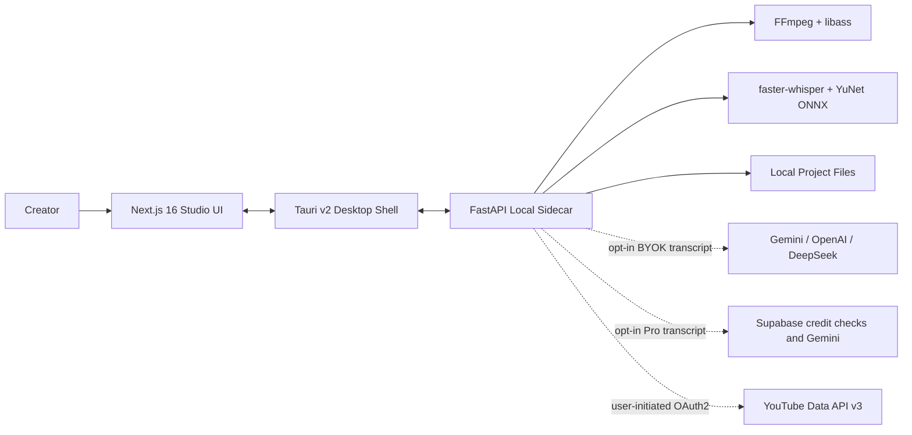
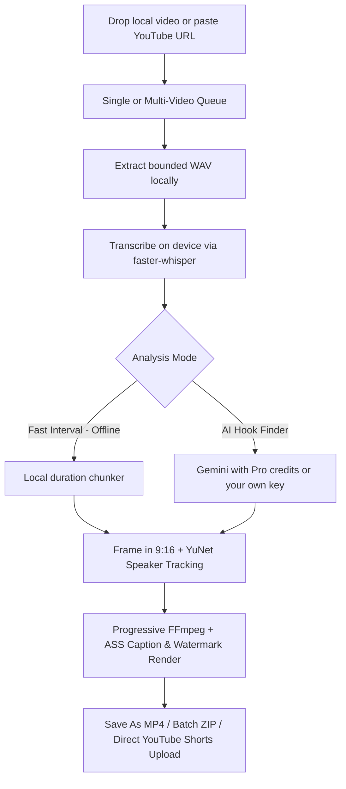

# Clip Robin

> Open-source, local-first video clipping for creators who want automation without surrendering their media workflow to the cloud.

Clip Robin (**v0.1.32**) is a Windows desktop and web application for discovering, reframing, captioning, and exporting viral short-form video clips (YouTube Shorts, TikTok, and Instagram Reels). Video processing runs locally. Cloud AI for hook suggestions is optional.

Local clipping and exports have no monthly video quota. Pro includes a separate allowance for hosted Gemini Hook Finder.

## Why Clip Robin?

Many clipping platforms upload your entire workflow to a hosted SaaS—charging monthly credit quotas for work your own PC can already perform, sending gigabytes of raw footage to third-party servers, and expiring your clips when a plan lapses.

Clip Robin takes a different route:

- **Local by default:** Media inspection, audio extraction, `faster-whisper` transcription, YuNet ONNX active-speaker face tracking, FFmpeg rendering, and project storage run directly on your hardware.
- **AI Hook Finder:** Choose included Pro credits or use your own Gemini key. The opt-in analysis sends timestamped transcript text. Direct analysis can also use OpenAI or DeepSeek with your own key.
- **Explicit cloud boundaries:** Cloud requests are opt-in, transparent, and replaceable; Fast Interval clipping works 100% offline.
- **Open and inspectable:** Architecture, endpoints, schemas, and test suites are documented in [`ai.md`](./ai.md).

## How It Fits Together

Clip Robin is a three-tier hybrid desktop application:

- **Next.js 16 (`16.4.6` / React `19.2.8`)** powers the responsive studio interface.
- **Tauri v2 (`2.12.3`)** provides the lightweight Windows desktop shell, dynamic port allocation, sidecar lifecycle, and signed auto-updates.
- **Python 3.12+ / FastAPI** runs the local media, transcription, smart-framing, and export engine.



## The Clipping Flow



## Cost and Privacy Model

| Capability | Execution Location | Cloud Usage |
| --- | --- | --- |
| Media inspection & duration probing | User hardware (`ffprobe`) | None |
| Audio extraction & video rendering | User hardware (`ffmpeg`) | None |
| Word-level speech transcription | User hardware (`faster-whisper`) | None (one-time model download) |
| Active-speaker face tracking (True 9:16) | User hardware (OpenCV YuNet ONNX) | None |
| Project storage & clip exports | User hardware | None |
| Semantic hook & virality scoring | Hosted Gemini or your configured API | Optional (transcript text only) |
| Direct YouTube Shorts publishing | YouTube Data API v3 | Optional (explicit user action) |

## Key Features (v0.1.32)

- **Dual Intake & Multi-Video Batch Queue:** Import local files (`.mp4`, `.mov`, `.mkv`, `.webm`, `.avi`) or download YouTube links (`yt-dlp`), queue multiple videos sequentially, and cancel or retry items cleanly at any stage.
- **Three 9:16 Vertical Framing Modes:**
  - **16:9 Letterbox Rounded** (`672x378` anti-aliased card on `720x1280` canvas)
  - **1:1 Rounded Square** (`660x660` anti-aliased card)
  - **True 9:16 Smart Framing:** Defaults to stationary **Locked Crop** (configurable horizontal anchor, zero face scan) with optional **Speaker Cuts** and **Follow Speaker** active-speaker tracking powered by OpenCV YuNet ONNX + Whisper VAD, plus real vertical divider detection and per-clip **Reframe** controls (`720×1280`, 30 fps MP4).
    Speaker tracking resets at camera cuts and suppresses brief reactions that would pull the crop off the current speaker. [YuNet model license](backend/app/models/YUNET-LICENSE.txt)
- **Flexible Clip Durations & Counter:** Generate **12s, 15s, 30s, 60s, or 90s** clips with a dynamic clip-count stepper bounded by source duration, early-exit Whisper transcription, and time-only slicing for silent media.
- **6 High-Impact Caption Styles & Previews:** Choose **Classic**, **Robin**, **Clean**, **Punch**, **Pill**, or **Karaoke** (2 words per line, gap bridging, bundled OFL + RTL Arabic & Devanagari fonts) inside an accessible native `<dialog>` 2-pane live preview picker with platform safe-zone guides.
- **Custom Top-Line Hooks & Brand Watermarks:** Burn custom `<=15`-word headline hooks onto individual clips without re-rendering the whole project, and overlay default or validated PNG/JPG/WebP brand logos with adjustable position and opacity (`20%–100%`).
- **AI Developer Mode (BYOK):** Configure your own Gemini API key directly in **Settings** (`gemini-3.8-flash` with automatic fallback to `gemini-3.1-flash-lite`), or configure OpenAI / DeepSeek via `.env`; requested vs. applied selection mode and any fallback reasons are tracked transparently without hiding failed AI runs in cache.
- **Native Export & Social Publishing:** Export single clips or full project `.zip` archives through native Windows File Explorer Save As dialogs (`POST` staging preserves committed clips if cancelled or interrupted), publish directly to **YouTube Shorts** via Google OAuth2 resumable upload, or prepare clips with **Prepare for TikTok** and **Prepare for Instagram** helpers.

## Repository Layout

```text
ClipRobin/
├── frontend/       Next.js 16 Studio UI, node unit tests & Tauri v2 Windows shell
├── backend/        FastAPI routes, media/AI services, bundled fonts/ONNX & pytest suite
├── requirements/   Pinned Python backend dependencies
├── docs/reports/   Engineering & UI audit archives
├── ai.md           Exhaustive architecture, API, schema & audit handbook
├── website.md      Landing page & product positioning blueprint
├── setup.ps1       One-command Windows development bootstrap script
└── README.md       Overview, local setup, testing & release workflow
```

## Local Development

### 1. One-time setup

```powershell
powershell -ExecutionPolicy Bypass -File .\setup.ps1
```

`setup.ps1` creates `.venv`, installs `requirements\backend.txt`, and runs `npm ci` in `frontend/`. Use **Python 3.12**, **Node.js 24**, and **FFmpeg** on `PATH` or in `backend/bin/`.

```powershell
winget install --id Python.Python.3.12 --source winget
winget install --id OpenJS.NodeJS.LTS --source winget
winget install --id Gyan.FFmpeg.Shared --source winget
```

Optional environment variables can be placed in `backend/.env` (copied from `backend/.env.example`) and are loaded automatically on backend startup.

### 2. Run in Web Mode

Open two PowerShell terminals from the repository root:

```powershell
# Terminal 1 — FastAPI Backend (http://127.0.0.1:8000)
Set-Location backend
..\.venv\Scripts\python.exe -m uvicorn app.main:app --reload --port 8000
```

```powershell
# Terminal 2 — Next.js Frontend (http://localhost:3000)
Set-Location frontend
npm.cmd run dev
```

### 3. Run as Windows Desktop App (Tauri v2)

Requires Rust `1.90+`, MSVC C++ Build Tools, and the Windows 10/11 SDK:

```powershell
Set-Location frontend
npx.cmd tauri dev
```

### 4. Run Automated Tests & Static Checks

```powershell
# Backend test suite (158 tests across 23 files)
.\.venv\Scripts\python.exe -m pytest backend/tests -q

# Frontend unit tests, TypeScript, ESLint, manifest version check & static build
Set-Location frontend
npm.cmd test
npx.cmd tsc --noEmit
npm.cmd run lint
npm.cmd run version:check
npm.cmd run build
```

## Versioning & Signed Desktop Releases

`frontend/package.json`, `frontend/src-tauri/Cargo.toml`, and `frontend/src-tauri/tauri.conf.json` share a synchronized version. Run the version script with the next release number from `frontend/`:

```powershell
npm.cmd run version:set -- 0.1.32
npm.cmd run version:check
```

Pushing a matching `v*` tag triggers `.github/workflows/release-tauri.yml` to build the PyInstaller sidecar, bundle the signed NSIS Windows installer, and publish Tauri updater metadata to GitHub Releases:

```powershell
git tag v0.1.32
git push origin main
git push origin v0.1.32
```

Production desktop builds (`com.cliprobin.desktop`) store projects, Whisper models, logs (`backend.log`), and local credentials inside `%APPDATA%\com.cliprobin.desktop` and check for signed updates automatically on startup and every 6 hours.

To generate a Tauri updater signing keypair once (never commit the private key; store it in GitHub Actions secret `TAURI_SIGNING_PRIVATE_KEY`):

```powershell
npx.cmd tauri signer generate --ci --write-keys "$env:USERPROFILE\.tauri\cliprobin.key"
```

## API Overview

Full request/response contracts are documented in [`ai.md`](./ai.md). Core route groups:

```text
GET    /api/health
GET    /api/caption-styles
GET    /api/jobs/active
POST   /api/download                          | GET /api/download/{project_id}
POST   /api/local-video/transcribe            | POST /api/local-video/from-path | GET /api/local-video/jobs/{project_id}
GET    /api/projects                          | PATCH /api/projects/{id}        | DELETE /api/projects/{id}
POST   /api/projects/{id}/transcribe
POST   /api/projects/{id}/generate-clips      | GET /api/projects/{id}/generation-jobs[/{job_id}] | POST .../cancel
GET    /api/projects/{id}/clips[/{file}]      | POST|DELETE /api/projects/{id}/clips/{clip_id}/top-line
POST   /api/projects/{id}/clips/{clip_id}/save-dialog | GET /clips/download-all | POST /clips/download-all-dialog
GET    /api/ai/status                         | POST /api/ai/config             | POST /api/ai/developer-mode | POST /api/analyze
GET    /api/watermark                         | POST /api/watermark/upload      | POST /api/watermark/settings | DELETE /api/watermark
GET    /api/youtube/status                    | POST /api/youtube/config        | GET /api/youtube/auth-url   | POST /api/youtube/upload
```

Free local editing works without an account. Clip Robin Pro is $12 USD per month and includes 20 Gemini Hook Finder credits per billing period when hosted billing is configured. **Account & Plans** shows both the credit balance and any spending limit that reduces what customers can use immediately. The [Supabase and Polar setup](supabase/README.md) covers public email sign-in and testing checkout in Polar Sandbox.

## Contributing

Contributions are welcome across the entire stack—Next.js UI/accessibility, Tauri desktop integration, FFmpeg/YuNet video pipelines, local Whisper performance, BYOK AI adapters, and automated tests. Please review [`ai.md`](./ai.md) before submitting changes.

## Links

- [GitHub Repository](https://github.com/abdullohtariq/ClipRobin)
- [AI & Engineering Handbook (`ai.md`)](./ai.md)
