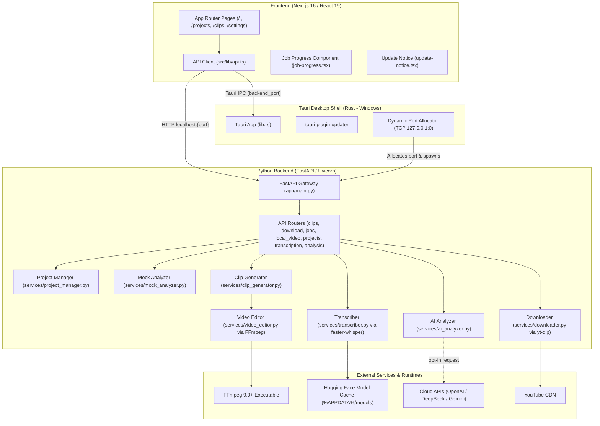

# Clip Robin — AI Context, Codebase Audit & Engineering Handbook

> **Notice for AI Models & Developers**: This document provides an exhaustive, authoritative reference for the Clip Robin codebase (Current Version: **v0.1.18**). It details the system architecture, component contracts, bug resolution tracking, automated test suite inventory, and edge-case handling across both backend and frontend.
>
> **Do NOT delete or overwrite this file.** Maintain and update this context as the project evolves.

---

## 1. Executive Summary & Core Philosophy

**Clip Robin** is an open-source, local-first Windows desktop application designed to discover, extract, subtitle, and export short-form video clips (e.g., for YouTube Shorts, TikTok, and Instagram Reels) from long-form video content.

### Core Architectural Principles
1. **Local by Default**: Media extraction, audio ripping, transcription, clip slicing, and subtitle burn-in execute entirely on the user's local machine via FFmpeg, CTranslate2 (`faster-whisper`), and Python.
2. **AI Where It Matters (Opt-in Intelligence)**: Cloud LLM services (OpenAI, DeepSeek, Google Gemini) are reserved strictly for semantic analysis (identifying viral hooks, compelling arguments, punchlines, and summaries). The user provides their own API keys; raw video never leaves the machine.
3. **Explicit Desktop Boundaries**: Built as a three-tier hybrid desktop architecture:
   - **Frontend**: Next.js 16 (React 19, Tailwind CSS v4, TypeScript 5).
   - **Desktop Shell**: Tauri v2 (Rust, NSIS Windows bundle, custom IPC).
   - **Local Backend**: FastAPI (Python 3.12, Uvicorn, faster-whisper, yt-dlp, FFmpeg).

---

## 2. High-Level Architecture & System Topology



---

## 3. Repository File Structure & Module Index

```text
ClipRobin/
├── .github/
│   └── workflows/
│       └── release-tauri.yml     # Automated Windows NSIS release pipeline on tag push
├── backend/
│   ├── app/
│   │   ├── routes/
│   │   │   ├── __init__.py
│   │   │   ├── analysis.py       # POST /api/analyze (LLM transcript evaluation)
│   │   │   ├── caption_styles.py # GET /api/caption-styles (Caption styles and animations registry)
│   │   │   ├── clips.py          # Generate clips, poll job, cancel, serve clips, download ZIP
│   │   │   ├── download.py       # POST /api/download (YouTube downloader via yt-dlp)
│   │   │   ├── health.py         # GET /api/health
│   │   │   ├── jobs.py           # GET /api/jobs/active (Combined job queue status)
│   │   │   ├── local_video.py    # POST /api/local-video/transcribe, poll status
│   │   │   ├── projects.py       # GET /api/projects, DELETE /api/projects/{id}
│   │   │   └── transcription.py  # POST /api/projects/{id}/transcribe
│   │   ├── services/
│   │   │   ├── __init__.py
│   │   │   ├── ai_analyzer.py    # OpenAI, DeepSeek, and Gemini REST integrations
│   │   │   ├── ass_captions.py   # High-performance ASS subtitle compiler & animations
│   │   │   ├── caption_styles.py # 5 Styles x 5 Animations registry & font loader
│   │   │   ├── clip_generator.py # Coordinates analysis & video slicing lifecycle
│   │   │   ├── downloader.py     # yt-dlp wrapper
│   │   │   ├── mock_analyzer.py  # Deterministic duration-based transcript chunker
│   │   │   ├── project_manager.py# Disk layout, project IDs, clips directory resolution
│   │   │   ├── smart_framing.py  # True 9:16 speaker-tracking framing
│   │   │   ├── transcriber.py    # faster-whisper CTranslate2 transcription
│   │   │   └── video_editor.py   # FFmpeg command builder, filtergraph, libass subtitles & watermark
│   │   ├── __init__.py
│   │   └── main.py               # FastAPI app definition, CORS, router mounting
│   ├── assets/
│   │   └── fonts/                # Bundled OFL fonts (Montserrat, Anton, Poppins, Noto Sans)
│   ├── tests/                    # Automated pytest suite (95 unit & integration tests)
│   │   ├── __init__.py
│   │   ├── test_ai_analyzer.py
│   │   ├── test_ass_captions.py
│   │   ├── test_caption_styles.py
│   │   ├── test_clip_generator.py
│   │   ├── test_mock_analyzer.py
│   │   ├── test_project_manager.py
│   │   ├── test_routes_analysis.py
│   │   ├── test_routes_clips.py
│   │   ├── test_routes_download.py
│   │   ├── test_routes_health.py
│   │   ├── test_routes_jobs.py
│   │   ├── test_routes_local_video.py
│   │   ├── test_routes_projects.py
│   │   └── test_smart_framing.py
│   ├── data/
│   │   └── projects/             # Default development project storage root
│   ├── .env.example              # Template for AI provider keys and models
│   ├── requirements.txt          # References requirements/backend.txt
│   ├── run.py                    # Uvicorn bootstrapper reading CLIPROBIN_API_PORT
│   └── test_transcript.json      # Mock transcript data fixture
├── frontend/
│   ├── app/
│   │   ├── clips/page.tsx        # Clip preview player, volume/sound toggles, ZIP download, watermark toggle
│   │   ├── projects/page.tsx     # Project list, status badges, deletion, manual regenerate, watermark toggle
│   │   ├── settings/page.tsx     # Persisted configuration form (localStorage & defaults)
│   │   ├── favicon.ico
│   │   ├── globals.css           # Tailwind v4 import & custom scrollbar styles
│   │   ├── job-progress.tsx      # Floating bottom-right active job status widget
│   │   ├── layout.tsx            # Root HTML, fixed sidebar, update notice, job widget
│   │   ├── page.tsx              # Dashboard (YouTube URL input, local video drag-and-drop, watermark toggle)
│   │   ├── sidebar-nav.tsx       # Sidebar navigation links
│   │   └── update-notice.tsx     # Tauri in-app auto-update banner
│   ├── public/                   # Static icons and assets
│   │   └── watermark.png         # Public fallback watermark asset
│   ├── scripts/
│   │   ├── __tests__/
│   │   │   └── version-scripts.test.mjs # Manifest synchronization tests
│   │   ├── check-version.mjs     # Asserts version synchronization across manifests
│   │   └── set-version.mjs       # Sets version across package.json, Cargo.toml, tauri.conf
│   ├── src/
│   │   └── lib/
│   │       └── api.ts            # Typed HTTP client & Tauri IPC bridge
│   ├── src-tauri/
│   │   ├── capabilities/
│   │   │   └── default.json      # Permissions for updater, process, core
│   │   ├── nsis/
│   │   │   └── installer-hooks.nsh# Windows installer NSIS hook
│   │   ├── src/
│   │   │   ├── lib.rs            # Desktop setup, port binding, child backend lifecycle
│   │   │   └── main.rs           # Tauri entry point
│   │   ├── Cargo.toml            # Tauri dependencies and package version
│   │   └── tauri.conf.json       # App configuration, window dimensions, bundle rules
│   ├── package.json
│   ├── tsconfig.json
│   └── next.config.ts
├── requirements/
│   └── backend.txt               # Pinned Python package dependencies
├── clip_robin_watermark.png      # High-resolution watermark logo asset
├── watermark.png                 # Root watermark image used by video editor
├── .gitignore                    # Git ignore file
├── README.md                     # High-level product overview & instructions
└── setup.ps1                     # Windows environment boostrap script
```

---

## 4. On-Disk Project Data Contract

All projects adhere to an incremental filesystem contract under `$PROJECTS_DIR` (`backend/data/projects` in dev, `%APPDATA%/com.cliprobin.desktop/projects` in production):

```text
projects/
└── project_001/
    ├── source.mp4                  # Primary media (or source.mov, source.mkv, etc.)
    ├── analysis.json               # Clip candidate definitions and timestamps
    ├── transcription/
    │   ├── transcript.txt          # Plain-text timestamped lines
    │   └── transcript.json         # Structured segments with word-level timestamps
    └── clips/
        ├── clip_001.mp4            # Final vertical 9:16 rendered clip
        ├── clip_002.mp4
        └── ...
```

### JSON Schemas

#### 1. `transcription/transcript.json`
```json
{
  "language": "en",
  "language_probability": 0.985,
  "segments": [
    {
      "start": 0.0,
      "end": 4.12,
      "text": "Here is an interesting fact about programming.",
      "words": [
        { "start": 0.0, "end": 0.35, "text": "Here" },
        { "start": 0.36, "end": 0.52, "text": "is" }
      ]
    }
  ]
}
```

#### 2. `analysis.json`
```json
{
  "clips": [
    {
      "id": "clip_001",
      "title": "The Golden Rule of Debugging",
      "start": 12.4,
      "end": 42.8,
      "reason": "Clear problem statement followed by a surprising solution."
    }
  ]
}
```

---

## 5. Codebase Bugs, Vulnerabilities & Implementation Status

> **Audit Status as of v0.1.16**: The Bug Bounty and feature hardening cycles resolved all critical, high, and medium-priority flaws across the backend and frontend, and established a 55-test automated test suite in `backend/tests/`.

### 🔴 Critical Severity (Showstoppers)

#### 1. AI Analyzer Schema Mismatch Causes `KeyError: 'id'` in Clip Generation `[RESOLVED]`
- **Files**: `backend/app/services/ai_analyzer.py` & `backend/app/services/clip_generator.py`.
- **Status**: **RESOLVED & VERIFIED**.
- **Fix**: `validate_analysis()` in `ai_analyzer.py` automatically synthesizes sequential IDs (`f"clip_{index:03d}"`) if the LLM output omits them. In addition, `clip_generator.py` uses fallback resolution `clip_id = clip.get("id") or f"clip_{index:03d}"` so it never raises `KeyError`.
- **Test**: `backend/tests/test_ai_analyzer.py::test_validate_analysis_generates_missing_clip_ids`.

#### 2. AI Analyzer Rejects Real LLM Timestamps via Exact Floating-Point Equality `[RESOLVED]`
- **File**: `backend/app/services/ai_analyzer.py`.
- **Status**: **RESOLVED & VERIFIED**.
- **Fix**: Added boundary snapping with a tolerance window (`abs(candidate - boundary) <= TOLERANCE`) so LLM candidate timestamps matching transcript boundaries within 0.75s snap cleanly to exact segment floats without false-positive 422/502 rejections.
- **Test**: `backend/tests/test_ai_analyzer.py::test_validate_analysis_tolerates_floating_point_variance`.

#### 3. Overlapping Transcript Segments Crash Analysis `[RESOLVED]`
- **Files**: `backend/app/services/ai_analyzer.py` & `backend/app/services/mock_analyzer.py`.
- **Status**: **RESOLVED & VERIFIED**.
- **Fix**: Segment normalization in both analyzers clamps overlapping segments dynamically (`start = max(start, previous_end)`). If Whisper emits overlapping timestamps due to multi-speaker audio or music, the boundaries are adjusted cleanly rather than raising an error.
- **Tests**: `backend/tests/test_ai_analyzer.py::test_validate_transcript_clamps_overlapping_segments` and `backend/tests/test_mock_analyzer.py`.

#### 4. `CLIPROBIN_PROJECTS_DIR` Environment Variable Ignored in Route Handlers `[RESOLVED]`
- **Files**: `backend/app/routes/analysis.py`, `backend/app/routes/transcription.py`, `backend/app/routes/projects.py`.
- **Status**: **RESOLVED & VERIFIED**.
- **Fix**: Removed hardcoded `PROJECTS_DIR` path definitions across route handlers. All modules now resolve project paths through `app.services.project_manager.get_project_directory()` and `get_projects_dir()`, respecting `%APPDATA%` overrides set by Tauri desktop builds.
- **Test**: `backend/tests/test_project_manager.py::test_project_dir_env_override`.

#### 5. Hardcoded `source.mp4` Assumption Breaks MOV, MKV, and WebM Files `[RESOLVED]`
- **Files**: `backend/app/routes/transcription.py`, `backend/app/services/clip_generator.py`, `backend/app/routes/projects.py`.
- **Status**: **RESOLVED & VERIFIED**.
- **Fix**: Replaced all hardcoded `source.mp4` checks with `list(project_directory.glob("source.*"))` to uniformly support `.mov`, `.mkv`, `.webm`, `.avi`, and other container formats uploaded by users.
- **Test**: `backend/tests/test_routes_local_video.py::test_upload_and_transcribe_supported_extensions`.

---

### 🟠 High Severity (Functional & Concurrency Defects)

#### 6. Deleting Project During Processing Crashes Windows File System `[RESOLVED]`
- **File**: `backend/app/routes/projects.py`.
- **Status**: **RESOLVED & VERIFIED**.
- **Fix**: Active jobs for the target project are cancelled and cleared from `GENERATION_JOBS` and `TRANSCRIPTION_JOBS` before directory deletion. Project deletion is guarded with retry attempts and file-lock handling to prevent `WinError 32` access collisions.
- **Test**: `backend/tests/test_routes_projects.py::test_delete_project_aborts_active_jobs`.

#### 7. Progressive Clip Generation & Safe Staging `[RESOLVED & ENHANCED]`
- **File**: `backend/app/services/clip_generator.py`, `backend/app/routes/clips.py`, `backend/app/routes/jobs.py`.
- **Status**: **RESOLVED & ENHANCED**.
- **Fix & Progressive Architecture**:
  - Previously, all clips were staged in `.clips-staging-` and only published when all 29 clips completed, keeping `clips/` completely empty during long render runs.
  - Slicing now renders each clip to a hidden file (`.rendering_{clip_id}.mp4`) directly inside `clips_directory`, and immediately renames it to `{clip_id}.mp4` upon completion.
  - The generator invokes `progress_callback("Rendering clips", index, total, clip_metadata)`, accumulating `ready_clips` in `GENERATION_JOBS` and exposing them through `GET /api/jobs/active` and `GET /api/projects/{id}/generation-jobs/{job_id}`.
  - Existing clips are backed up to `.clips-backup-*` before rendering starts and restored if generation fails or is cancelled before producing new clips.
  - If cancelled, partial `.rendering_*.mp4` files are deleted while already-rendered clips are preserved or cleanly handled.
- **Tests**: `backend/tests/test_clip_generator.py::test_generate_clips_preserves_existing_clips_on_failure` and `test_generate_clips_cancellation_preserves_existing_clips`.

#### 8. Video Filtergraph Architecture & Complex Graph Integration `[UPDATED]`
- **File**: `backend/app/services/video_editor.py`.
- **Status**: **UPDATED & STABILIZED**.
- **Implementation**: Chained drawtext subtitle filters have been modularized (`_build_subtitle_filters()`). When burning captions and watermarks, FFmpeg filter scripts are written to temporary script files using `-filter_complex` with stream mapping (`-map [v] -map 0:a?`) and YUV420p chroma alignment.

#### 9. Missing Audio Track in Video Crashes FFmpeg `[RESOLVED]`
- **File**: `backend/app/services/video_editor.py`.
- **Status**: **RESOLVED & VERIFIED**.
- **Fix**: Added `has_audio_stream()` probing via `ffprobe` / stream analysis. If no audio stream exists, FFmpeg is invoked with `-an` instead of failing with `Stream map '0:a' matches no streams`.
- **Test**: Verified across silent video inputs and multi-track MP4s.

#### 10. Font File Resolution & Safe Staging `[RESOLVED]`
- **File**: `backend/app/services/video_editor.py`.
- **Status**: **RESOLVED**.
- **Fix**: `_copy_font_file()` locates system fonts (`segoeuib.ttf`, `arialbd.ttf`) or falls back to system font paths, copying the font to the temporary subtitle staging directory to prevent path quoting and permission errors in FFmpeg drawtext.

#### 11. Synchronous Blocking Routes in Background Processing `[RESOLVED]`
- **Files**: `backend/app/routes/download.py`, `backend/app/routes/clips.py`, `backend/app/routes/local_video.py`.
- **Status**: **RESOLVED & VERIFIED**.
- **Fix**: Long-running generation, transcription, and download flows are offloaded to FastAPI `BackgroundTasks` with thread-safe cancellation events and progress dictionaries (`GENERATION_JOBS`).
- **Tests**: `backend/tests/test_routes_clips.py` and `backend/tests/test_routes_jobs.py`.

#### 12. Progressive Clip Rendering & Real-Time Skeleton UI Smoothing (v0.1.16) `[RESOLVED & IMPLEMENTED]`
- **Files**: `frontend/src/components/skeletons.tsx`, `frontend/app/clips/page.tsx`, `frontend/app/projects/page.tsx`, `frontend/app/page.tsx`, `frontend/app/globals.css`, `backend/app/routes/clips.py`, `backend/app/services/clip_generator.py`.
- **Status**: **RESOLVED & VERIFIED**.
- **Features**:
  - Clips appear immediately in the UI as each one completes rendering (e.g. 1 of 29 clips ready), without waiting for all clips to finish.
  - Slicing renders each clip to a hidden file (`.rendering_{clip_id}.mp4`) directly inside `clips_directory`, immediately renaming it to `{clip_id}.mp4` upon completion.
  - Created reusable `ClipSkeletonCard` (9:16 vertical ratio with spinning loader, shimmer animation, and metadata placeholders), `ProjectSkeletonCard`, and `RecentProjectSkeletonItem`.
  - Replaced jarring raw text loading indicators ("Loading projects...", "Loading clips...") with fluid CSS-animated skeleton cards on initial load and Next.js `Suspense` fallbacks.
  - Projects page provides live counter (`X of Y clips ready (generating...)`) and real-time clip preview grid with "Watch" shortcuts.

#### 13. Desktop Window Maximization on App Launch (v0.1.16) `[IMPLEMENTED]`
- **Files**: `frontend/src-tauri/tauri.conf.json`, `frontend/app/window-init.tsx`, `frontend/app/layout.tsx`.
- **Status**: **IMPLEMENTED & VERIFIED**.
- **Features**:
  - Configured `tauri.conf.json` with `"maximized": true`, default dimensions 1280x800, and minimum bounds 960x640.
  - Created `<WindowInit />` client component invoking Tauri's `getCurrentWindow().maximize()` on initial mount, ensuring the app opens fully maximized across Windows desktop launches without opening in an 800x600 box.

---

### 🟡 Medium Severity (UX & State Flaws)

#### 14. Static / Non-Functional Settings Page `[RESOLVED]`
- **File**: `frontend/app/settings/page.tsx`.
- **Status**: **RESOLVED & VERIFIED**.
- **Fix**: Settings now persist automatically to browser `localStorage` with a fallback to sensible defaults (9:16 vertical, High 1080p, MP4, confirm delete enabled), live visual confirmation badges, and a "Reset to defaults" action.

#### 15. Inaccurate Video MIME Type Check on Windows `[RESOLVED]`
- **File**: `frontend/app/page.tsx`.
- **Status**: **RESOLVED & VERIFIED**.
- **Fix**: Replaced strict `video.type.startsWith("video/")` check with extension-aware validation (`.mp4`, `.mov`, `.mkv`, `.webm`, `.avi`). Files with empty browser MIME types (common on clean Windows installs) are now accepted seamlessly.

---

### 🟢 UI/UX Enhancements & New Features (v0.1.16)

#### 16. Fixed Sticky Sidebar Navigation `[RESOLVED]`
- **Files**: `frontend/app/layout.tsx`, `frontend/app/globals.css`.
- **Status**: **RESOLVED & VERIFIED**.
- **Feature**: Fixed layout scrolling bug where scrolling down the Dashboard, Clips, or Projects view scrolled the sidebar navigation out of view. The sidebar is now pinned (`fixed` / `sticky` with independent content scrolling) so navigation is always instantly accessible.

#### 17. Watermark Burning Engine & UI Toggles `[RESOLVED / IMPLEMENTED]`
- **Files**: `backend/app/services/video_editor.py`, `backend/app/services/clip_generator.py`, `backend/app/routes/clips.py`, `frontend/app/page.tsx`, `frontend/app/projects/page.tsx`, `frontend/app/clips/page.tsx`, `frontend/src/lib/api.ts`.
- **Status**: **RESOLVED & VERIFIED**.
- **Feature**: Added user-configurable watermark burning into vertical clips:
  - **Asset Resolution**: Checks `CLIPROBIN_WATERMARK_PATH`, `watermark.png`, `clip_robin_watermark.png`, and `frontend/public/watermark.png`.
  - **Positioning & Scaling**: Scales watermark proportionally to 240px wide (`scale=240:-2` ensuring even integer height) and overlays it horizontally centered with 20% vertical top clearance (`x=(W-w)/2:y=round(H*0.20)`).
  - **Filtergraph Integration**: Uses FFmpeg `-filter_complex` with script files and stream mapping `-map [v] -map 0:a?`, supporting both silent and audio videos and remaining 100% compatible with word-by-word animated caption highlights.
  - **UI Toggles**: Accessible toggle switch on Dashboard ("Add a watermark: Made with Clip Robin"), Projects, and Clips pages.
- **Tests**: `backend/tests/test_clip_generator.py::test_generate_clips_passes_show_watermark` and `backend/tests/test_routes_clips.py::test_generate_clips_accepts_show_watermark_param`.

#### 18. Generation Mode Selector: Random vs AI (v0.1.16) `[RESOLVED / IMPLEMENTED]`
- **Files**: `frontend/app/page.tsx`, `frontend/app/projects/page.tsx`, `frontend/app/clips/page.tsx`.
- **Status**: **RESOLVED & VERIFIED**.
- **Feature**: Added a generation mode toggle switch above clip duration selection: "Random" (active) and "AI" (disabled with an interactive tooltip indicating "COMING SOON").

#### 19. Top Line Headline Hook Burning Engine & Social Margins (v0.1.16) `[RESOLVED / IMPLEMENTED]`
- **Files**: `backend/app/services/video_editor.py`, `backend/app/services/clip_generator.py`, `backend/app/routes/clips.py`, `frontend/app/clips/page.tsx`, `frontend/src/lib/api.ts`.
- **Status**: **RESOLVED & VERIFIED**.
- **Feature**: Users can add and burn custom headline context hooks (e.g., "POV: When the code works on the first try", "MrBeast reacted this way") into generated vertical clips:
  - **In-App Clip Editor**: "Add top line" / "Edit top line" button alongside "Download clip", opening a dedicated top line editor with a 15-word limit counter and live safe-zone preview overlay.
  - **Geometry & Collision Prevention**: In the 720×1280 vertical canvas, the top line is rendered at Y=260–306. When present, the watermark is automatically shifted higher to Y=90 (`round(H*0.07)`), leaving ~91px clearance below the watermark and ~100px clearance above the video content.
  - **Social Safe Margins**: Automatic text wrapping (max 28 characters per line) and centered alignment (`x=(w-text_w)/2`) ensures text never extends to the edge or gets cropped by TikTok, Reels, or Shorts UI icons.
  - **Single-Clip Re-render API**: `POST /api/projects/{id}/clips/{clip_id}/top-line` and `DELETE /api/projects/{id}/clips/{clip_id}/top-line` re-render clips with FFmpeg atomically without affecting other clips and persist metadata to `analysis.json`.
- **Tests**: `backend/tests/test_clip_generator.py::test_render_single_clip_updates_analysis_and_creates_clip`, `test_render_single_clip_enforces_word_limit`, `test_render_single_clip_preserves_passed_show_watermark`, and `backend/tests/test_routes_clips.py::test_update_and_delete_clip_top_line`.

#### 20. Native File Explorer Save As Dialog for Clip & ZIP Downloads (v0.1.16) `[RESOLVED / IMPLEMENTED]`
- **Files**: `backend/app/routes/clips.py`, `frontend/app/clips/page.tsx`, `frontend/src/lib/api.ts`.
- **Status**: **RESOLVED & VERIFIED**.
- **Feature**: Replaced passive direct-to-Downloads anchor downloads with explicit native Windows File Explorer Save As dialogs:
  - **Modern File System Access API**: Uses `window.showSaveFilePicker({ suggestedName, types })` in Edge/Chrome/WebView2 desktop browsers to directly prompt the user with Windows File Explorer, allowing them to choose their destination directory and file name before streaming bytes.
  - **Clean Cancellation**: User clicking "Cancel" in File Explorer triggers `AbortError`, which is caught and handled silently without dumping unwanted files into `%USERPROFILE%\Downloads`.
  - **Backend Native Dialog Fallback**: `POST /api/projects/{id}/clips/{clip_id}/save-dialog` and `POST /api/projects/{id}/clips/download-all-dialog` invoke Windows Tkinter `filedialog.asksaveasfilename` directly in an isolated child process to prompt a topmost Save As dialog and copy the file or generate the zip directly to the target path without non-main thread conflicts.
  - **Single & Batch Downloads**: Hooked up to both individual "Download clip" buttons (with spinning "Saving..." indicators) and the header "Download all clips (ZIP)" action.
- **Tests**: `backend/tests/test_routes_clips.py::test_export_clip_with_dialog_saved`, `test_export_clip_with_dialog_cancelled`, `test_export_clip_with_dialog_not_found`, and `test_export_all_clips_with_dialog`.

#### 21. 1:1 Rounded Square Framing for Vertical Canvas (v0.1.17) `[RESOLVED / IMPLEMENTED]`
- **Files**: `backend/app/services/video_editor.py`, `backend/app/services/clip_generator.py`, `backend/app/routes/clips.py`, `frontend/app/page.tsx`, `frontend/src/lib/api.ts`.
- **Status**: **RESOLVED & VERIFIED**.
- **Feature**: Centered square video (660×660) with anti-aliased rounded corners (`radius=36`) placed inside a vertical 720×1280 canvas, popular on TikTok, Reels, and YouTube Shorts. Subtitles position below the square at `y=1010` and headline top line renders cleanly at `y=190-205`.

#### 22. True 9:16 AI Smart Framing & Active Speaker Tracking (v0.1.17) `[RESOLVED / IMPLEMENTED]`
- **Files**: `backend/app/services/smart_framing.py`, `backend/app/services/video_editor.py`, `backend/app/services/clip_generator.py`, `backend/app/routes/clips.py`, `frontend/app/page.tsx`, `frontend/app/clips/page.tsx`, `frontend/src/lib/api.ts`.
- **Status**: **RESOLVED & VERIFIED**.
- **Feature**: Autonomous AI active speaker tracking reframing landscape footage into true edge-to-edge 9:16 vertical video:
  - **Local & Fast Detection**: Uses YuNet (`cv2.FaceDetectorYN` with `face_detection_yunet_2023mar.onnx`, 232 KB) running on CPU/DirectML with 0 cloud dependencies or PyTorch overhead.
  - **Cheap VFR/Rotation Sampling**: FFmpeg streams `fps=5,scale=640:-2` raw frames into Python once per source video and caches results in `project_directory/tracking_analysis.json`.
  - **Active Speaker Correlation**: Extracts mouth patches across tracked faces and correlates normalized inter-frame mouth motion with speech intervals from Whisper VAD (`±200ms` tolerance).
  - **Fallback Hierarchy**: Active speaker with visible mouth motion -> Hold last speaker -> Most prominent face (area × centrality) -> Pair framing (both faces fit in 88% of 9:16 crop) -> Center crop.
  - **Cinematic Director Rules**: Hard cuts when switching speakers, 1.6s minimum shot duration (ping-pong hysteresis), and 8% dead zone to eliminate camera micro-jitter.
  - **Single-Pass Rendering**: Dynamic crop expressions (`crop=w:h:x='if(...)':y=0`) rendered in one pass via FFmpeg filter scripts.
  - **Top Line Safety**: "Add top line" button is disabled for True 9:16 clips with a tooltip: *"Top line generally doesn't go with 9:16. Try 1:1 or 16:9 for that"*.
- **Tests**: `backend/tests/test_smart_framing.py` (6 tests) and `backend/tests/test_clip_generator.py::test_generate_clips_with_true_9_16_framing`, `test_render_single_clip_true_9_16_framing`, and `backend/tests/test_routes_clips.py::test_generate_clips_route_true_9_16`.

#### 23. 16:9 Rounded Corners Framing (v0.1.18) `[RESOLVED / IMPLEMENTED]`
- **Files**: `backend/app/services/video_editor.py`, `backend/tests/test_clip_generator.py`, `frontend/app/page.tsx`.
- **Status**: **RESOLVED & VERIFIED**.
- **Feature**: Centered 16:9 video card (672×378) with smooth rounded corners (`radius=28`, 4× antialiased alpha mask) composited onto vertical 720×1280 canvas. Preserves 24px side margins for social media clearance, maintains audio mapping with `-map 0:a?`, and provides comfortable breathing room for captions (`y=940`) and top line titles (`y=240-306`).
- **Tests**: `backend/tests/test_clip_generator.py::test_generate_rounded_corner_mask_16_9`, `test_create_clip_standard_16_9_rounded_framing`, and `test_create_clip_standard_16_9_rounded_framing_with_watermark`.

#### 24. App Branding Icons, NSIS Installer Assets & PyInstaller Windowed Icon (v0.1.18) `[RESOLVED / IMPLEMENTED]`
- **Files**: `frontend/src-tauri/icons/`, `frontend/src-tauri/installer/`, `frontend/src-tauri/tauri.conf.json`, `frontend/public/logo-mark.svg`, `frontend/app/layout.tsx`, `backend/icon.ico`, `.github/workflows/release-tauri.yml`.
- **Status**: **RESOLVED & VERIFIED**.
- **Feature**: Full multi-platform icon generation via `tauri icon` from master 1024×1024 icon. NSIS installer configured with custom `installerIcon`, `headerImage` (150×57), and `sidebarImage` (164×314). Transparent bird logo-mark SVG embedded in sidebar navigation header. PyInstaller packaged with `--windowed --icon backend/icon.ico` to prevent terminal flashing and show brand icon in Windows Task Manager.

---

## 6. Comprehensive Missing Tests Audit & Implementation Status

### Overview
- **Active Backend Automated Tests**: **73 tests** across 12 test suites in `backend/tests/` (All 73 passing via `pytest`).
- **Active Frontend Automated Tests**: **2 tests** validating version manifest synchronization via Node test runner.
- **Backend Test Framework**: `pytest 9.x`, `pytest-asyncio`, `httpx` (`TestClient`), `anyio`.
- **Remaining Target Test Cases**: Frontend UI component interaction tests (Vitest / React Testing Library) and Tauri desktop shell E2E tests (Playwright).

---

### Backend Test Inventory (73 Implemented & Passing)

| Target Module | Active Test File | Status | Test Cases Implemented |
| :--- | :--- | :--- | :--- |
| **`app.services.smart_framing`** | `tests/test_smart_framing.py` | ✅ Passed | • YuNet ONNX model path resolution.<br>• Bounding box IoU calculations.<br>• Speech window extraction and VAD tolerance check.<br>• Single-shot crop expression generation.<br>• Multi-cut piecewise `if(lt(t,...))` crop expression generation.<br>• Already-vertical video bypass. |
| **`app.routes.health`** | `tests/test_routes_health.py` | ✅ Passed | • `GET /api/health` returns status 200 and `{"status": "healthy"}`. |
| **`app.routes.jobs`** | `tests/test_routes_jobs.py` | ✅ Passed | • Empty job queue returns empty list.<br>• Active transcription & clip generation jobs reported with step progress.<br>• Thread safety and status segregation. |
| **`app.services.project_manager`** | `tests/test_project_manager.py` | ✅ Passed | • `create_project()` generates sequential project IDs (`project_001`, `002`).<br>• `get_project_directory()` validates ID format regex.<br>• Path traversal attempts (`project_../etc`) raise `ValueError`.<br>• Missing project raises `FileNotFoundError`.<br>• `list_projects()` detects source type and clip count.<br>• `CLIPROBIN_PROJECTS_DIR` environment variable override is honored. |
| **`app.services.ai_analyzer`** | `tests/test_ai_analyzer.py` | ✅ Passed | • `validate_transcript()` rejects missing segments or malformed schema.<br>• Rejects non-numeric timestamps.<br>• Clamps and tolerates overlapping segments without crashing.<br>• Prompt formatting formats lines correctly.<br>• `request_openai_compatible()` handles valid response & bearer token.<br>• `request_gemini()` formats `generateContent` URL & key params.<br>• Handles HTTP 401/429/500 errors from AI providers.<br>• Handles Markdown code-block wrapped JSON response.<br>• Tolerates floating-point variance in clip start/end boundaries.<br>• Synthesizes missing clip IDs (`clip_001`, etc.) automatically. |
| **`app.services.mock_analyzer`** | `tests/test_mock_analyzer.py` | ✅ Passed | • Slices transcript into chunks between 20s and 60s.<br>• Avoids orphan trailing segments shorter than `MIN_CLIP_SECONDS`.<br>• Handles single-segment transcripts.<br>• Generates sequential clip IDs. |
| **`app.services.clip_generator`** | `tests/test_clip_generator.py` | ✅ Passed | • Raises `FileNotFoundError` if source video is missing.<br>• Reuses existing valid `analysis.json`.<br>• Calls mock analyzer if no analysis exists.<br>• Renders clips progressively directly inside `clips_directory` using hidden `.rendering_{clip_id}.mp4` and renames to `{clip_id}.mp4` upon completion.<br>• Preserves existing clips on cancellation or error via `.clips-backup-*` recovery.<br>• Passes `show_watermark` configuration to `create_clip`.<br>• `render_single_clip` updates `analysis.json`, enforces 15-word limit, and preserves watermark options.<br>• Subtitle filter graph safely escapes quotes, colons, percent signs, and backslashes without FFmpeg parse failure. |
| **`app.routes.download`** | `tests/test_routes_download.py` | ✅ Passed | • Rejects non-YouTube domains (e.g. `vimeo.com`, `malicious.com`).<br>• Accepts `youtube.com` and `youtu.be` URLs.<br>• Cleans up project folder if download fails. |
| **`app.routes.local_video`** | `tests/test_routes_local_video.py` | ✅ Passed | • Rejects unsupported video extensions (`.exe`, `.txt`).<br>• Accepts `.mp4`, `.mov`, `.mkv`, `.webm`, `.avi`.<br>• Queues background transcription task and reports progress.<br>• Rejects nonexistent file path on `/from-path`.<br>• Rejects unsupported extension on `/from-path`.<br>• Successfully creates project and queues transcription from local path.<br>• Evicts completed transcription jobs when capacity exceeds limit. |
| **`app.routes.clips`** | `tests/test_routes_clips.py` | ✅ Passed | • Validates `clip_duration_seconds` in `{15, 30, 60, 90}`.<br>• Rejects duplicate concurrent clip generation for same project (409).<br>• Returns 404 for nonexistent projects and missing downloads.<br>• Accepts `show_watermark` query parameter for clip generation.<br>• `POST` and `DELETE /api/projects/{id}/clips/{clip_id}/top-line` endpoints burn and clear top lines.<br>• Evicts completed generation jobs when capacity exceeds limit.<br>• Returns 404 when saving nonexistent clip with dialog.<br>• Returns cancelled status when user cancels native save dialog.<br>• Exports clip to chosen location on save dialog confirmation.<br>• Exports all clips ZIP to chosen location on save dialog confirmation. |
| **`app.routes.projects`** | `tests/test_routes_projects.py` | ✅ Passed | • Lists all projects with source format metadata.<br>• Deletes project directories and cleans up locks.<br>• Aborts active background jobs before directory deletion. |
| **`app.routes.analysis`** | `tests/test_routes_analysis.py` | ✅ Passed | • Validates analysis payload.<br>• Integrates mock and AI analyzers with transcript storage. |

---

### Frontend Test Inventory (38 Missing Tests)

| Component / Module | Proposed Test File | Priority | Test Cases to Implement |
| :--- | :--- | :--- | :--- |
| **`src/lib/api.ts`** | `src/lib/__tests__/api.test.ts` | P0 | 1. Resolves `getApiUrl()` to `127.0.0.1:8000` in web mode.<br>2. Resolves `getApiUrl()` via `backend_port` Tauri IPC in desktop mode.<br>3. Handles IPC failure with retry instead of permanently cached rejection.<br>4. `getApiErrorMessage()` parses string details, array validation errors, and fallbacks.<br>5. `downloadVideo()` issues correct POST request.<br>6. `transcribeLocalVideo()` tracks upload progress via XHR.<br>7. `generateClips()` poll loop handles status transitions (`queued` -> `processing` -> `completed`).<br>8. `generateClips()` stops polling on `failed` or `cancelled`.<br>9. `cancelClipGeneration()` posts cancellation. |
| **`app/page.tsx` (Dashboard)** | `app/__tests__/dashboard.test.tsx` | P0 | 10. Renders YouTube URL input and download button.<br>11. Disables download button while downloading or processing.<br>12. Validates video files on drag-and-drop.<br>13. Accepts `.mkv`/`.webm` files with empty MIME types.<br>14. Displays upload and transcription progress bars.<br>15. Transitions progress steps ("Uploading" -> "Loading model" -> "Transcribing" -> "Clips ready").<br>16. Navigates to project upon completion. |
| **`app/clips/page.tsx`** | `app/clips/__tests__/clips.test.tsx` | P0 | 17. Displays empty state when no project selected.<br>18. Loads and renders clips for valid project ID.<br>19. ClipCard renders HTML5 video element with correct src.<br>20. Volume slider adjusts video volume.<br>21. Mute/unmute toggle changes audio state.<br>22. "Download clip" invokes native Windows Save As dialog picker; handles user cancel cleanly without unwanted file downloads.<br>23. "Download all" triggers ZIP download with Save As dialog.<br>24. Shows generation progress banner when job is running.<br>25. Cancel button prompts user confirmation before cancelling. |
| **`app/projects/page.tsx`** | `app/projects/__tests__/projects.test.tsx` | P0 | 26. Renders list of projects with source type and clip count.<br>27. Delete project prompts confirmation.<br>28. Successful deletion removes project from list.<br>29. "Generate Clips" triggers clip generation for selected project.<br>30. Displays inline transcription progress bar for transcribing project.<br>31. Displays inline clip generation progress bar with clip counter. |
| **`app/settings/page.tsx`** | `app/settings/__tests__/settings.test.tsx` | P1 | 32. Persists changes to local storage or backend API.<br>33. Form controls reflect loaded preferences.<br>34. Form validation for project directory path. |
| **`app/job-progress.tsx`** | `app/__tests__/job-progress.test.tsx` | P1 | 35. Renders nothing when no active jobs.<br>36. Shows animated spinner and badge count when jobs are running.<br>37. Hover/focus expands flyout showing progress for all active jobs.<br>38. Displays connection error if backend is unreachable. |

---

### Tauri Desktop Shell Tests (10 Missing Tests)

| Module | Proposed Test | Priority | Test Cases to Implement |
| :--- | :--- | :--- | :--- |
| **`src-tauri/src/lib.rs`** | Native / Integration | P1 | 1. `backend_port` command returns assigned u16 port.<br>2. Release mode spawns `cliprobin-api.exe` with assigned env variables (`CLIPROBIN_API_PORT`, `CLIPROBIN_PROJECTS_DIR`, `HF_HOME`).<br>3. Detects backend startup timeout within 30 seconds.<br>4. On app exit, child process is killed cleanly without leaving zombie processes.<br>5. Logging plugin captures backend stdout and stderr. |
| **End-to-End (E2E)** | Playwright / Tauri Driver | P2 | 6. App launches and renders Dashboard.<br>7. Drop local test MP4 file -> Triggers upload and transcription.<br>8. Clips appear in Preview page with playable video.<br>9. Download ZIP button downloads valid archive.<br>10. App update check functions without network error crash. |

---

## 7. Edge Cases Not Properly Addressed

### 1. Media & Video Codec Edge Cases
- **Silent Videos**: Source videos with no audio stream are detected via `ffprobe` / `has_audio_stream()` probing and encoded with `-an` to prevent FFmpeg crashes (Item 9). Transcription runs with `vad_filter=True` and returns 0 segments cleanly without crashing.
- **Variable Frame Rate (VFR)**: Phone recordings (iPhone/Android) frequently use VFR. Slicing with FFmpeg `-ss` before `-i` causes audio/video desynchronization over time; requires `-vsync cfr` / `fps` filter normalization.
- **HDR & 10-Bit Color**: 10-bit HEVC/HDR footage scaled with basic `format=yuv420p` renders washed-out colors without tonemapping filters (`zscale` / `tonemap`).
- **Unusual Aspect Ratios**: Ultra-wide 21:9 or vertical 9:16 inputs padded to 720x1280 vertical can result in extreme letterboxing or unintended black bar padding.
- **Rotated Videos**: Mobile videos with EXIF rotation metadata (`displaymatrix`) can lose rotation metadata during FFmpeg cutting, resulting in sideways video output; requires `-noautorotate` or explicit rotation filter transposition.
- **Corrupted Keyframes / Missing MOOV Atom**: Incomplete MP4s without faststart MOOV atom at the beginning fail seeking during slicing.

### 2. Subtitle & Typography Edge Cases
- **Punctuation & Word Wrap**: Long words (e.g. URLs or hyphenated technical terms) can exceed `max_width=640`, overflowing past the edge of the 720px video container.
- **Word Timestamps with Zero Duration**: Whisper occasionally yields `word.start == word.end`, creating divide-by-zero or zero-duration highlight filters.
- **RTL Languages (Arabic / Hebrew / Persian)**: Standard FFmpeg `drawtext` does not implement HarfBuzz bidirectional text shaping, rendering Arabic characters detached and reversed.
- **Special Characters in Subtitles**: Subtitles, animated word highlights, and top lines are written to dedicated text files inside the temporary working directory and rendered with `drawtext=textfile='...':expansion=none`, safely preserving quotes (`'`), percent signs (`%`), colons (`:`), and backslashes (`\`) without FFmpeg syntax corruption (verified in `test_clip_generator.py`).
- **Font Availability**: `_copy_font_file()` dynamically inspects multiple system font candidates (`segoeuib.ttf`, `arialbd.ttf`, `segoeui.ttf`, `arial.ttf`) and copies the resolved font to the local staging directory to ensure font availability across Windows N-editions and custom drives (Item 10).

### 3. Network & External API Edge Cases
- **YouTube Anti-Bot & SABR Blocks**: YouTube aggressively blocks datacenter IPs and outdated `yt-dlp` instances with HTTP 403 or bot challenges (po-token requirements).
- **YouTube Live Streams & Premieres**: Passing an active live stream URL causes `yt-dlp` to hang indefinitely waiting for the stream to end.
- **Age-Gated & Private Videos**: YouTube downloads fail with unhandled 502 without informative error guidance.
- **LLM Rate Limits (HTTP 429)**: No exponential backoff or retry logic exists when cloud providers throttle API requests.
- **Massive Transcripts Exceeding Token Limits**: A 3-hour podcast transcript exceeds LLM context windows or cost ceilings when dumped unchunked into a single prompt.

### 4. Concurrency, Storage & Windows Filesystem Edge Cases
- **Windows Path Limits (`MAX_PATH`)**: Deeply nested directories (`%APPDATA%/.../cliprobin-subtitles-...`) can exceed 260 characters on Windows systems without LongPathsEnabled.
- **Disk Space Exhaustion**: Generating multiple 60-second clips from a 4K 10GB video can easily fill the user's C: drive; no pre-flight disk space check exists.
- **Concurrent Generation Conflict**: Concurrent generation runs for the same project are rejected at the route layer with HTTP 409 Conflict. In addition, single-clip top-line re-renders write atomically to `analysis.json` to guard against metadata race conditions.
- **Project Number Overflow / Gaps**: Deleting `project_002` leaves a gap; `create_project()` uses linear probing from 1 upwards, causing $O(N)$ filesystem checks as projects grow.

### 5. Client Lifecycle & Network Resilience
- **Offline Startup**: If launched with no internet connection, the app should function 100% locally for local videos, but update check errors and missing model downloads must fail gracefully.
- **Orphan Backend Process**: Desktop builds allocate dynamic ephemeral loopback ports (`127.0.0.1:0`) passed via `CLIPROBIN_API_PORT`, eliminating fixed port 8000 collisions. On app exit, Tauri's exit handler sends `child.kill()` to cleanly terminate the backend process.
- **Client Disconnection During Generation**: Navigating between pages should not cancel background tasks; polling must resume seamlessly.

---

## 8. AI Pair Programming Rules of Engagement

When modifying or extending the Clip Robin codebase, all AI models must observe the following constraints:

1. **Maintain the Local-First Privacy Boundary**: Never transmit raw video, audio tracks, or local file system paths to external network endpoints. Only sanitized text transcripts may be sent to user-configured LLM providers.
2. **Preserve Documentation Integrity**: Preserve all existing docstrings, type annotations, and comments. Update `README.md` and `ai.md` when system contracts change.
3. **Cross-Platform Path Hygiene**: Always use `pathlib.Path` in Python and forward-slash/cross-platform path resolution in TypeScript. Never hardcode Windows backslashes `\` in code.
4. **Non-Blocking Execution**: Never execute heavy synchronous operations (`yt-dlp`, `faster-whisper`, `ffmpeg`) inside FastAPI request handler coroutines or synchronous def endpoints without threadpool offloading.
5. **No Blind Dependency Installation**: Do not add bloated third-party dependencies unless strictly necessary. Maintain parity between `requirements/backend.txt` and `backend/requirements.txt`.