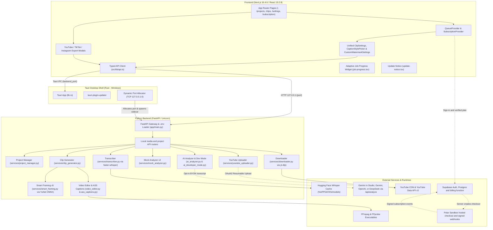

# Clip Robin — AI Context, Codebase Audit & Engineering Handbook

> **Clip Robin v0.1.32 engineering handbook.** Section 5 records current audit findings and their acceptance checks.
>
> **Do NOT delete or overwrite this file.** Maintain and update this context as the project evolves.

---

## 1. Executive Summary & Core Philosophy

**Clip Robin** is an open-source, local-first Windows desktop application designed to discover, extract, subtitle, and export short-form video clips (for YouTube Shorts, TikTok, and Instagram Reels) from long-form video content.

### Core Architectural Principles
1. **Local by Default**: Media extraction, audio ripping, transcription, active-speaker face tracking, clip slicing, and subtitle/watermark burn-in execute entirely on the user's local machine via FFmpeg, CTranslate2 (`faster-whisper`), OpenCV YuNet ONNX, and Python.
2. **Optional cloud analysis.** The Studio's AI Hook Finder uses Gemini and sends timestamped transcript text with the user's configured key. The direct `/api/analyze` route also has OpenAI and DeepSeek adapters. Media processing runs locally. YouTube link intake contacts YouTube, and a user-initiated YouTube upload sends the selected rendered clip to YouTube. The first Whisper run may need to download model files.
3. **Explicit Desktop Boundaries**: Built as a three-tier hybrid desktop architecture:
   - **Frontend**: Next.js 16 (`16.4.6`, React `19.2.8`, Tailwind CSS v4, TypeScript 5, static export `output: "export"`).
   - **Desktop Shell**: Tauri v2 (`2.12.3` Rust crate & `@tauri-apps/api`, NSIS Windows bundle, dynamic port IPC, signed updater).
   - **Local Backend**: FastAPI (Python 3.12+, Uvicorn, `faster-whisper`, `yt-dlp`, OpenCV YuNet ONNX, `httpx`, FFmpeg 7+/9+).

---

## 2. High-Level Architecture & System Topology



---

## 3. Repository File Structure & Module Index

```text
ClipRobin/
├── .github/
│   └── workflows/
│       └── release-tauri.yml          # Automated Windows NSIS signed release pipeline on tag push
├── backend/
│   ├── app/
│   │   ├── routes/
│   │   │   ├── __init__.py
│   │   │   ├── analysis.py            # GET /api/ai/status, POST /api/ai/config, /api/ai/developer-mode, /api/analyze
│   │   │   ├── caption_styles.py      # GET /api/caption-styles (6 styles x 5 animations registry)
│   │   │   ├── clips.py               # Generate clips, poll/cancel jobs, serve MP4s, top-line CRUD, Win32 Save As & ZIP
│   │   │   ├── download.py            # POST /api/download, GET /api/download/{id} (yt-dlp YouTube intake)
│   │   │   ├── health.py              # GET /api/health
│   │   │   ├── jobs.py                # GET /api/jobs/active (Aggregated download, transcription & generation jobs)
│   │   │   ├── local_video.py         # POST /api/local-video/transcribe, /from-path, GET /api/local-video/jobs/{id}
│   │   │   ├── projects.py            # GET /api/projects, PATCH /api/projects/{id}, DELETE /api/projects/{id}
│   │   │   ├── transcription.py       # POST /api/projects/{id}/transcribe (Re-transcribes missing or partial transcripts)
│   │   │   ├── watermark.py           # GET/DELETE /api/watermark, POST /upload, GET /image, POST /settings
│   │   │   └── youtube.py             # /api/youtube/{status,config,auth-url,oauth/callback,disconnect,upload}
│   │   ├── models/                   # Bundled face_detection_yunet_2023mar.onnx
│   │   ├── services/
│   │   │   ├── __init__.py
│   │   │   ├── ai_analyzer.py         # Gemini, OpenAI, and DeepSeek REST integrations
│   │   │   ├── ai_developer_mode.py   # Atomic local Gemini BYOK key storage & AI Developer Mode toggle
│   │   │   ├── ass_captions.py        # ASS subtitle compiler, 2-word chunks, karaoke & hardlinked font staging
│   │   │   ├── caption_styles.py      # 6 Styles x 5 Animations registry, aliases & script-aware font resolver
│   │   │   ├── clip_generator.py      # Incremental analysis cache, language forwarding & progressive MP4 rendering
│   │   │   ├── downloader.py          # Cancellable yt-dlp wrapper with FFmpeg path injection & Win32 window hiding
│   │   │   ├── mock_analyzer.py       # Deterministic duration-based transcript chunker (analyzer_version: 2)
│   │   │   ├── process_utils.py       # Win32 CREATE_NO_WINDOW & STARTF_USESHOWWINDOW subprocess helper
│   │   │   ├── project_manager.py     # Single directory scan for sequential IDs, metadata & clips paths
│   │   │   ├── smart_framing.py       # True 9:16 active-speaker director (YuNet ONNX + VAD + dual tracked/static cache)
│   │   │   ├── transcriber.py         # faster-whisper CTranslate2 transcription with bounded WAV & cancellation
│   │   │   ├── video_editor.py        # FFmpeg filtergraph builder, cached corner masks, custom watermark & opacity
│   │   │   └── youtube_uploader.py    # Google OAuth2 client, token refresh lock & chunked resumable Shorts uploader
│   │   ├── __init__.py
│   │   └── main.py                    # FastAPI app, zero-dependency .env loader, CORS & router mounting
│   ├── assets/
│   │   ├── caption_preview/           # Fixed word-timing fixture for deterministic preview renders
│   │   └── fonts/                     # Bundled OFL fonts (Montserrat, Anton, Poppins, Noto Sans, Arabic, Devanagari)
│   ├── bin/                           # Optional bundled ffmpeg.exe & ffprobe.exe binaries (gitignored)
│   ├── scripts/
│   │   └── build_caption_previews.py  # Build-time 360x640 moving preview MP4, poster JPG & manifest generator
│   ├── tests/                         # 161 tests passed across 22 test_*.py files in the v0.1.29 audit
│   │   ├── __init__.py
│   │   ├── test_ai_analyzer.py
│   │   ├── test_ass_captions.py
│   │   ├── test_audit_regressions.py  # v0.1.28 & v0.1.29 security, caching, O(N) smoothing, partial transcript & framing tests
│   │   ├── test_caption_previews.py
│   │   ├── test_caption_styles.py
│   │   ├── test_clip_counter.py
│   │   ├── test_clip_generator.py
│   │   ├── test_mock_analyzer.py
│   │   ├── test_process_utils.py
│   │   ├── test_project_manager.py
│   │   ├── test_routes_analysis.py
│   │   ├── test_routes_clips.py
│   │   ├── test_routes_download.py
│   │   ├── test_routes_health.py
│   │   ├── test_routes_jobs.py
│   │   ├── test_routes_local_video.py
│   │   ├── test_routes_projects.py
│   │   ├── test_routes_watermark.py
│   │   ├── test_routes_webhooks.py
│   │   ├── test_smart_framing.py
│   │   ├── test_transcriber_shim.py
│   │   └── test_youtube.py
│   ├── data/
│   │   └── projects/                  # Default development project storage root (sibling to runtime configs)
│   ├── .env.example                   # Template for AI provider keys, Whisper overrides & YouTube credentials
│   ├── icon.ico                       # Windows application icon for PyInstaller windowed sidecar
│   ├── requirements.txt               # References ../requirements/backend.txt
│   └── run.py                         # Uvicorn / PyInstaller bootstrapper reading CLIPROBIN_API_PORT
├── docs/
│   └── reports/                       # Historical engineering audit reports (playback, responsive-ui, settings-mismatch)
├── frontend/
│   ├── app/
│   │   ├── clips/
│   │   │   ├── loading.tsx            # Clips Studio route skeleton boundary
│   │   │   └── page.tsx               # Clips Studio player grid, modal viewer, top-line editor, social export & ZIP
│   │   ├── projects/
│   │   │   ├── loading.tsx            # Projects route skeleton boundary
│   │   │   └── page.tsx               # Project library, inline rename, regenerate panel, face-tracking toggle
│   │   ├── settings/page.tsx          # Persisted preferences, Gemini AI Developer Mode, YouTube OAuth, custom watermark
│   │   ├── subscription/page.tsx      # Account sign-in, Free/Pro plan, and hosted billing
│   │   ├── favicon.ico
│   │   ├── globals.css                # Tailwind v4 @theme tokens, scrollbars & reduced-motion utilities
│   │   ├── job-progress.tsx           # Visibility-aware adaptive active job status widget
│   │   ├── layout.tsx                 # Root layout, SubscriptionProvider, QueueProvider, responsive sidebar
│   │   ├── page.tsx                   # Dashboard (Upload / YouTube intake, queue workflow, live 9:16 preview)
│   │   ├── sidebar-nav.tsx            # Responsive 3-tier navigation + subscription badge
│   │   ├── update-notice.tsx          # Tauri signed auto-update notification banner
│   │   └── window-init.tsx            # Tauri startup window maximization helper
│   ├── public/
│   │   ├── caption-previews/          # Pre-rendered 360x640 MP4 moving previews, JPG posters & manifest.json
│   │   ├── logo-mark.svg              # Brand bird logo mark
│   │   └── watermark.png              # Default fallback watermark asset
│   ├── scripts/
│   │   ├── __tests__/
│   │   │   ├── project-name-utils.test.mjs # Project name validation & duplicate-check unit tests (4 tests)
│   │   │   └── version-scripts.test.mjs    # Manifest version synchronization unit tests (2 tests)
│   │   ├── check-version.mjs          # Verifies package.json, Cargo.toml & tauri.conf.json match (0.1.32)
│   │   ├── set-version.mjs            # Updates version across all 3 manifests simultaneously
│   │   └── take_screenshots.mjs       # Playwright visual snapshot utility
│   ├── src/
│   │   ├── components/
│   │   │   ├── ui/                    # Shared primitives (badge, checkbox, icon-button, option-card, segmented-control, status-pill, toggle-row, tooltip)
│   │   │   ├── caption-style-picker.tsx     # Single-video responsive 2-pane modal picker with Pro gating
│   │   │   ├── clip-settings.tsx            # Unified clip settings (mode, duration, count, framing, face tracking, captions, watermark)
│   │   │   ├── custom-watermark-settings.tsx# Custom PNG/JPG/WebP brand logo uploader, position & opacity sync
│   │   │   ├── instagram-upload-modal.tsx   # Guided Instagram Reels export & caption copy modal
│   │   │   ├── live-moving-captions.tsx     # Visibility & reduced-motion aware live 9:16 caption preview
│   │   │   ├── paddle-sandbox-modal.tsx     # Sandbox checkout / webhook simulator for local development
│   │   │   ├── skeletons.tsx                # Shimmer loading skeletons across Dashboard, Projects & Clips
│   │   │   ├── subscription-badge.tsx       # Sidebar plan pill & upgrade trigger
│   │   │   ├── tiktok-upload-modal.tsx      # Guided TikTok export & caption copy modal
│   │   │   ├── upgrade-modal.tsx            # Link from gated features to Account & Plans
│   │   │   ├── video-queue-view.tsx         # Multi-video batch queue view with live progress & cancellation
│   │   │   └── youtube-upload-modal.tsx     # Direct YouTube Shorts OAuth2 resumable upload modal
│   │   ├── hooks/
│   │   │   └── use-ai-developer-status.ts   # Event-driven & visibility-aware AI Developer Mode status hook
│   │   └── lib/
│   │       ├── api.ts                       # Typed HTTP client, Tauri port discovery, AbortSignal & custom events
│   │       ├── account.ts                   # Supabase client and authenticated billing requests
│   │       ├── project-name-utils.ts        # Stateless filename-safe project rename validator
│   │       ├── queue-context.tsx            # Multi-video processing queue with AbortController & backend job cancel
│   │       └── subscription-context.tsx     # Auth state, verified plan refresh & UI feature gates
│   ├── src-tauri/
│   │   ├── capabilities/default.json  # Tauri v2 permissions for updater, process & core windowing
│   │   ├── nsis/installer-hooks.nsh   # Windows NSIS installer lifecycle hooks
│   │   ├── src/
│   │   │   ├── lib.rs                 # Ephemeral port binding, cliprobin-api sidecar spawn & cleanup
│   │   │   └── main.rs                # Desktop entry point
│   │   ├── Cargo.toml                 # Rust crate manifest (v0.1.32)
│   │   └── tauri.conf.json            # Tauri bundle & updater configuration (v0.1.32)
│   ├── package.json                   # Frontend manifest (v0.1.32)
│   ├── tsconfig.json
│   └── next.config.ts                 # Static export configuration (`output: "export"`)
├── requirements/
│   └── backend.txt                    # Pinned Python dependencies
├── clip_robin_watermark.png           # High-resolution brand watermark asset
├── watermark.png                      # Root default watermark image
├── .gitignore
├── ai.md                              # This engineering handbook
├── README.md                          # Product overview, setup & release workflow
├── website.md                         # Marketing & landing page blueprint
└── setup.ps1                          # One-command Windows development bootstrap script
```

---

## 4. API Surface, Environment Variables & On-Disk Data Contract

### 4.1 Complete Backend HTTP API Reference

| Method & Path | Module | Purpose |
| :--- | :--- | :--- |
| `GET /` | `app.main` | Root service status (`{"app": "Clip Robin", "status": "running"}`). |
| `GET /api/health` | `routes.health` | Liveness probe (`{"status": "healthy"}`). |
| `GET /api/caption-styles` | `routes.caption_styles` | Lists all 6 caption styles, allowed animations, colors, and defaults. |
| `GET /api/jobs/active` | `routes.jobs` | Aggregated active download, transcription, and clip generation jobs. |
| `POST /api/download` | `routes.download` | Starts background `yt-dlp` YouTube video download (`202` queued). |
| `GET /api/download/{project_id}` | `routes.download` | Polls YouTube download progress, title, and status. |
| `POST /api/local-video/transcribe` | `routes.local_video` | Uploads local media file (`multipart/form-data`), creates project, queues Whisper. |
| `POST /api/local-video/from-path` | `routes.local_video` | Creates project from local disk path (hardlink/copy) and queues Whisper. |
| `GET /api/local-video/jobs/{project_id}` | `routes.local_video` | Polls transcription job progress and status. |
| `POST /api/projects/{id}/transcribe` | `routes.transcription` | Queues full transcription if missing or if existing transcript has `is_complete: false`. |
| `GET /api/projects` | `routes.projects` | Lists all projects with `title`, `source_type`, `clips`, `created_at`, and `status`. |
| `PATCH /api/projects/{id}` | `routes.projects` | Atomically updates project `title` inside `metadata.json` while preserving other fields. |
| `DELETE /api/projects/{id}` | `routes.projects` | Cancels active download/transcription/generation jobs and deletes project folder (`204`). |
| `POST /api/projects/{id}/generate-clips` | `routes.clips` | Starts progressive background clip rendering (`12, 15, 30, 60, 90`s; framing; style; face tracking). |
| `GET /api/projects/{id}/generation-jobs` | `routes.clips` | Returns latest generation job ordered chronologically (`created_seq`, `created_at`). |
| `GET /api/projects/{id}/generation-jobs/{job_id}` | `routes.clips` | Polls specific generation job status and progressive `ready_clips`. |
| `POST /api/projects/{id}/generation-jobs/{job_id}/cancel` | `routes.clips` | Signals cancellation. The current cleanup can delete previously rendered MP4s. See [regeneration safety](#p0-regeneration-can-delete-or-mix-existing-exports). |
| `GET /api/projects/{id}/clips` | `routes.clips` | Lists rendered clips, `generation_options` (incl. `face_tracking`), and `source_duration`. |
| `GET /api/projects/{id}/clips/{filename}` | `routes.clips` | Streams rendered MP4 clip (`video/mp4`). |
| `POST /api/projects/{id}/clips/{clip_id}/top-line` | `routes.clips` | Burns or updates a custom <=15-word top-line hook on a single clip. |
| `DELETE /api/projects/{id}/clips/{clip_id}/top-line` | `routes.clips` | Removes top-line hook and re-renders the single clip cleanly. |
| `POST /api/projects/{id}/clips/{clip_id}/save-dialog` | `routes.clips` | Opens native Win32 `GetSaveFileNameW` Save As dialog and exports MP4. |
| `GET /api/projects/{id}/clips/download-all` | `routes.clips` | Streams a ZIP archive containing all rendered clips in the project. |
| `POST /api/projects/{id}/clips/download-all-dialog` | `routes.clips` | Opens native Save As dialog and writes ZIP archive directly to disk. |
| `GET /api/ai/status` | `routes.analysis` | Returns Gemini key configuration, YouTube auth status, and `ai_enabled` state. |
| `POST /api/ai/config` | `routes.analysis` | Validates and atomically persists local Gemini API key (`gemini_config.json`). |
| `POST /api/ai/developer-mode` | `routes.analysis` | Enables or disables AI Developer Mode (`ai_enabled`). |
| `POST /api/analyze` | `routes.analysis` | Evaluates a transcript with Gemini, OpenAI, or DeepSeek and optionally saves `analysis.json`. |
| `GET /api/watermark` | `routes.watermark` | Returns custom/default watermark availability, cache-busted `custom_url`, `position`, `opacity`. |
| `POST /api/watermark/settings` | `routes.watermark` | Persists watermark `position` (`top_right`, `top_left`, `bottom_right`, `bottom_left`, `center`) and `opacity` (`20–100`). |
| `POST /api/watermark/upload` | `routes.watermark` | Validates PNG/JPG/WebP magic bytes (<=10 MB) and saves custom brand logo. |
| `GET /api/watermark/image` | `routes.watermark` | Serves the active custom watermark image with `Cache-Control: no-cache`. |
| `DELETE /api/watermark` | `routes.watermark` | Deletes the custom watermark image and reverts to default watermark. |
| `GET /api/youtube/status` | `routes.youtube` | Returns Google OAuth client configuration and connected YouTube channel info. |
| `POST /api/youtube/config` | `routes.youtube` | Saves Google OAuth `client_id` and `client_secret`. |
| `POST /api/youtube/config/paste-json` | `routes.youtube` | Extracts credentials from pasted Google Cloud `client_secret_*.json`. |
| `GET /api/youtube/auth-url` | `routes.youtube` | Generates CSRF-state-protected Google OAuth2 consent URL. |
| `GET /api/youtube/oauth/callback` | `routes.youtube` | HTML-escaped OAuth2 callback page exchanging `code` for offline tokens. |
| `POST /api/youtube/disconnect` | `routes.youtube` | Clears stored YouTube OAuth tokens (`youtube_auth.json`). |
| `POST /api/youtube/upload` | `routes.youtube` | Streams rendered clip in 256 KB chunks to YouTube Data API v3 resumable upload. |

Accounts use the hosted `cliprobin-billing` function. The current source connects that function to Polar Sandbox and restricts test checkout and portal sessions to one designated Supabase account. Polar sends signed lifecycle events to `/webhook`. See the [database and billing setup](supabase/README.md) for the schema, secrets, and deployment steps.

### 4.2 Environment Variables

`backend/app/main.py` automatically loads `backend/.env` and root `.env` at startup using `os.environ.setdefault(...)`:

| Variable | Layer | Description |
| :--- | :--- | :--- |
| `CLIPROBIN_API_PORT` | Backend / Tauri | Loopback port bound by Uvicorn (`8000` in dev, dynamic `127.0.0.1:0` in Tauri). |
| `CLIPROBIN_PROJECTS_DIR` | Backend / Tauri | Root directory for projects (`backend/data/projects` in dev, `%APPDATA%/com.cliprobin.desktop/projects` in desktop). Gemini, YouTube, and watermark settings resolve under its parent directory. |
| `CLIPROBIN_FFMPEG_PATH` | Backend | Explicit override path to `ffmpeg` executable. |
| `CLIPROBIN_WATERMARK_PATH` | Backend | Explicit override path to fallback watermark image. |
| `WHISPER_MODEL` | Backend | `faster-whisper` model name or path. The code defaults to `tiny`. |
| `WHISPER_COMPUTE_TYPE` | Backend | CTranslate2 compute precision override (default `int8` on CPU). |
| `AI_PROVIDER` | Backend | Default provider for direct analysis when the caller leaves it unspecified. Studio generation explicitly selects Gemini. |
| `GEMINI_API_KEY` / `GEMINI_MODEL` | Backend | Gemini key and optional primary model override. The source defaults to `gemini-3.5-flash-lite` and builds a candidate list with `gemini-3.8-flash` and `gemini-3.1-flash-lite`. `backend/.env.example` explicitly sets `gemini-3.8-flash`. Fallback depends on the failure type. |
| `OPENAI_API_KEY` / `OPENAI_MODEL` | Backend | OpenAI API key and model override. |
| `DEEPSEEK_API_KEY` / `DEEPSEEK_MODEL` | Backend | DeepSeek API key and model override. |
| `YOUTUBE_CLIENT_ID` / `YOUTUBE_CLIENT_SECRET` | Backend | Optional env fallback for Google OAuth2 YouTube uploader credentials. |
| `NEXT_PUBLIC_SUPABASE_URL` / `NEXT_PUBLIC_SUPABASE_PUBLISHABLE_KEY` | Frontend | Project URL and public key for account sign-in and billing requests. |
| `NEXT_PUBLIC_CLIPROBIN_ACCOUNT_URL` | Frontend | Optional hosted Account & Plans URL for email confirmation and desktop password recovery. |
| `NEXT_PUBLIC_CLIPROBIN_GITHUB_AUTH` / `NEXT_PUBLIC_CLIPROBIN_GOOGLE_AUTH` | Frontend | Set to `1` after configuring the corresponding browser OAuth provider. |

The web client uses `http://127.0.0.1:8000` for the media API. Tauri obtains its sidecar port through `backend_port`. Billing secrets stay in the hosted function, which defaults to test mode.

### 4.3 On-Disk Data Contract

All runtime data resolves relative to `$DATA_ROOT = Path(CLIPROBIN_PROJECTS_DIR).parent` (`backend/data` in dev, `%APPDATA%/com.cliprobin.desktop` in packaged desktop builds so PyInstaller `_MEIPASS` temp cleanup never loses user credentials or custom watermarks):

```text
$DATA_ROOT/
├── gemini_config.json              # Local Gemini API key & developer_mode boolean (atomic write)
├── youtube_config.json             # Google OAuth2 client_id & client_secret
├── youtube_auth.json               # YouTube access_token, refresh_token & channel profile
├── watermarks/
│   ├── custom_watermark.{png|jpg|webp} # Validated custom brand watermark asset
│   └── watermark_settings.json     # Persisted {"position": "...", "opacity": 20..100}
└── projects/
    └── project_001/
        ├── metadata.json           # {"title": "...", "source_type": "YouTube|Local Video", "duration": 184.2, "url": "..."}
        ├── source.mp4              # Primary media (.mp4, .mov, .mkv, .webm, .avi)
        ├── analysis.json           # analyzer_version: 2, clip candidates, per-clip overrides & generation_options
        ├── tracking_analysis.json  # v5 YuNet + VAD cache with both shots_tracked & shots_static + scanned_duration
        ├── transcription/
        │   ├── transcript.txt      # Plain-text timestamped transcript
        │   └── transcript.json     # Segments + word timestamps + language + is_complete + covered_duration
        └── clips/
            ├── clip_001.mp4        # Final vertical 720x1280 H.264 + AAC rendered clip
            └── ...
```

### JSON Schemas

#### 1. `transcription/transcript.json`
```json
{
  "language": "en",
  "language_probability": 0.985,
  "is_complete": true,
  "covered_duration": 184.2,
  "segments": [
    {
      "start": 0.0,
      "end": 4.12,
      "text": "Here is an interesting fact about programming.",
      "words": [
        { "start": 0.0, "end": 0.35, "text": "Here" },
        { "start": 0.36, "end": 0.52, "text": "is" }
      ]
    }
  ]
}
```

#### 2. `analysis.json`
```json
{
  "analyzer_version": 2,
  "clips": [
    {
      "id": "clip_001",
      "title": "The Golden Rule of Debugging",
      "start": 12.4,
      "end": 42.8,
      "score": 92,
      "reason": "Clear problem statement followed by a surprising solution.",
      "top_line": "",
      "framing_mode": "true_9_16",
      "caption_style": "robin",
      "caption_animation": "grow",
      "face_tracking": true
    }
  ],
  "generation_options": {
    "show_subtitles": true,
    "show_watermark": false,
    "framing_mode": "true_9_16",
    "caption_style": "robin",
    "caption_animation": "grow",
    "clip_duration_seconds": 30,
    "clip_count": 3,
    "generation_mode": "random",
    "face_tracking": true
  }
}
```

---

## 5. Codebase Bugs, Vulnerabilities & Implementation Status

### Open findings and implementation plan

The November 10, 2026 audit covered the `v0.1.29` checkout. Fixes and regression coverage below were implemented on the `fixes` branch (`v0.1.30` docs alignment). **Reproduced** means observed in browser or exercised in production code with disposable data. Controlled tests inject failures or detections where noted and do not touch production accounts, customer projects, or private footage.

#### P0 Regeneration can delete or mix existing exports — Resolved on `fixes`

- **Original issue.** Regenerating with previously exported clips present could delete committed MP4s on cancellation or leave mixed new/old files on failure because `analysis.json` and finished files were written directly into the live project directory.
- **Implementation.** Each generation run writes `analysis.json` and rendered MP4s into a job-owned `.staging_{job_id}` workspace and commits the full set atomically (`_commit_staged_generation`) once rendering completes. Staged previews serve exclusively via `?stage_job_id=`, cancel/failure/startup orphan cleanup only removes `.staging_*` directories owned by that job, and active job/stage checks scope by `(project_id, project_dir, project_uid)`. Project-level serialization locks protect commit, cleanup, top-line edits, and single-clip reframes while preserving existing `top_line` overlays and ZIP/MP4 parity.
- **Verification.** Covered by [`backend/tests/test_audit_regressions.py`](backend/tests/test_audit_regressions.py) through the real route worker: cancel before first render, cancel mid-second render, forced render failure, orphan `.staging_*` cleanup at reload, byte-for-byte hash preservation, ZIP contents parity, and full replacement upon successful regeneration.
- **Code.** [Renderer and rollback](backend/app/services/clip_generator.py) · [Generation routes and clip list](backend/app/routes/clips.py) · [Existing renderer tests](backend/tests/test_clip_generator.py)

#### P0 Provider-controlled clip IDs can escape the output directory — Resolved on `fixes`

- **Original issue.** External/AI-supplied clip IDs were kept in generated filenames without local ID allocation or full producer-path containment validation, allowing path traversal out of the project clips directory.
- **Implementation.** AI response validation (`ai_analyzer.py`) preserves provider identifiers only as `provider_clip_id` metadata while allocating safe local filesystem IDs. Both staging and committed output construction in `clip_generator.py` and `video_editor.py` verify strict resolved path containment (`_validate_output_containment`) and treat cached `analysis.json` files as untrusted input while migrating safe legacy IDs cleanly.
- **Verification.** Covered by [`backend/tests/test_audit_regressions.py`](backend/tests/test_audit_regressions.py) against `..`, Windows/POSIX separators, drive-qualified (`C:\...`) and UNC (`\\server\share\...`) IDs, duplicate IDs, and malformed cached analyses with external sentinel MP4 integrity checks.
- **Code.** [AI response validation](backend/app/services/ai_analyzer.py) · [Clip path construction](backend/app/services/clip_generator.py) · [Renderer](backend/app/services/video_editor.py)

#### P1 Face Tracking Off still moves the crop — Resolved on `fixes` (multi-speaker footage validation ongoing)

- **Original issue.** `face_tracking=false` still scanned faces and moved horizontal crops; split-screen detection used opposite-half face proxies that cut into two-person shots; tracking cache omitted transcript revision; Dashboard preview ignored static anchor offsets.
- **Implementation.** Full `9:16` now defaults to **`Locked Crop`** (`tracking_mode="locked"`, adjustable `crop_anchor_x` with L/C/R presets) and performs zero face scanning. **`Speaker Cuts`** (`"cuts"`, legacy stationary-shot migration) and **`Follow Speaker`** (`"follow"`) are explicit separate modes. `smart_framing.py` detects true center split-screen dividers before clamping half-frames, keys tracking cache entries by media fingerprint + `transcript_revision` + tracking inputs, reports requested vs applied tracking mode and fallback reasons, adds `GET /api/projects/{id}/crop-preview`, and adds `POST /api/projects/{id}/clips/{clip_id}/reframe` for single-clip reframing without affecting sibling clips. Dashboard mirrors `crop_anchor_x` via CSS `object-position`.
- **Verification & limits.** Covered by [`backend/tests/test_audit_regressions.py`](backend/tests/test_audit_regressions.py) (zero detector invocation under `locked`, real divider vs ordinary two-person shot, `/crop-preview`, single-clip `/reframe`) and Playwright E2E Steps 3 & 6. Qualitative accuracy on diverse real multi-speaker webcam/B-roll footage remains subject to user real-footage validation.
- **Code.** [Framing and crop cache](backend/app/services/smart_framing.py) · [Dashboard](frontend/app/page.tsx) · [Projects](frontend/app/projects/page.tsx) · [Studio](frontend/app/clips/page.tsx) · [Current framing tests](backend/tests/test_smart_framing.py)

#### P1 AI fallback is reported and cached as successful AI analysis — Resolved on `fixes`

- **Original issue.** Provider failures silently fell back to deterministic interval clips while saving `generation_mode="ai"`, causing retries to reuse cached interval outputs and omitting failure reasons.
- **Implementation.** Metadata separately tracks `requested_generation_mode`, `applied_generation_mode`, `ai_provider`, `ai_model`, and sanitized `ai_fallback_reason` (stripping API keys and never logging raw transcript text). Subsequent AI generation requests bypass cached interval results when prior runs fell back (`force_reanalyze` / mode mismatch). Developer Mode validation runs uniformly after provider resolution across `clip_generator.py` and `routes/analysis.py`. Studio renders fallback banners with a **Retry AI Analysis** button, and Dashboard/Settings disclose before enabling AI that timestamped transcript text is transmitted to the user-configured LLM provider.
- **Verification.** Covered by [`backend/tests/test_audit_regressions.py`](backend/tests/test_audit_regressions.py) (401, 404, 429, malformed JSON, Developer Mode block, log key redaction, fallback reporting, retry bypass) and Playwright E2E Step 5 confirming `Time Slice` cards omit fake `8.5/10` / `"Mock analysis"` labels.
- **Code.** [Analysis and cache](backend/app/services/clip_generator.py) · [Provider requests and retries](backend/app/services/ai_analyzer.py) · [Direct analysis route](backend/app/routes/analysis.py)

#### P1 Verified billing requires hosted setup and sandbox testing — Local fixes complete; hosted sandbox pending

- **Original reproduction.** Earlier releases allowed local license-key spoofing and unauthenticated local webhook mutations; those paths are removed.
- **Current status.** Supabase Auth is hosted. Lemon Squeezy closed new store sign-ups on November 16, 2026. The current source integrates Polar checkout and its customer portal with signed webhooks, account-scoped links, and ordered billing updates. Sandbox is the default billing environment. `PLAN_FEATURES` matches actual `720×1280, 30 fps` renderer limits.
- **Plan and Gemini cost controls.** Pro is priced at $12 USD per month with 20 Hook Finder credits per billing period. Each fresh analysis uses one credit per started 30 minutes. `20261117000000_hook_credits.sql` reserves credits and a conservative spend estimate before Google receives a request, with $1 per-account and configurable project-wide limits. The function pins Gemini 3.5 Flash-Lite and records input, output, and thinking tokens. The existing local cache and bring-your-own-key path are available in the desktop app. The signed-in plan screen explains when checkout is unavailable and shows the credit balance when configured.
- **Verification.** `frontend/scripts/__tests__/billing.test.mjs` runs both migrations in embedded PostgreSQL and tests a full simulated cycle with Polar and Gemini responses. It exercises activation, account isolation, failed generation, concurrent requests, exhaustion, renewal, cancellation, and loss of access when the subscription ends.
- **Still needed.** Finish Polar Sandbox sign-in and create the organization, $12 recurring product, restricted API token and webhook. Apply the credit migration, configure secrets and the Google project budget, deploy the Edge Function, and verify checkout, credit use, and renewal against Polar Sandbox from a build that accepts Polar links. The `v0.1.30` installer accepts Lemon Squeezy links. Production requires an approved Polar organization and an updated app release. See the [setup and test instructions](supabase/README.md).
- **Code.** [Subscription context](frontend/src/lib/subscription-context.tsx) · [Plans page](frontend/app/subscription/page.tsx) · [Billing function](supabase/functions/cliprobin-billing/index.ts) · [Setup and acceptance](supabase/README.md)

#### Account, payment, and credit audit (November 18, 2026)

**Hosted checks.** The existing confirmed account stayed signed in and refreshed to Free in the local app connected to the real Supabase project. The Pro card showed $12/month and disabled checkout with an explanation. Supabase has email signup and confirmation enabled, uses the built-in mail sender, and has Google and GitHub disabled. The Site URL is `http://localhost:3000`. Both allowed account redirects point to loopback addresses. The dashboard listed the original subscription and checkout tables. `billing_hook_requests` and the required custom Polar and Gemini settings were absent. Polar Sandbox was at sign-in.

**Local checks.** The static frontend built successfully. All 13 Node tests and 65 Python tests in the account-adjacent analysis and clip-generation suites passed. Isolated browser tests covered signup prompts, resend, invalid credentials, unconfirmed email, email delivery and rate-limit errors, session persistence, sign-out, a failed plan refresh and retry, checkout link validation, the portal link, Pro activation and balance, cancellation, and the account screen at 390 px. Same-browser password recovery passed on the exported frontend with three simulated response speeds. The development preview missed the reset form with the immediate response and passed with delayed responses. The browser test used simulated Auth email callbacks.

**Credit and payment checks.** The real migrations ran against embedded PostgreSQL with simulated Polar and Gemini APIs. Checkout rejected a production price mismatch. The cycle covered activation, concurrent reservations, exhaustion, invalid or oversized input, failed Gemini output, renewal, failed payment and recovery, cancellation, and expiration. A 30-minute source used one credit and a 30-minute-and-one-second source used two. A synthetic video also rendered through the real local clip route with a simulated Hook Finder response. Changing captions reused the hooks. An out-of-credits response switched generation to Fast Interval and preserved the reason in the job status. These checks incurred no payments, provider calls for Gemini, or outgoing account emails.

| Priority | Finding | Work before launch |
| --- | --- | --- |
| Blocker | New public accounts cannot reliably receive confirmation or reset email. Supabase's built-in sender is restricted to project team addresses and is rate-limited. Loopback redirects only reach the account screen when a local server is running on the customer's computer. | Configure an SMTP sender, publish Account & Plans at an HTTPS address, and put its exact URL in Supabase's redirect allowlist and `NEXT_PUBLIC_CLIPROBIN_ACCOUNT_URL` for the desktop build. Test signup, resend, confirmation, and reset with a non-team inbox. [Supabase email delivery](https://supabase.com/docs/guides/auth/auth-smtp) · [Supabase redirects](https://supabase.com/docs/guides/auth/redirect-urls) |
| Blocker | Paid checkout and included credits are unavailable in the hosted project. The current GitHub `v0.1.30` source accepts Lemon Squeezy billing links. | Finish Polar Sandbox onboarding and create the $12 monthly product and signed webhook. Apply the Hook Finder migration before deploying the updated function. Configure the restricted Polar credentials and the dedicated Gemini key and budget. Verify sandbox checkout from the updated Windows build before publishing it. Verify a second account stays Free. [Setup steps](supabase/README.md) · [Polar Sandbox](https://polar.sh/docs/integrate/sandbox) |
| High | Expired email links and links opened in another browser returned to sign-in with no explanation. Desktop offers password reset only when the build has a hosted Account & Plans URL. Web sign-in with Google or GitHub requires the providers and frontend flags. | Display safe callback errors with an expired-link or wrong-browser recovery action. Test a fresh reset, an expired link, a different browser, and restart during recovery on the packaged app. Keep the email route usable regardless of optional social sign-in. [Supabase PKCE](https://supabase.com/docs/guides/auth/sessions/pkce-flow) |
| High | A simulated payment already recorded by Polar left Clip Robin on Free until the signed subscription event was delivered. **Refresh plan** reads Supabase's last subscription state. Repeated refreshes did not recover a missing notification. | Add a payment-pending screen, a server-side way to reconcile the expected checkout against Polar, and help for a confirmed payment that is still pending in the app. Store the checkout identifier and prevent a replacement charge while the first checkout is unresolved. Verify delayed delivery, replay, and repeated checkout attempts. [Polar webhook delivery and redelivery](https://polar.sh/docs/integrate/webhooks/delivery) |
| High | A simulated order refund left Pro and its credits available while Polar still reported the subscription as active. A failed renewal removed Pro and showed the billing portal, and a later active event restored it. | Define when a current-period refund should end access. Until an entitlement change is implemented, verify the corresponding subscription cancellation or revocation in Polar after any applicable refund. Test full and partial refunds, an older-order refund, and recovery from a failed renewal. [Polar refund behavior](https://polar.sh/docs/api-reference/refunds/create) |
| High | The project spend cap correctly stopped Gemini, but **Account & Plans** still showed the unused per-account credits. At the documented $5 budget and $0.02 reserved per credit, the shared project can reserve 250 credits per UTC month, equivalent to 12 full 20-credit allowances with 10 left, before counting failed attempts. | Size the paid pilot to the shared budget, show temporary service exhaustion separately from the customer's credit balance, and account for this shared limit when accepting new subscriptions. Verify the cap and alerts with the provider configuration before allowing paid upgrades. |
| Medium | **Open secure checkout** stayed visible after the same account refreshed to Pro. A simulated provider outage also held the checkout slot until its 30-second reservation expired. | Clear or hide the old link when checkout is no longer available. Show confirmed or pending payment after returning from Polar and make retry feedback explain a checkout that is still being prepared. |

**External acceptance still open.** Test delivery to an ordinary inbox, initial sign-in from a fresh Windows installation, checkout in the external browser, a successful and declined test card, any verification challenge Polar displays, receipt and portal access, a renewal or failed-renewal event from Polar, and use of the hosted credit function with the intended capped Gemini project. No cloud configuration was changed during the audit.

#### Account and billing fixes (November 18, 2026)

| Audit item | Fix in the working copy | Hosted acceptance |
| --- | --- | --- |
| Public signup and reset email | The Account & Plans export can be uploaded to Cloudflare Pages at its free HTTPS address. The Clip Robin confirmation and reset templates send customers to that page. Customers confirm the action on the page before the app sends the one-time token to Supabase. The template works across browsers and keeps the token in the URL fragment until the page reads it. | Publish the account page, configure an SMTP sender and the exact HTTPS redirect, and install both templates. Verify signup, resend, and reset with a non-team inbox. |
| Expired links and password recovery | Account & Plans displays errors for expired, used, or wrong-browser links. It explicitly exchanges legacy PKCE codes after registering the password-recovery listener. After verification it keeps a short account-scoped recovery marker so a page reload can reopen the password form. The Windows build uses Tauri's browser opener for the configured account URL and for Polar links. | Verify the two email link formats and a reset from an installed Windows build. Legacy PKCE requires the browser that requested the link. Configure each optional social provider in Supabase before enabling its sign-in button. |
| Missing or delayed checkout notification | The billing function records the Polar checkout ID. It checks the provider state on plan refresh, validates the purchase with the signed Clip Robin account claim, and syncs the matching subscription. Confirmed checkouts stay pending until Polar records the payment. Repeated clicks reuse an open link and cannot create a new checkout while Polar reports the previous one unresolved. The app hides the old link when the attempt or plan changes. A failed attempt to create a link releases its slot immediately. | SQL and function deployment completed November 18. Finish the Polar connection, then verify a declined test card and a successful sandbox payment with webhook delivery paused. Re-enable delivery and replay the event. |
| Refunds and billing portal | The function verifies the order and subscription directly with Polar for an `order.refunded` event. A full refund for the current subscription period ends Pro and its included credits immediately, while the billing portal stays available. The database persists the affected period so a replayed active subscription event cannot restore it. Partial and older refunds preserve the current plan. A later paid period gets a new allowance. | Enable `order.refunded` delivery and `orders:read`. Test a full first-order refund, full renewal refund, a partial refund, an old-order refund, and access to the portal. Manage cancellation in Polar when appropriate. |
| Shared Gemini budget | The UI shows the balance and the amount available now. The server checks both before reserving a generation and deducts a shared spending reservation for every attempt. Production checkout holds room for current subscriptions and unresolved checkouts before it offers another paid plan. At $5/month, 12 full 20-credit allowances fit before counting additional attempts or usage at differing points in each customer's billing cycle. | Set a dedicated Gemini key and a matching provider-side budget. Check the ledger against actual Gemini usage during the pilot. |

**Verification.** All 13 Node tests passed, including the real migrations in embedded PostgreSQL. The combined scenario covered simultaneous production checkout reservations, immediate retry after a failed provider request, confirmation pending, activation without a webhook, credit reservation and exhaustion, a Gemini error, cancellation, a partial refund, a full current refund, an older invoice refund, and renewal. The 65 related Python tests passed. Deno type checking, ESLint on the changed frontend routes, version manifest checks, and both static builds passed. The packaged account site was served and tested in Edge at 390 px with simulated Supabase and billing responses. The browser covered signup, resend, invalid credentials, expired and wrong-browser links, cross-browser confirmation and password reset, reload during recovery, pending checkout, Pro activation, the portal link, the credit-cap notice, refund, and sign-out. The 58-file ZIP is in `frontend/build/ClipRobin-Account-Site.zip`. These tests incurred no checkout or Gemini charges.

**Dependencies.** Next.js and its ESLint configuration were updated to 16.4.6, and the locked source-map dependency was updated to 1.2.2. The production dependency audit reported zero vulnerabilities after those updates. [Next.js advisory](https://github.com/advisories/GHSA-vcvr-r3jv-pc5j) · [Source map advisory](https://github.com/advisories/GHSA-68fv-2mgg-jv7q)

**Hosted steps pending.** Supabase CLI owner authorization is complete. All three billing migrations are applied and the current billing function is deployed. Polar Sandbox checkout activated Test Pro, and the actual customer portal was verified. The account site is now public at `https://cliprobin-accounts.thinarch8.chatgpt.site/subscription/`; Google sign-in on that public page returned to the correct URL and loaded the owner's Test Pro plan. Supabase Auth, checkout returns, local configuration, and the GitHub release variable use the new address. Google publishing status is **In production**, with separate sensitive-scope verification still required. The dedicated free-tier Gemini service passed a real hosted synthetic analysis and correctly reduced the test balance from 20 to 19 credits. The November 26 email setup now has a provider-confirmed delivered owner reset; public signup/link acceptance and live Polar merchant credentials remain pending before real paid checkout. See the launch follow-up below. The published `v0.1.32` installer predates the new account address; the release variable applies to future builds. [Deployment and verification steps](supabase/README.md)

#### Google sign-in setup (November 18, 2026)

- **Cloud configuration.** Created a dedicated **Clip Robin sign-in (Supabase)** web OAuth client in the existing `youtube-api-512616` Google Cloud project. Its callback is `https://kzdbmkmelbbojudjouet.supabase.co/auth/v1/callback`. Authorized origins are `http://127.0.0.1:3000`, `http://localhost:3000`, and `https://abdullohtariq.github.io`. The owner completed Google's required 2-Step Verification. Initial testing used the owner's listed test account; the later approved publishing step changed Audience to **In production**, as recorded below. The private client JSON was saved in the owner's Downloads folder.
- **Supabase configuration.** Enabled the Google provider using the dedicated client ID and secret. Email sign-in stays enabled, with email confirmation required. The initial local Site URL was replaced with `https://cliprobin-accounts.thinarch8.chatgpt.site/subscription/`. The redirect allowlist retains both local `/subscription` addresses and both old GitHub variants, and includes both variants of the new public account address.
- **Verification.** The hosted Auth settings report `external.google=true`. An authorization request returns HTTP 302 to `accounts.google.com` with the new client ID, the exact Supabase callback, and the `email profile` scopes. After the owner completed the Google account picker and consent in Chrome, Clip Robin returned to `http://127.0.0.1:3000/subscription` and displayed **Signed in as abdollahtariq@gmail.com** with **Free plan**. The session persisted after a full page reload. **Refresh plan** completed successfully using the Google session.
- **Public account page and publishing completed.** The old GitHub Pages subscription address returned HTTP 404. The account-only site is now public at `https://cliprobin-accounts.thinarch8.chatgpt.site/subscription/`. Anonymous page, JavaScript and CSS requests return HTTP 200 without a hosting sign-in gate. Updated Supabase's Site URL and added both trailing-slash variants of the new account URL while preserving existing callbacks. A real Google sign-in from that page returned to the public `/subscription/` address, cleared its one-time code, and loaded the owner's existing Test Pro plan. Saved the existing public marketing homepage, privacy, and terms links in Google Branding after checking each returned HTTP 200. With the owner's explicit approval, published the Google app; Audience now reports **In production**. The project also declares `youtube.upload` as a sensitive scope and Google displays a verification requirement and a 100-user cap for unapproved sensitive/restricted scopes. Publishing does not complete that verification. [Supabase Google setup](https://supabase.com/docs/guides/auth/social-sign-in/auth-google)

#### Disabled Pro checkout check (November 18, 2026)

- **Original customer-visible result and fix.** The signed-in account showed **Free plan**, a disabled **Upgrade to Pro** button, and **Upgrades open once payment setup is complete**. Missing hosted payment settings caused the billing service to report checkout unavailable. After completing the configuration below, the owner's signed-in account now shows an enabled **Test Pro checkout** button. Clicking it creates a Polar test checkout, changes the action to **Resume checkout**, and displays **Open secure checkout**. The hosted page correctly shows **Clip Robin Pro, $12/month**. No frontend change was needed to enable it.
- **Initial hosted check.** The original subscription schema existed, while the credit usage table and balance RPCs were missing. Privileged inspection after the owner's Supabase CLI authorization confirmed that only the original migration had been applied manually. The original deployment was billing function version 1, and the project had no custom payment secrets.
- **Deployment completed.** Registered the existing original migration, applied `20261117000000_hook_credits.sql` and `20261118000000_billing_reliability.sql`, and deployed the reviewed function and its two supporting modules. The database records all three migrations. Live checks confirmed row-level security on all three billing tables, public and account writes denied, and the server role permitted to perform billing and credit operations. At initial deployment there were zero subscription and credit-request rows; the later approved mock payment created the single active test subscription described below. Function version numbers can increase when secrets are propagated and do not alone identify a source change.
- **Sandbox settings.** Set `POLAR_ENVIRONMENT=sandbox`, designated the owner's existing Supabase account for testing, generated a private checkout signing secret, and set the previously planned project reservation limit to 500 cents per UTC month. The dedicated free-tier Gemini key was subsequently installed and passed the hosted cycle below. Temporary local settings files were removed after upload.
- **Polar organization and product created.** After the owner explicitly authorized acceptance of Polar's Terms, Privacy Policy, and AUP, created the **Clip Robin** sandbox organization with slug `clip-robin`, USD currency, and organization ID `23176ef5-701b-4015-89ba-5edfbf041f2c`. Created **Clip Robin Pro**, product ID `d6d9e744-295d-40e3-96ad-45519489e71e`, as a recurring subscription at **$12 USD every one month**, without a trial. The catalogue confirms `$12 / mo`. This is Polar's separate test environment; no real payment was made.
- **Private connection completed.** With the owner's explicit approval, created the `cliprobin-supabase-sandbox` organization access key with the four runtime permissions `checkouts:write`, `subscriptions:read`, `orders:read`, and `customer_sessions:write`. The dashboard shows expiry **December 18, 2026**; replace it before that date if testing continues. Created the enabled **Clip Robin billing sandbox** raw webhook at `https://kzdbmkmelbbojudjouet.supabase.co/functions/v1/cliprobin-billing/webhook`, API version `2026-10`, with all eleven available `subscription.*` events and `order.refunded`. Uploaded the token, organization ID, product ID, and generated Standard Webhooks secret as Supabase function secrets. Secret values were not printed or placed in tracked files. The ignored temporary settings file was removed after successful upload.
- **Completed hosted mock payment.** The local account page returns HTTP 200 and retains the Google session for the owner. After explicit approval to use the owner's email and the published 4242 test card, submitted the $12/month Polar Sandbox checkout with dummy expiry/CVC and Pakistan selected. Polar displayed **Thank you for your order!**. Supabase recorded one active test subscription and closed the matching checkout. Clip Robin automatically changed to **Test Pro is active**, and manual **Refresh plan** retained the verified plan. No real money was charged. An unsigned POST to the deployed webhook returns HTTP 401 with `Invalid webhook signature`.
- **Completed portal verification.** The app created an **Open billing portal** link. The actual sandbox portal was verified in the browser on November 18, showing **Clip Robin Pro — Active — $12/mo**, a paid $12 test order dated November 18, and renewal on December 18, 2026. Subscription activation and a usable portal are now provider-tested. Explicit delivery-log inspection and event replay remain separate checks; activation alone does not establish every notification timing scenario.
- **Remaining end-to-end checks.** Verify a declined card, an abandoned/resumed checkout, activation with delayed webhook delivery, replay safety, cancellation, and the refund scenarios above against the hosted provider. The existing automated suite covers these conditions with simulated provider responses; those results are distinct from hosted provider verification. Included Gemini generation now passes the real hosted cycle below. Production checkout remains in sandbox until the live merchant configuration and remaining launch checks are complete.

#### Production launch follow-up from the pasted checklist (November 18–26, 2026)

**Current decision.** Do not enable real charges merely by changing `POLAR_ENVIRONMENT`. The sandbox integration and successful mock payment are complete. Public account hosting, ordinary-inbox delivery, a dedicated included-Gemini service, and live merchant configuration must be completed together. The owner requested implementation of this checklist while retaining the earlier instruction not to make payments.

| Work item | Completed or directly observed | Remaining action and acceptance check |
| --- | --- | --- |
| Public HTTPS account page | Built the account export with its own root path and new HTTPS URL. Compilation, TypeScript and static generation passed. Created **Clip Robin Account & Plans**, Site `appgprj_6afe1c4a4ee88191972c105802668b9a`, and deployed the account-only bundle at `https://cliprobin-accounts.thinarch8.chatgpt.site/subscription/`. After explicit owner approval, set access to **public**, revision 2. Anonymous HTML, JavaScript and CSS requests returned HTTP 200, and the browser displayed the actual sign-in form. Source and manifest are in `hosting/cliprobin-account`, an independent nested repository. | Public hosting is complete. Continue ordinary-inbox confirmation/recovery acceptance after SMTP is connected. |
| Redirects and installed app | Updated and verified Supabase Site URL and the two new redirect entries, retaining all four existing entries. Config push changed exactly two properties and left twelve undeclared remote settings unchanged; the follow-up diff shows zero updates pending. Set `CLIPROBIN_CHECKOUT_RETURN_URL` to the public account URL, updated the ignored local frontend configuration, and set/read back GitHub Actions `NEXT_PUBLIC_CLIPROBIN_ACCOUNT_URL` in `abdullohtariq/ClipRobin`. Public Google sign-in completed successfully. | Rebuild the installer before claiming downloaded copies use the new address. Verify ordinary-inbox confirmation/reset and a new checkout return. An old checkout retains its creation-time return settings. |
| Google public readiness | Completed Branding with the existing public homepage/privacy/terms URLs and confirmed the saved notification. With explicit owner approval, published the app; Audience now reports **In production** and External. Data Access contains the separate sensitive `youtube.upload` permission. The actual public account sign-in returned the owner's session and Test Pro plan, and the session survived a full page reload. Verification Center says branding is not verified and disables **Prepare for verification** for data access until branding verification is complete. | Complete branding verification first, then Google's sensitive-scope review with truthful app information and the required demonstration. Google currently shows a 100-user lifetime cap for unapproved sensitive/restricted scopes. Do not remove the YouTube scope or report the application verified merely to clear this warning. |
| Public email signup and recovery | Brevo Free is created with the owner-supplied organization details; optional promotional messages were declined. On November 26 the owner completed phone verification and generated the Standard SMTP key. Brevo reports **Clip Robin <abdollahtariq@gmail.com>** as **Verified**. Connected custom SMTP in Supabase at `smtp-relay.brevo.com:587`. A direct hosted check confirms SMTP enabled, Google enabled, and email confirmation required. Installed both branded email subjects and HTML bodies; both saved previews show the correct brand, instructions, and email/recovery token-fragment links. An actual reset request from the public account page produced **Sent** and **Delivered** events in Brevo. Supabase allows 30 account emails/hour initially; Brevo Free has 300/day. No card, paid plan, or real payment was added. Private address, phone, key, and token values are excluded from this report. | Verify receipt and inbox/spam placement, the actual From address, and the delivered reset link with the owner. Then test signup/resend/confirmation with an authorized non-team inbox, confirmation in another browser, full recovery with owner-entered credentials, expired/used links, and rate-limit feedback. Brevo's Tracking page offers anonymization, not a tracking-off control; no tracking setting was changed. Inspect actual delivered URLs and token fragments rather than claiming tracking is disabled. Keep confirmation enabled. A delivered owner reset does not establish every public signup case. |
| Included Hook Finder | With explicit approval, created **Clip Robin hosted Hook Finder** in the existing `clip-robin` project, project number `372276921955`, which AI Studio identifies as **Free tier**. Stored the key as the server-only `CLIPROBIN_GEMINI_API_KEY`; the temporary upload file was removed. No billing was linked. A real authenticated call to the deployed billing function analyzed a synthetic 30-second transcript with `gemini-3.5-flash-lite`, returned HTTP 200 and a valid clip, and charged exactly one credit. The balance changed from 20 to 19; the public account page showed **19 of 20 credits left**, resetting December 18. The hosted ledger has one complete test hook request. | Retain the $5/month application reservation limit. Free-tier quotas can still limit availability, and Google may use Free-tier submitted text to improve its products, as disclosed before approval. Revisit provider-side caps and privacy terms before any paid billing change; no paid billing or credit purchase was authorized here. Failure/refund, exhaustion and renewal remain covered by the existing automated suite and require their separate hosted acceptance checks. |
| Live Polar merchant and plan | The owner explicitly approved live Polar signup and its Terms, Privacy Policy and seller rules, then completed the private personal-details step. Created the **Clip Robin** individual organization, slug `clip-robin`, USD currency, Software / SaaS category, and Subscription sales model, using the public account site and owner's support email. Created **Clip Robin Pro**, live product `8801cb6c-8620-4b6d-9720-5d6cc197d093`, with a fixed **$12 USD every one month**, no trial, and public customer-portal visibility. The live catalogue confirms **$12 / mo**. No real payment was made. Existing Supabase Sandbox configuration remains active. | Retrieve and verify the live organization UUID; create a restricted live runtime key with `checkouts:write`, `subscriptions:read`, `orders:read`, and `customer_sessions:write`; configure a signed **Raw**, API `2026-10` webhook at the existing billing endpoint for every available `subscription.*` event and `order.refunded`. Store secrets only in Supabase. A live runtime key needs its own authorization and an explicit expiry/rotation plan; the separate Sandbox key expires December 18, 2026. Neither live credentials nor the live webhook is connected yet. Verify merchant readiness and owner-completed identity/payout steps; a created product is not evidence of merchant approval. Do not invent personal details or submit identity/financial information on the owner's behalf. |
| Production enablement | No live configuration switch was made and no real payment was taken. The existing function already validates live price/currency/monthly interval and requires included-Gemini configuration and available budget capacity. | Only after the dependencies above pass, install the matching live Polar values and switch environment as one reviewed deployment. Keep the same checkout-claim secret for existing claims unless deliberately migrating it. Confirm test records do not grant live Pro, ordinary new accounts stay Free, and checkout creates the intended live plan. Follow Polar's guidance to use sandbox for payment tests; never run card-testing purchases with real cards. |

**Corrections to the pasted advice.** GitHub Pages explicitly excludes commercial SaaS/transaction sites and sensitive password/card transactions, so do not upload the account and payment page there. The existing GitHub marketing page can remain separately linked while the account site is hosted elsewhere. Google's official OAuth state documentation also has an exception to the testing-user allowlist for applications that request only `openid`, `email`, and `profile`; the pasted claim that every non-test user is necessarily blocked is too broad. Account sign-in and YouTube upload request different permissions and must be checked separately. [GitHub Pages limits](https://docs.github.com/en/pages/getting-started-with-github-pages/github-pages-limits) · [Google OAuth app states](https://developers.google.com/identity/protocols/oauth2/production-readiness/overview)

**Cost and review boundaries.** Google's project spend cap is experimental and can have roughly ten minutes of enforcement delay, so retain the application-side reservations and use a dedicated project rather than treating a billing alert as a hard stop. Polar's first-payout review requires the owner to supply identity and payout information and can take external review time. These account-side prerequisites cannot be replaced with fake credentials, a forced Pro flag, or removal of the production checks. [Gemini spend caps](https://aistudio.google.com/docs/billing#project-spend-caps) · [Polar account reviews](https://polar.sh/docs/merchant-of-record/account-reviews) · [Supabase SMTP setup](https://supabase.com/docs/guides/auth/auth-smtp)

**Branded email dependency.** Supabase changed customization for new Free projects on June 3, 2026: when using its default sender, those projects cannot change the authentication email templates. Free projects with a custom SMTP provider can customize them. The custom connection and both branded templates were installed November 26, and the owner's reset email has a provider-confirmed Delivered event. Public signup acceptance remains separate. No Supabase plan purchase was required. [Supabase Free email-template change](https://supabase.com/changelog/46599-changes-to-email-template-customisation-on-free-tier)

**Google account to Windows sign-in gap.** Browser Google sign-in does not transfer its session to the Tauri app. The prior desktop instructions said to use an email and password, but a new Google account might not have a Clip Robin password. The only offered path was an email reset, which previously lacked a public SMTP connection. Added **Set app password** to the authenticated hosted account screen, with password confirmation, cancellation that clears both fields, and guidance to sign in again when Supabase requires reauthentication. It updates the signed-in Supabase account rather than creating a separate identity. The Windows instructions now name that action. This is a password sign-in bridge; native desktop OAuth with a secure browser return has not been implemented. Signed-out recovery now uses the installed SMTP connection; complete the owner inbox/link/password acceptance below. No real account password was changed during this work. [Supabase authenticated password updates](https://supabase.com/docs/reference/javascript/auth-updateuser)

**Callback feedback regression.** A browser acceptance test found that an expired/missing/mismatched PKCE verifier displayed only the provider's technical message. Restored actionable guidance for `bad_code_verifier`, `pkce_code_verifier_not_found`, `flow_state_not_found`, `flow_state_expired`, and `otp_expired`: restart sign-in in the current browser or request a new email link. Other callback failures retain their diagnostic message. Callback credentials are still removed from the address bar before processing.

**Repeatable account UI check.** `npm run test:account-ui` runs the static export in headless Edge with disposable simulated Supabase and billing responses. It covers signup/resend, invalid credentials, callback errors, cross-browser confirmation, setting an app password without a recovery email, mismatched passwords, cancellation, reauthentication feedback, pending checkout, Pro, credit limits, refunds, portal links, recovery/reload, and sign-out. These are local acceptance checks, distinct from the real Google, Polar Sandbox, and Gemini checks above; they do not establish ordinary-inbox delivery, live merchant approval, or a real payment. Build the account export before running this command.

**Account-site verification and deployment.** The account build, including TypeScript, passed after both sign-in fixes. The complete browser scenario passed; inspected 390 px and 1440 px screenshots show the password form and comparison table without horizontal overflow. All 13 Node tests also passed. Published account-site version **2**, source commit `1ccfbc9140cb993caa791cc736ef977904a346d0`, deployment `appgdep_6afe707ab478819198e5ff02174319a7`, reports **succeeded** at the existing public address. The hosted billing check recorded Sandbox mode, the Gemini key and checkout return address installed, one active test subscription, one closed test checkout, and one completed test hook request. On November 26 the public page still displayed the owner's Test Pro plan and 19 of 20 credits. No production subscription or real payment was created. Phone verification and the SMTP/template deployment are now complete as described below.

**November 26 email deployment and verification.** A delegated read-only review checked the prepared templates against the deployed callback handling and examined the exact CLI v3.2.0 implementation. Added only the two template sections to `supabase/config.toml`. The reviewed push applied confirmation subject/content and recovery subject/content, with **19 undeclared remote properties left unchanged**. Follow-up configuration comparison reports zero pending ordinary updates; SMTP, Google, and confirmation remain enabled, and the email rate limit is 30/hour. Verified both deployed HTML bodies through Supabase's rendered previews, including `#type=email` and `#type=recovery` links containing `TokenHash`. The HTML content is push-only in this CLI, so subjects-only diff verification is insufficient. No frontend rebuild or function redeployment was needed. [CLI HTML loading](https://github.com/supabase/cli/blob/v3.2.0/apps/cli/src/commands/config/push/push.auth-email-content.ts#L71) · [Template encoding](https://github.com/supabase/cli/blob/v3.2.0/apps/cli/src/commands/config/push/push.encoders.ts#L1365) · [Undeclared-property preservation](https://github.com/supabase/cli/blob/v3.2.0/apps/cli/src/commands/config/push/push.plan.ts#L108)

**Actual delivery and reset-link test.** Requested one reset email for the existing owner account through the public Account & Plans page, preserving its intended redirect. The page reported the request completed. Brevo recorded **Sent** and **Delivered** for the email with subject **Reset your Clip Robin password**. Its log shows the From address rewritten onto Brevo's `brevosend.com` domain. Followed **Open password reset** from that delivered message's preview through the actual Brevo tracking redirect. The public account page displayed **Confirm password reset**; after pressing **Continue to reset password**, Supabase accepted the token and the app displayed **Choose a new password**. The tested link was valid, not expired. No new password was entered or submitted. This verifies the actual SMTP route, tracked-link redirect, explicit confirmation, and real recovery-token exchange. Owner inbox/spam placement, inbox-rendered From identity, full password update/sign-in with owner-entered credentials, and non-team signup remain pending. The generated SMTP key and reset token/link values were not put in chat, files, or source; temporary browser-session secret variables were cleared after their checks.

**Tracking acceptance.** The observed Brevo setting is **Anonymous email tracking**, with No selected. It anonymizes engagement data when enabled; it does not disable tracking. It was left unchanged. Do not describe link tracking as disabled. The actual delivered owner reset URL was rewritten onto a `sendibt2.com` tracking host. Following it reached Clip Robin's explicit confirmation page and successfully exchanged the recovery token, establishing that this tested redirect preserves the information required by the app. Repeat confirmation/signup and other mail/browser client checks before broader rollout; one successful reset is not proof for every client. [Brevo anonymization behavior](https://help.brevo.com/hc/en-us/articles/11643306229906-Can-I-anonymize-the-tracking-of-opens-and-clicks-for-my-emails) · [Supabase tracking guidance](https://supabase.com/docs/guides/auth/auth-email-templates#email-tracking)

**Connection order still required before real charges:**

1. **Email infrastructure completed November 26:** phone/sender verification, encrypted SMTP connection, branded confirmation/reset subjects and bodies, and one provider-confirmed delivered owner reset email. Capacity remains 30 account emails/hour and 300/day. Keep the private key out of source/chat and record its expiry/rotation in the provider account.
2. **Email acceptance still required:** owner inbox/spam placement, inbox-rendered From identity, new signup/resend/confirmation with an authorized non-team address, different-browser confirmation, recovery with owner-entered password, expired/used links, and rate-limit feedback. The actual tracked owner reset link now passes through token verification to the password form. Repeat link behavior for signup and other clients; the observed anonymization control is not a tracking-off control. Preserve Google, confirmations, redirects, and the public Site URL.
3. In the live Polar organization, verify the organization UUID and product above, then create the four-scope runtime key and signed raw webhook. Set an explicit credential expiry and rotation date. Verify merchant and payout readiness directly; completing onboarding and creating a product do not establish either.
4. Install the complete matching live Polar settings and `POLAR_ENVIRONMENT=production` in one deployment only after the dependencies pass. Do not overwrite one Sandbox credential with a live value while leaving the other Sandbox values active. Preserve `CLIPROBIN_CHECKOUT_SECRET` so existing signed claims stay valid. Verify the live API host, organization, $12 USD monthly product, no trial, webhook signature, budget capacity, new-account Free state, and separation from test entitlements.
5. Complete the remaining provider acceptance cases in Sandbox: decline, abandon/resume, delayed delivery, replay, cancellation, full current-period refund, partial refund, older-order refund, and renewal/failure recovery. The automated tests cover simulated versions of these cases; they are not evidence that every provider-hosted scenario has been exercised.
6. Build and smoke-test a new Windows installer with the updated account address and password instructions. The existing v0.1.32 download does not acquire new embedded configuration when the hosted page is redeployed. Verify Google account creation in the browser, setting the app password, desktop email/password sign-in to the same account, plan refresh, and an included-credit generation from the installed app. Make no real card-test purchase.

#### v0.1.32 face tracking and Windows packaging

- **Smart Framing.** Speaker Cuts and Follow Speaker use the bundled YuNet detector with new face geometry checks, camera-cut detection, and suppression of brief cuts to a listener. Divider detection requires a visible edge near the center across most of the frame. Locked Crop uses the chosen anchor without scanning faces. The change invalidates old tracking caches.
- **Model distribution.** The Windows installer packages OpenCV's MIT-licensed YuNet model and its copyright notice. The SCRFD and 106-point landmark integration is available for source experiments with an explicitly configured `CLIPROBIN_FACE_MODEL_DIR`, a local `onnxruntime` install, and model files the experimenter has rights to use. [YuNet license](backend/app/models/YUNET-LICENSE.txt) · [InsightFace model terms](https://github.com/deepinsight/insightface/tree/master/python-package#license)
- **Release check.** The v0.1.31 build stopped when the packaged backend failed to start. Uvicorn's log formatter needs a standard output stream during startup. The v0.1.32 package preserves those streams so Tauri can log to disk, and Tauri starts the engine without displaying a console window. GitHub Actions verifies health and an authenticated jobs request before building the signed NSIS installer and updater metadata. Public account email and Polar checkout require the hosted configuration above.

#### P1 Queue recovery, silent sources, and project ownership — Resolved on `fixes`

- **Original issue.** Page reload lost queued progress state, cancellation called `deleteProject()`, no retry button existed, deleted highest project IDs could be reused by late background jobs, and silent videos without an audio track failed in intake because `has_audio_stream()` raised `TypeError` when called without `ffmpeg_path`.
- **Implementation.** `QueueProvider` persists recoverable state, reconciles `processing` items on startup against `/api/jobs/active`, `/generation-jobs`, and `/clips`, separates `cancelled` from `failed`, preserves projects on cancellation, and provides **Retry** (with clear file re-selection messaging if raw `File` objects are gone). `project_manager.py` persists a monotonic `.next_project_seq` counter so deleted project IDs are not reused, writes a per-project `project_uid` UUID into `metadata.json` checked by `verify_project_ownership()`, and scopes generation & cancellation by `(project_id, project_dir, project_uid)`. `has_audio_stream(video_path, ffmpeg_path=None)` resolves `find_ffmpeg()` automatically so silent sources skip Whisper cleanly, mark `has_audio=False`, and slice via time-based segments rendered with `-an`.
- **Verification.** Covered by [`backend/tests/test_audit_regressions.py`](backend/tests/test_audit_regressions.py) (non-reused IDs, real FFmpeg silent video intake skipping Whisper & slicing time-based clips) and Playwright E2E Steps 4–5 (real silent H.264 upload -> `✓ Ready` -> Studio playback).
- **Code.** [Queue state and cancellation](frontend/src/lib/queue-context.tsx) · [Queue UI](frontend/src/components/video-queue-view.tsx) · [Project IDs](backend/app/services/project_manager.py) · [Download worker](backend/app/routes/download.py) · [Transcription](backend/app/services/transcriber.py)

#### P1 Local API and release security — Hardened on `fixes` (Tauri native build/keyring pending MSVC host)

- **Original issue.** Localhost API lacked per-session authentication and `Sec-Fetch-Site` enforcement, Tauri CSP was `null`, and watermark uploads only checked file magic bytes.
- **Implementation.** `backend/app/main.py` applies `enforce_local_api_security` inside outermost `CORSMiddleware`, rejecting disallowed `Origin` headers and `Sec-Fetch-Site: cross-site` (exempting `/api/youtube/oauth/callback`), and requiring `hmac.compare_digest` verification of `CLIPROBIN_API_TOKEN` via `X-ClipRobin-Token` header (or `?token=` strictly on read-only media GET routes). `frontend/src-tauri/src/lib.rs` generates a per-launch 32-byte `BCryptGenRandom` hex token for the sidecar + `backend_token` command (`src/lib/api.ts`), and `tauri.conf.json` configures a restrictive CSP (`frame-src 'none'; object-src 'none'; base-uri 'self'`). `routes/watermark.py` fully decodes uploads with Pillow (`Image.open().verify()` + decode, max `4096×4096`) before atomically replacing existing watermarks.
- **Verification & limits.** Verified by [`backend/tests/test_audit_regressions.py`](backend/tests/test_audit_regressions.py) & [`test_routes_watermark.py`](backend/tests/test_routes_watermark.py) (`Origin`, `Sec-Fetch-Site`, token auth, corrupt/oversized PNG preservation). Native `cargo` build/linking could not run on this workstation because MSVC `link.exe` is unavailable; OS-backed keyring storage for long-lived credentials and signed NSIS installer smoke tests remain for a MSVC-equipped Windows build host.
- **Code.** [FastAPI configuration](backend/app/main.py) · [Tauri shell](frontend/src-tauri/src/lib.rs) · [Tauri configuration](frontend/src-tauri/tauri.conf.json) · [Watermark upload](backend/app/routes/watermark.py) · [Updater UI](frontend/app/update-notice.tsx)

#### P2 Export, Settings, and social actions overstate current capabilities — Resolved on `fixes`

- **Original issue.** Copy claimed `1080×1920` / `4K 60FPS Ultra`, Settings stored dead preferences (`Video Defaults`, `Default project directory`, auto-open), and TikTok/Instagram modals exposed unused `Direct API` credential prompts while masking save/copy failures.
- **Implementation.** UI copy across Clip Settings, Settings, `PLAN_FEATURES`, and social modals now matches the actual `720×1280, 30 fps H.264/AAC MP4` export pipeline. Dead Settings controls and `Direct API` tabs/localStorage state were removed; TikTok/Instagram modals are clearly labeled **Prepare for TikTok** and **Prepare for Instagram** and surface export/clipboard errors directly in UI alerts.
- **Verification.** Verified via Playwright E2E Steps 7 & 10 and unit tests.
- **Code.** [Renderer](backend/app/services/video_editor.py) · [Settings](frontend/app/settings/page.tsx) · [Clip settings](frontend/src/components/clip-settings.tsx) · [Plan copy](frontend/src/lib/subscription-context.tsx) · [TikTok](frontend/src/components/tiktok-upload-modal.tsx) · [Instagram](frontend/src/components/instagram-upload-modal.tsx)

#### P2 GUI controls, state, and accessibility — Resolved on `fixes`

| Area | Fix implemented on `fixes` | Verification |
| --- | --- | --- |
| Local source **Change** | Kept `<input type="file">` mounted permanently outside conditional branches with a keyboard/mouse-accessible **Change** button (`app/page.tsx`). | Playwright Step 2 tests both mouse click and keyboard `Enter` replacement. |
| Studio stale project leakage | Keyed `<ProjectClipsContent key={projectId}>`, added request `AbortController`, and guarded mutating actions with `loadedProjectId === projectId` (`app/clips/page.tsx`). | Playwright Step 9 verifies switching between newly uploaded silent project and `project_001` cleanly with zero stale leak. |
| Dialogs, keyboard & switches | Built shared `<ModalDialog>` wrapper (`showModal()`, Escape, focus return, `overscroll-behavior: contain` per CSS) for all 5 dialogs; fixed `CaptionStylePicker` arrow navigation to cycle preview smoothly within `radiogroup` without yanking focus into `UpgradeModal`; labeled switches across Settings & Projects. | Playwright Steps 7, 8 & 10 exercise `<dialog>` Escape dismissal, `ArrowRight` across Locked/Free options in `CaptionStylePicker`, and named switch lookup. |
| Interval badges & card layout | Replaced fake `8.5/10` / `Mock analysis` with applied method (`Time Slice` / `Fast Interval`) and timestamps; placed clip index & duration badges above the player frame clear of watermarks and gave `<h3>` titles a dedicated row. | Playwright Step 5 asserts zero `8.5/10` or `Mock analysis` strings on `Time Slice` clips. |
| Live Engine Status | Added [`EngineStatus`](frontend/src/components/engine-status.tsx) backed by `GET /api/health`, displaying `Checking Engine…`, `Local Engine Ready`, or `Engine Unavailable` with manual `Retry`. | Playwright Step 1 verifies `Local Engine Ready`, and `--offline-check` verifies `Engine Unavailable` + `Retry` when backend stops. |

- **Code.** [Dashboard](frontend/app/page.tsx) · [Studio](frontend/app/clips/page.tsx) · [Modal dialog](frontend/src/components/ui/modal-dialog.tsx) · [Caption picker](frontend/src/components/caption-style-picker.tsx) · [Engine status](frontend/src/components/engine-status.tsx) · [Settings](frontend/app/settings/page.tsx) · [App layout](frontend/app/layout.tsx)

#### Release checklist remaining items

1. **MSVC Windows Build & Packaged Verification.** On a Windows build machine with MSVC `link.exe`, build the Tauri NSIS bundle and smoke-test launch, dynamic port + `X-ClipRobin-Token` auth handshake, updater notice, native Save As dialogs, and first-run Whisper model setup.
2. **Hosted Billing & Live External Flows.** Run Polar Sandbox checkout and webhook verification with Supabase Auth, real Gemini/YouTube OAuth test accounts, and qualitative multi-speaker real-footage framing evaluation.
3. **Keep release documentation aligned.** Verify `ai.md`, `README.md`, `frontend/README.md`, and `website.md` remain synchronized on every version bump via `npm run version:check`.

### Historical milestones

The numbered entries below describe earlier changes. They do not close the current findings above.

### 🔴 Critical Severity (Showstoppers)

#### 1. AI Analyzer Schema Mismatch Causes `KeyError: 'id'` in Clip Generation `[RESOLVED]`
- **Files**: `backend/app/services/ai_analyzer.py` & `backend/app/services/clip_generator.py`.
- **Status**: **RESOLVED & VERIFIED**.
- **Fix**: `validate_analysis()` in `ai_analyzer.py` automatically synthesizes sequential IDs (`f"clip_{index:03d}"`) if the LLM output omits them. In addition, `clip_generator.py` uses fallback resolution `clip_id = clip.get("id") or f"clip_{index:03d}"` so it never raises `KeyError`.
- **Test**: `backend/tests/test_ai_analyzer.py::test_validate_analysis_injects_missing_clip_id`.
- **Open follow-up.** Missing-ID handling is implemented. Supplied IDs still need [output containment](#p0-provider-controlled-clip-ids-can-escape-the-output-directory).

#### 2. AI Analyzer Rejects Real LLM Timestamps via Exact Floating-Point Equality `[RESOLVED]`
- **File**: `backend/app/services/ai_analyzer.py`.
- **Status**: **RESOLVED & VERIFIED**.
- **Fix**: Added boundary snapping with a tolerance window (`abs(candidate - boundary) <= TOLERANCE`) so LLM candidate timestamps matching transcript boundaries within 0.75s snap cleanly to exact segment floats without false-positive 422/502 rejections.
- **Test**: `backend/tests/test_ai_analyzer.py::test_validate_analysis_snaps_floating_point_boundaries`.

#### 3. Overlapping Transcript Segments Crash Analysis `[RESOLVED]`
- **Files**: `backend/app/services/ai_analyzer.py` & `backend/app/services/mock_analyzer.py`.
- **Status**: **RESOLVED & VERIFIED**.
- **Fix**: Segment normalization in both analyzers clamps overlapping segments dynamically (`start = max(start, previous_end)`). `validate_transcript()` clones normalized segments rather than mutating caller dicts in place.
- **Tests**: `backend/tests/test_ai_analyzer.py::test_validate_transcript_clamps_overlapping_segments` and `backend/tests/test_mock_analyzer.py`.

#### 4. `CLIPROBIN_PROJECTS_DIR` Environment Variable Ignored in Route Handlers & Config Stores `[RESOLVED]`
- **Files**: `backend/app/routes/analysis.py`, `backend/app/routes/transcription.py`, `backend/app/routes/projects.py`, `backend/app/routes/watermark.py`, `backend/app/routes/webhooks.py`, `backend/app/services/youtube_uploader.py`, `backend/app/services/ai_developer_mode.py`.
- **Status**: **RESOLVED & VERIFIED**.
- **Fix**: All project paths and sibling runtime config files (`gemini_config.json`, `youtube_config.json`, `youtube_auth.json`, `subscriptions.json`, `watermarks/`) resolve dynamically from `get_projects_dir()`, respecting `%APPDATA%` in Tauri builds and isolated `tmp_path` directories in automated tests.
- **Tests**: `backend/tests/test_project_manager.py` and `backend/tests/test_audit_regressions.py`.

#### 5. Hardcoded `source.mp4` Assumption Breaks MOV, MKV, and WebM Files `[RESOLVED]`
- **Files**: `backend/app/routes/transcription.py`, `backend/app/services/clip_generator.py`, `backend/app/routes/projects.py`.
- **Status**: **RESOLVED & VERIFIED**.
- **Fix**: Replaced hardcoded `source.mp4` checks with filtered `project_directory.glob("source.*")` excluding `.part`, `.ytdl`, `.tmp`, `.json`, and `.txt`.
- **Test**: `backend/tests/test_routes_local_video.py`.

---

### 🟠 High Severity (Functional & Concurrency Defects)

#### 6. Deleting Project During Processing Crashes Windows File System `[RESOLVED]`
- **File**: `backend/app/routes/projects.py`.
- **Status**: **RESOLVED & VERIFIED**.
- **Fix**: `_cancel_active_jobs()` signals `CANCEL_EVENTS` (clip generation), `TRANSCRIPTION_CANCEL_EVENTS` (Whisper), and `DOWNLOAD_CANCEL_EVENTS` (`yt-dlp`) before `_safe_rmtree()` removes the directory with retry and read-only permission clearing.
- **Test**: `backend/tests/test_routes_projects.py`.
- **Open follow-up.** Signaling cancellation before deletion does not establish exclusive job ownership of the path. See [project ownership and recovery](#p1-queue-recovery-silent-sources-and-project-ownership-are-incomplete).

#### 7. Progressive Clip Generation & Staging `[PARTIAL]`
- **Files**: `backend/app/services/clip_generator.py`, `backend/app/routes/clips.py`, `backend/app/routes/jobs.py`.
- **Current behavior.** Each clip is rendered to `.rendering_{clip_id}.mp4` and individually published as `{clip_id}.mp4`. `ready_clips` exposes progressive results. Clip files and `analysis.json` have separate commit points, and cancellation can delete restored files. See [regeneration safety](#p0-regeneration-can-delete-or-mix-existing-exports).

#### 8. Video Filtergraph Architecture & Complex Graph Integration `[UPDATED]`
- **File**: `backend/app/services/video_editor.py`.
- **Status**: **UPDATED & STABILIZED**.
- **Implementation**: Modularized `_build_subtitle_filters()` and ASS burn-in filtergraphs written to script files (`-/filter_complex` / `-filter_complex_script`) with `-map [v] -map 0:a?` and `yuv420p` chroma alignment.

#### 9. Missing Audio Track `[RENDERER HANDLES IT; INTAKE OPEN]`
- **File**: `backend/app/services/video_editor.py`.
- **Current behavior.** `has_audio_stream()` probes the source and the renderer can use `-an` once clip ranges exist. Silent video can still fail earlier in transcription. See [silent source intake](#p1-queue-recovery-silent-sources-and-project-ownership-are-incomplete).

#### 10. Font File Resolution & Zero-Copy Staging `[RESOLVED & OPTIMIZED]`
- **Files**: `backend/app/services/video_editor.py`, `backend/app/services/ass_captions.py`.
- **Status**: **RESOLVED & OPTIMIZED**.
- **Fix**: `_copy_font_file()` and `stage_caption_fonts()` stage system and bundled OFL fonts using `os.link()` hardlinks first before falling back to `shutil.copyfile()`, eliminating repeated multi-MB font copies per rendered clip.

#### 11. Synchronous Blocking Routes in Background Processing `[RESOLVED]`
- **Files**: `backend/app/routes/download.py`, `backend/app/routes/clips.py`, `backend/app/routes/local_video.py`.
- **Status**: **RESOLVED & VERIFIED**.
- **Fix**: Long-running downloads, transcriptions, and renders execute in background tasks with thread-safe locks, cancellation events, and bounded LRU/FIFO job eviction (`MAX_COMPLETED_JOBS = 50`).

#### 12–15. Skeleton UI Smoothing, Window Maximization, Persisted Settings & Windows MIME Fallbacks `[IMPLEMENTED WITH GAPS]`
- **Implementation.** The UI includes skeletons, window initialization, settings persistence, and extension-based validation. Several persisted preferences have no runtime effect. See [export and Settings](#p2-export-settings-and-social-actions-overstate-current-capabilities).

---

### 🟢 UI/UX Enhancements & Feature Milestones (v0.1.16 – v0.1.28)

#### 16–35. Core Studio Capabilities (v0.1.16 – v0.1.25) `[RESOLVED / IMPLEMENTED]`
- **16–20**: Pinned responsive sidebar, configurable watermark burn-in, Fast Interval vs AI Hook Finder modes, Top-Line headline hook editor (`<=15` words), and native Windows File Explorer Save As export for single MP4s and batch ZIPs.
- **21–24**: 1:1 Rounded Square (`660x660`), True 9:16 YuNet ONNX + VAD active-speaker framing, 16:9 Rounded Card (`672x378`), and Tauri/NSIS/PyInstaller brand icons & `--windowed` console suppression.
- **25–30**: 6 caption styles (`classic`, `robin`, `clean`, `punch`, `pill`, `karaoke`), 2-words-per-line high-contrast highlights, gap bridging, 0.42 MB pre-rendered moving previews in `CaptionStylePicker`, and transparent Top-Line hooks on True 9:16.
- **31–35**: Win32 `CREATE_NO_WINDOW` subprocess suppression, 14 smart-framing edge-case guards, dynamic clip counter (`12s, 15s, 30s, 60s, 90s`), container-query responsive UI, exclusive `<video>` playback coordination, YouTube Data API v3 Shorts OAuth uploader, and dual-tab Dashboard intake redesign.

#### 36. Multi-Video Batch Queue, Inline Project Renaming, TikTok/Instagram Flows & Face Tracking Toggle (v0.1.26) `[IMPLEMENTED WITH GAPS]`
- **Files**: `frontend/src/lib/queue-context.tsx`, `frontend/src/components/video-queue-view.tsx`, `frontend/src/lib/project-name-utils.ts`, `frontend/app/projects/page.tsx`, `frontend/app/clips/page.tsx`, `frontend/src/components/tiktok-upload-modal.tsx`, `frontend/src/components/instagram-upload-modal.tsx`, `backend/app/routes/projects.py`, `backend/app/services/smart_framing.py`.
- **Features**:
  - **Multi-Video Processing Queue (`QueueProvider`)**. Sequential local-file and YouTube intake includes per-item status, progress, and cancellation. Retry and restart recovery remain open.
  - **Inline Project Renaming**: `PATCH /api/projects/{id}` persists custom project titles in `metadata.json` with stateless illegal-character & Windows reserved-name validation (`project-name-utils.ts`).
  - **Face Tracking Toggle on True 9:16**. The toggle switches between smooth tracking and a shot-based mode that can still reframe.
  - **Guided TikTok and Instagram Reels Export**. These flows prepare files for manual upload. YouTube has a separate direct upload implementation.

#### 37. Pro Subscription System, Paddle Billing v2, Custom Brand Watermarks & AI Developer Mode (v0.1.27) `[BILLING PROTOTYPE REPLACED]`
- **Features**:
  - **Subscription and Feature Gating**. The former Paddle prototype used a local Free/Pro plan and accepted arbitrary license text. See the [current verified billing implementation](#p1-verified-billing-requires-hosted-setup-and-sandbox-testing).
  - **Custom Brand Watermarks**: Upload custom PNG/JPG/WebP brand logos (`<=10 MB`) with configurable canvas position (`top_right`, `top_left`, `bottom_right`, `bottom_left`, `center`) and opacity (`20%–100%`) burned directly into rendered clips via FFmpeg `colorchannelmixer`.
  - **Local AI Developer Mode (BYOK)**. The Settings toggle and key configuration are backed by `gemini_config.json`. See [current model defaults](#42-environment-variables) and [fallback behavior](#p1-ai-fallback-is-reported-and-cached-as-successful-ai-analysis).

#### 38. Full-Stack Security, Reliability & Correctness Hardening (v0.1.28) `[RESOLVED & VERIFIED]`
- **Files**: Across 22 backend modules and 24 frontend modules; regression-tested in `backend/tests/test_audit_regressions.py` and `frontend/scripts/__tests__/project-name-utils.test.mjs`.
- **Status**: **RESOLVED & VERIFIED**.
- **Fixes Implemented**:
  - **Fixed `NameError: shutil` in `transcriber.py`**: Restored `import shutil` and added `cancel_event` checks before, during, and after Whisper segment iteration.
  - **Fixed PyInstaller Save-As Dialog Crash (`clips.py`)**: Replaced `[sys.executable, "-c", "import tkinter..."]` (which re-launched the FastAPI server binary in frozen builds) with native Win32 `ctypes.windll.comdlg32.GetSaveFileNameW` (`OPENFILENAMEW`).
  - **Fixed PyInstaller `_MEIPASS` Data Loss**: Moved `watermarks/`, `subscriptions.json`, `gemini_config.json`, `youtube_config.json`, and `youtube_auth.json` resolution to `get_projects_dir().parent` with atomic temp-file + `os.replace` writes.
  - **Security Hardening**: HTML-escaped reflected `error`, `channel_title`, and exception strings in `youtube_oauth_callback` (preventing reflected XSS); added OAuth `state` validation; blocked path traversal and glob metacharacters (`*`, `?`, `[`, `]`) in `/api/youtube/upload` and clip routes; removed SVG upload vector and added PNG/JPEG/WebP magic-byte validation + bounded `read(MAX_FILE_SIZE + 1)` in `/api/watermark/upload`; enforced fail-closed Paddle webhook verification when `PADDLE_ENVIRONMENT == "production"`.
  - **Partial Transcript & Mock Cache Integrity**: Recorded `"is_complete"` and `"covered_duration"` in `transcript.json` so early-exit transcripts are never reused for longer clip counts or full re-transcriptions; bumped `mock_analyzer.py` to `analyzer_version: 2` so caption/framing edits reuse cached analysis while preserving user `top_line` hooks across re-analysis.
  - **Chronological Job Ordering & Retry Recovery**: Added monotonic `created_seq` + `created_at` ordering in `get_latest_clip_generation_job` (replacing random UUID key order) and separated `pollIntervalId` from `retryTimeoutId` in `frontend/app/clips/page.tsx`.
  - **Stateless Project Rename Regex & Dynamic Desktop Port URLs**: Replaced stateful `/g` regex `.test()` in `project-name-utils.ts` and replaced hardcoded `127.0.0.1:8000` URLs in YouTube OAuth, custom watermark previews, and Paddle sandbox modals with dynamic Tauri-compatible `getApiBaseUrl()` / `resolveWatermarkImageUrl()`.

#### 39. Full-Stack Performance & Efficiency Optimizations (v0.1.28) `[IMPLEMENTED]`
- **Optimizations Implemented**:
  - **Camera Trajectory Smoothing (`smart_framing.py`)**. `_smooth_and_simplify_segment` uses bisect lookups and prefix sums. `_scan_faces` can bound the decode with `-t {max_duration + 1.0}`. The two shot lists can be reused from a compatible cache. A cache miss can still scan faces in either mode.
  - **Zero-Copy Hardlinks & Persistent Media Caches (`video_editor.py`, `ass_captions.py`, `local_video.py`)**: Cached 4× supersampled rounded-corner alpha masks in `tempfile.gettempdir() / "cliprobin_masks"`, cached `has_audio_stream` and `probe_video_duration` by `(resolved_path, st_mtime_ns, st_size)`, hardlinked (`os.link`) local video imports and staged fonts before falling back to `shutil.copyfile`, and bounded Whisper WAV extraction with `-t {max_duration + 5.0}`.
  - **Streaming & Connection Reuse (`youtube_uploader.py`, `ai_analyzer.py`)**: Streamed YouTube MP4 uploads in 256 KB file chunks instead of loading entire videos into RAM, and reused persistent `httpx.Client` connections across API calls and retries.
  - **Frontend CPU/GPU & Polling Efficiency**: Mounted only a single `<video>` preview element in `CaptionStylePicker` via `matchMedia`, paused `LiveMovingCaptions` `380ms` timer when hidden or `prefers-reduced-motion` is active, switched `job-progress.tsx`, `projects/page.tsx`, and `use-ai-developer-status.ts` to visibility-aware adaptive polling with equality bailouts and custom DOM event wakeups (`cliprobin:job-started`, `cliprobin:ai-status-changed`), disconnected `ProClipCard` `IntersectionObserver` once visible, and isolated `isActivePlaying` boolean props + memoized callbacks so play/pause changes only re-render the affected card.

#### 40. Clip Playback Cache-Busting, Long-Form Context Relocation & Split-Screen 9:16 Framing (v0.1.29) `[IMPLEMENTED WITH FRAMING LIMITATIONS]`
- **Files**: `backend/app/routes/clips.py`, `backend/app/services/clip_generator.py`, `backend/app/services/ai_analyzer.py`, `backend/app/services/smart_framing.py`, `backend/app/services/video_editor.py`, `frontend/src/lib/api.ts`, `frontend/app/clips/page.tsx`, `frontend/src/lib/subscription-context.tsx`, `backend/tests/test_audit_regressions.py`.
- **Fixes Implemented**:
  - **Fixed "Clip Unavailable" / 416 Range Errors on Regenerated Clips**: Appended dynamic version tokens (`v={mtime_ns}_{size}`) to clips in `/api/projects/{id}/clips` and client media URLs (`clipUrl`), sent `Cache-Control: no-cache` in `serve_clip`, and added automatic video player retry and dynamic URL re-resolution upon regeneration in `frontend/app/clips/page.tsx`.
  - **Intro Teaser Soundbite Relocation (`_relocate_and_expand_clip_bounds`)**: Detected 4-second teaser soundbites selected from pre-roll intro highlight montages (<120s of video) and automatically relocated them to their full conversation exchange later in the transcript, expanding setup and payoff context.
  - **Split-Screen 9:16 Center Seam Clamp (`_clamp_split_screen_target`)**. The crop stays within a presumed speaker half when faces are detected on opposite sides. That assumption can crop a face in shared-camera footage. See [face tracking](#p1-face-tracking-off-still-moves-the-crop).
  - **Incremental Tail-Resuming for Face Tracking**: Added `start_offset` and duration check fixes in `smart_framing.py` so partial tracking analyses resume from where they stopped rather than re-decoding the entire video.
  - **Burned-in Letterbox Auto-Detection (`_detect_letterbox_vertical_crop`)**: Added FFmpeg `cropdetect` helper to automatically crop out burned-in horizontal letterbox bars from 16:9 source segments in `true_9_16` mode.

---

## 6. Automated Test Suite Inventory

### Verification Results (`fixes` branch / v0.1.30)

| Check | Result and scope |
| --- | --- |
| Backend tests | **167 passed** across **22 `test_*.py` files** (including 6 new multi-scenario P0/P1 audit regression tests in `tests/test_audit_regressions.py` with real FFmpeg media). |
| Frontend tests & static checks | **11 passed** (`node --test` across `frontend/tests/`), TypeScript (`npx tsc --noEmit`), ESLint (`npm run lint`), and `npm run version:check` (`0.1.30`) all exited 0. |
| Production web build | `npm run build -- --webpack` exited 0 and exported static pages for `/`, `/clips`, `/projects`, `/settings`, `/subscription`, and `/_not-found`. |
| Playwright E2E browser walkthrough | **10/10 online steps + offline Engine Unavailable check exited 0** in headless Microsoft Edge against isolated ephemeral FastAPI (`uvicorn`) + static `frontend/out` + real FFmpeg silent & speech test videos: verified `EngineStatus`, mounted `Change` mouse + keyboard replacement, `Locked Crop` default + `25%` anchor CSS preview, silent video intake + `Time Slice` generation, single-clip `/reframe` (`0.75`), native `<ModalDialog>` `Prepare for TikTok` + `Escape`, `CaptionStylePicker` arrow navigation across `Classic` -> `Robin` -> `Clean` without `UpgradeModal` focus hijack, bidirectional project switching without stale leakage, Settings `720×1280` honesty + switch labels, and backend stop/offline `Engine Unavailable` UI. Zero unexpected HTTP `>=400` responses or page errors (filtering out Next 16 static-export `.__PAGE__.txt?_rsc=` prefetch probes that fall back cleanly to `.html`). |
| Native & external boundaries | Rust compilation (`cargo check --offline`) blocked locally because MSVC `link.exe` is unavailable on this workstation; Windows NSIS packaging, native `backend_token` IPC startup, native Save As dialogs, and auto-updater remain unverified until built on an MSVC host. Live YouTube OAuth, Gemini API keys, hosted Polar Sandbox checkout with Supabase, and qualitative multi-speaker real-footage evaluation still need manual verification. |

For a clean setup, install `pytest` as a development dependency before running the backend suite (`setup.ps1` installs backend runtime dependencies).

### Backend Test Inventory (22 Files — 167 Passing Tests)

| Test File | Target Modules | Key Coverage |
| :--- | :--- | :--- |
| `tests/test_audit_regressions.py` | Full-stack v0.1.28–v0.1.30 & `fixes` P0/P1 regressions | Chronological job sequence, mock v2 cache + `top_line` retention + language forwarding, partial transcript re-transcription, $O(N)$ `_smooth_and_simplify_segment` + `shots_tracked`/`shots_static` cache, isolated watermark decode/settings, YouTube OAuth XSS escaping + path traversal block, isolated atomic `gemini_config.json`, intro teaser relocation, real split-screen divider detection vs two-person shot, clip versioning + `no-cache`, **P0.1** route cancel/fail/orphan staging preservation + ZIP parity, **P0.2** traversal/drive/UNC + poisoned cached `analysis.json` containment, **P1.1** `Locked Crop` zero face scan + `/crop-preview` + single-clip `/reframe`, **P1.2** Dev Mode gate + 401/404/429/bad-JSON + log redaction + retry bypass, **P1.3/P1.4** non-reused IDs + real FFmpeg silent intake skipping Whisper, **P1.5** corrupt PNG preservation + CORS/`Sec-Fetch-Site`/`CLIPROBIN_API_TOKEN` enforcement. |
| `tests/test_ai_analyzer.py` | `services.ai_analyzer` | Transcript validation, overlap clamping, Gemini/OpenAI/DeepSeek formatting, markdown JSON parsing, boundary snapping, provider ID preservation & safe local ID allocation. |
| `tests/test_ass_captions.py` | `services.ass_captions` | ASS time formatting, escaping, hex-to-ASS BGR conversion, safe vertical positioning across all 25+ style/animation pairs, top-line overlay, font hardlink staging, karaoke tags. |
| `tests/test_caption_previews.py` | `scripts.build_caption_previews` | SHA-256 manifest freshness, existence of all MP4 previews & JPG posters, total size ceiling (`<=10 MB`). |
| `tests/test_caption_styles.py` | `services.caption_styles` | 6 styles registry, legacy aliases, animation defaults, bundled OFL & RTL/Devanagari font resolution. |
| `tests/test_clip_counter.py` | `clip_generator`, `mock_analyzer`, `clips` | `12s` slicing, `max_clips`/`clip_count` enforcement, `source_duration` metadata/ffprobe probing. |
| `tests/test_clip_generator.py` | `services.clip_generator`, `video_editor` | Job-owned `.staging_*` isolation, atomic commit & rollback, watermark and top-line burn-in, special-character escaping, 16:9/1:1/9:16 filtergraphs, silent render `-an` handling. |
| `tests/test_mock_analyzer.py` | `services.mock_analyzer` | Deterministic duration chunking, trailing orphan prevention, `analyzer_version: 2` schema. |
| `tests/test_process_utils.py` | `services.process_utils` | Windows `CREATE_NO_WINDOW` and `SW_HIDE` subprocess flags. |
| `tests/test_project_manager.py` | `services.project_manager` | Monotonic `.next_project_seq` sequential IDs, `project_uid` ownership verification, path traversal rejection, `CLIPROBIN_PROJECTS_DIR` override, `.staging_*` / `.rendering_*` exclusion. |
| `tests/test_routes_analysis.py` | `routes.analysis` | `/api/analyze`, `/api/ai/status`, `/api/ai/config`, `/api/ai/developer-mode` validation & error codes. |
| `tests/test_routes_clips.py` | `routes.clips` | Duration/framing/style/animation/tracking validation, 409 duplicate job guard, top-line CRUD, single-clip `/reframe`, `/crop-preview`, Save-As dialog MP4 & ZIP export, `?stage_job_id=` preview & `generation_options` hydration. |
| `tests/test_routes_download.py` | `routes.download` | YouTube host allowlist (`youtube.com`, `m.youtube.com`, `youtu.be`), failure cleanup, friendly local-file fallback message. |
| `tests/test_routes_health.py` | `routes.health` | `GET /api/health` returns `200` and `{"status": "healthy"}`. |
| `tests/test_routes_jobs.py` | `routes.jobs` | Aggregated active download, transcription, and generation job snapshots. |
| `tests/test_routes_local_video.py` | `routes.local_video` | Extension allowlist, multipart upload & `/from-path` transcription queueing, FIFO job eviction. |
| `tests/test_routes_projects.py` | `routes.projects` | Project listing, `PATCH` title rename in `metadata.json`, active job cancellation before `DELETE`. |
| `tests/test_routes_watermark.py` | `routes.watermark` | Custom watermark upload, full Pillow PNG decode & bounds validation, retrieval, deletion, position/opacity settings. |
| `tests/test_routes_webhooks.py` | Local API | Removed Paddle routes cannot activate or disclose a legacy subscription. Hosted billing behavior has separate frontend Node tests with provider and Auth fixtures. |
| `tests/test_smart_framing.py` | `services.smart_framing` | YuNet ONNX resolution, IoU tracking, VAD correlation, `locked`/`cuts`/`follow` crop expressions, divider detection, transcript-revision-aware cache. |
| `tests/test_transcriber_shim.py` | `services.transcriber` | CTranslate2 / `faster-whisper` transcription wrapper, silent-stream pre-check, bounded audio extraction, cancellation. |
| `tests/test_youtube.py` | `services.youtube_uploader`, `routes.youtube` | Google OAuth config/JSON parsing, auth URL state, token exchange/refresh, chunked resumable upload. |

---

## 7. Residual Edge Cases & Operational Notes

1. **Media & Codec Nuances**:
   - **Silent videos**: Videos without an audio stream skip Whisper at intake via `has_audio_stream()`, record empty segments (`has_audio=False`), slice cleanly via `Time Slice` intervals, and render with FFmpeg `-an`.
   - **10-Bit HDR Footage**: Converted via `format=yuv420p`; extreme BT.2020 HDR sources without tonemapping may appear slightly desaturated compared to SDR sources.
   - **RTL & Indic Scripts**: Supported in all 5 ASS-backed styles (`robin`, `clean`, `punch`, `pill`, `karaoke`) via `transcript.json` `"language"` forwarding into `NotoSansArabic-Bold.ttf` / `NotoSansDevanagari-Bold.ttf`. Note that legacy `"classic"` uses FFmpeg `drawtext`, so non-Latin creators should prefer `"robin"` or `"clean"`.
2. **External Network Boundaries**:
   - **YouTube Anti-Bot Challenges**: If YouTube blocks `yt-dlp` on restricted networks, `routes/download.py` surfaces clear guidance to drop a local video file instead.
   - **Cloud LLM errors**: Transient HTTP `429` and selected `5xx` responses trigger retries and candidate model fallback; terminal errors or Developer Mode restrictions surface readable fallback reasons (`ai_fallback_reason`) in Studio and allow explicit retry without serving stale interval caches.
3. **Storage & Lifecycle**:
   - **Project ID allocation & ownership**: `create_project()` uses a monotonic `.next_project_seq` file so deleted project IDs are not reused, writes a `project_uid` UUID into `metadata.json`, and guards project mutations/cleanup via `verify_project_ownership()`.
   - **Disk Space**: High-bitrate exports write to `%APPDATA%/com.cliprobin.desktop/projects` in desktop builds; users with low `C:` free space can override `CLIPROBIN_PROJECTS_DIR`.

---

## 8. AI Pair Programming Rules of Engagement

When modifying or extending the Clip Robin codebase, all AI models and contributors must observe the following constraints:

1. **Maintain the Local-First Privacy Boundary**: Keep raw video, audio tracks, and filesystem paths on device unless the user explicitly initiates an upload. Opt-in Hook Finder sends timestamped transcript text to Gemini through either the included-credit service or the user's own API key.
2. **Preserve Documentation Integrity**: Preserve existing docstrings, type annotations, and comments. Keep `ai.md`, `README.md`, `frontend/README.md`, and `website.md` synchronized when routes, versions, or schemas change.
3. **Cross-Platform & Frozen-Build Path Hygiene**: Always resolve runtime mutable files via `get_projects_dir()` / `CLIPROBIN_PROJECTS_DIR` (never write mutable state under `Path(__file__)`, which points to ephemeral `_MEIPASS` in PyInstaller builds). Use atomic temp-file + `os.replace()` for JSON persistence.
4. **Non-Blocking & Cancellable Execution**: Offload heavy media/network operations (`yt-dlp`, `faster-whisper`, `ffmpeg`, `cv2`) from request threads and honor `threading.Event` cancellation promptly.
5. **Version Manifest Synchronization**: Whenever bumping the application version, run `npm run version:set -- <x.y.z>` and `npm run version:check` inside `frontend/` so `package.json`, `src-tauri/Cargo.toml`, and `src-tauri/tauri.conf.json` stay strictly aligned.

---

# branch taste

> Frontend design audit & simplification blueprint using **`Leonxlnx/taste-skill`** (`design-taste-frontend` v2.5.1, installed in `.agents/skills/design-taste-frontend/`) adapted for Clip Robin's local-first desktop app (`frontend/`).
>
> **Goal**: Keep the **exact existing dark-neutral + emerald colour scheme**, while making every screen **simpler, calmer, easier to use, and visually cohesive**.

---

## 1. Colour Scheme: Same Palette, Strict Discipline

Clip Robin already has a strong palette defined in `frontend/app/globals.css` (`@theme`), and we should **keep it intact** rather than inventing a new theme:

| Role | Token / Value | Intended Usage |
| --- | --- | --- |
| App Canvas | `--color-bg` (`#09090b`) | Main viewport and sidebar background (replace `#0a0a0a` drift in `app-frame.tsx` / `layout.tsx`). |
| Primary Surface | `--color-surface` (`#121215`) | Top-level cards, modals, and toolbars (replace `#111113` in `projects/page.tsx`, `sidebar-nav.tsx`, `job-progress.tsx`). |
| Inset / Control Well | `#0c0c0e` / `--color-surface-raised` (`#18181c`) | Inputs, segmented tracks, and recessed dropzones — max 2 levels deep. |
| Hairlines & Borders | `--color-border` (`#27272a`) / `--color-border-subtle` (`#1f1f23`) | Single consistent hairline family (replace `#232326` and mismatched `zinc-700/800`). |
| Typography | `--color-text` (`#f4f4f5`), `--color-text-muted` (`#a1a1aa`), `--color-text-dim` (`#71717a`) | Crisp contrast hierarchy; avoid dim labels under `12px`. |
| Primary Accent | `--color-accent` (`#10b981`) / hover `--color-accent-hover` (`#059669`) | **One primary CTA per view**, active nav/tab states, `.focus-ring`, and ready indicators (align `subscription/page.tsx` and `upgrade-modal.tsx` away from `bg-emerald-400`). |
| Semantic Status | `--color-highlight` (`#f59e0b`), `--color-danger` (`#ef4444`) | Warnings/Pro notices (amber) and destructive/error states (red, unifying `rose-300` / `red-300`). |

### What `taste-skill` Flags in Our Current Colour Usage
1. **90–95% Neutral, One Accent**: `design-taste-frontend` emphasizes keeping interfaces 90–95% neutral so real video frames, captions, and the single primary action stand out. Currently, `subscription-badge.tsx` puts an amber-to-emerald gradient CTA (`from-amber-500 to-emerald-500`) inside the sidebar, and `clips/page.tsx` (`ClipModalViewer`) places four clashing button styles side-by-side (`#10b981` Export, `#FF0000` YouTube, `#000` cyan-bordered TikTok, multi-stop Instagram gradient).
2. **Retire Decorative Purple/Violet Chrome**: `taste-skill` (`SKILL.md`, `references/system.md`) explicitly warns against violet/lavender UI chrome (`--color-ai: #a855f7` / `purple-*` / `violet-*` currently used across `Full 9:16 Crop`, `9:16 Crop Framing Mode`, `AI Hook Finder` badges, and `AI Developer Mode` in `settings/page.tsx`). Moving active states to **neutral zinc + emerald `#10b981`** (with amber `#f59e0b` reserved strictly for Pro/warning indicators) immediately makes the app look intentional and unified without changing the core dark-emerald brand.

---

## 2. Applying `taste-skill` Principles to Clip Robin's Desktop App

Because Clip Robin is a **desktop video workstation** (not a marketing brochure), we apply `taste-skill` where it brings real clarity and craft:

1. **One System (`references/system.md`)**
   - Unify container widths, padding, radius scale, button heights, focus rings, and card borders across all 5 routes (`/`, `/projects`, `/clips`, `/settings`, `/subscription`).
   - Current drift to eliminate:
     - Radii: `rounded-[12px]` / `rounded-[10px]` / `rounded-[8px]` in `projects/page.tsx` and `job-progress.tsx` vs `rounded-2xl` / `rounded-xl` / `rounded-lg` elsewhere. Standardize on one scale (`rounded-2xl` cards, `rounded-xl` inner wells/buttons, `rounded-lg` compact chips/segmented items).
     - Focus rings: `sidebar-nav.tsx`, `projects/page.tsx`, and `settings/page.tsx` use inline `focus:ring-2` instead of the shared `.focus-ring` utility in `globals.css`.
     - Shared primitives: `projects/page.tsx` and `settings/page.tsx` hand-roll toggles, duration pills, ratio buttons, and `<select>` dropdowns instead of reusing `ToggleRow`, `SegmentedControl`, `OptionCard`, and `CaptionStylePicker`.
2. **Two Boxes Deep at Most (`references/cards.md`)**
   - Right now, Step 3 on `app/page.tsx` stacks up to **4–5 nested bordered containers**: `section` (`#121215`) → `ClipSettings` collapsible card (`#121215`) → `Live Animated Preview Stage` (`#0d0d11` + dot-grid background) → `Style Card` (`#0d0d10`) → `Mini visual sample` (`#141418`).
   - Flatten controls using subtle surface contrast (`#121215` card + `#0c0c0e` well, or crisp `1px` horizontal dividers `border-zinc-800/80`) instead of boxes inside boxes inside boxes. Also remove the dot-grid background (`bg-[radial-gradient(#27272a_1px,...)]`) behind preview stages so video/caption previews sit cleanly on quiet dark ground.
3. **One Primary Action per View & Clean Copy (`references/copy.md`)**
   - Remove duplicate primary CTAs: on `app/page.tsx`, the right sticky preview panel renders a full-width emerald CTA (`Browse Video File` / `Generate X Clips`) *at the same time* as the dropzone and Step 3's `Start Generating X Clips` button.
   - Replace micro-labels (`text-[7px]`, `text-[8px]`, `text-[9px]`, `text-[10px]`, `text-[11px]`) with readable `12px` metadata and `13px–14px` control labels.
   - Tighten copy: cut marketing filler inside the workspace (e.g., `"Local-First Engine / 100% Offline Capable"` card on `/` and multi-line feature explanations), drop exclamation marks (`"Saved!"`, `"was added to the queue!"`, `"⚡ Unlock AI Hooks"`), and use plain verb + object button labels (`Add video`, `Generate clips`, `Export MP4`, `Rename project`).
4. **Restrained, Purposeful Motion (`references/motion.md`)**
   - Keep `cubic-bezier(0.16, 1, 0.3, 1)` at `150ms`.
   - Use subtle `2px` lift (`-translate-y-0.5`) only on clickable cards (projects, clips), crisp press feedback (`active:scale-[0.985]`), and remove decorative `animate-pulse` dots on static badges (`EngineStatus` ready dot, `SubscriptionBadge` Pro dot, `Local-First Engine` offline dot). Reserve pulse/progress animation strictly for active downloads, transcription, and rendering.

---

## 3. Page-by-Page Redesign Plan (Simple, Easy to Use, Beautiful)

### A. App Shell (`app-frame.tsx`, `sidebar-nav.tsx`, `job-progress.tsx`, `subscription-badge.tsx`)
- **Single-source Engine Status**: Remove the duplicate `EngineStatus variant="badge"` from the Dashboard header (`app/page.tsx`) and keep it solely in the sidebar footer (surfacing a clear top alert banner *only* when `unavailable`).
- **Calm Sidebar Footer**: Replace the promotional gradient `SubscriptionBadge` box in the sidebar with a quiet, compact account/plan row (`Free` or `Pro` pill + subtle `Account` link) right above `EngineStatus`. Keep the sidebar focused on the 4 workspaces: **Create** (`/`), **Projects** (`/projects`), **Clips** (`/clips`), and **Settings** (`/settings`).
- **Predictable Job Drawer**: Change `JobProgress` (`bottom-5 right-5`) from hover-only (`hidden group-hover:block`) to an explicit click-to-toggle compact pill/drawer, unified visually with `bg-[#121215]` and `border-zinc-800`.

### B. Create Clips Dashboard (`frontend/app/page.tsx` & `clip-settings.tsx`)
- **Make the first screen effortless**:
  - Before a source video is selected, show a clean, centered **Source Dropzone + YouTube URL input** without an empty phone shell asking for `"Step 1"` or duplicating a `"Browse Video File"` button underneath.
  - Once a video is loaded (file or YouTube URL), transition smoothly into the **2-column Studio Setup**:
    - **Left column (Simplified Controls)**:
      1. **Source bar** (compact summary with `Change` / `Remove`).
      2. **Framing & Tracking** (`16:9 Letterbox`, `1:1 Rounded`, `Full 9:16 Crop` + `Locked / Speaker Cuts / Follow Speaker` only when `9:16` is active).
      3. **Clip Setup** (Project name, Duration `12s–90s`, Clip count, Moments `Fast Interval` vs `AI Hook Finder`).
      4. **Captions & Branding** (Clean toggle + current style row opening `CaptionStylePicker`, instead of an always-expanded 300px nested studio inside Step 3; keep watermark toggle simple).
    - **Right column (Sticky 9:16 Live Preview + Single Primary CTA)**:
      - Clean 9:16 frame showing the actual framing crop, caption preview, and watermark placement, plus **one** summary line and **one** primary emerald button (`Generate 3 Clips` or `Add to Queue (N/max)` using dynamic `maxQueueSize`, fixing the hardcoded `"10/10"` label).
- **Replace bottom marketing card**: Give `"Recent projects"` full width (`3–4` clean linked cards with `2px` hover lift) and remove the static `"Local-First Engine"` pitch box below the fold.

### C. Projects Library (`frontend/app/projects/page.tsx`)
- **Fix the biggest UX bottleneck**: Currently `/projects` embeds the entire clip-generation control matrix (aspect ratio, tracking, caption toggle, caption picker, AI/Interval mode, 5 durations, watermark toggle) inside **every single project card**, duplicating `ClipSettings` and creating dozens of repeated controls on screen.
- **Simpler design**:
  - Display projects in a clean, scannable list or 2-column grid of compact cards: **Project title** (with inline rename), **source type + date**, **clip count + status pill**, and **two clean actions**: `Open Studio` (primary/emerald link to `/clips?project=...`) and `Regenerate` / `Delete` (secondary).
  - If regeneration is triggered from `/projects`, open a single shared `<ModalDialog>` containing `<ClipSettings />` rather than repeating settings forms on every card.
  - Replace native `window.confirm()` on delete and cancel with accessible `<ModalDialog>` confirmations respecting `confirmDelete`.

### D. Clips Studio (`frontend/app/clips/page.tsx`)
- **Clean Grid Cards (`ProClipCard`)**:
  - Keep each `220px+` grid card focused on watching and exporting:
    1. Top row: Clip `#01` + duration + status (`StatusPill`).
    2. 9:16 Video player frame (clean `rounded-xl`, quiet hover overlay with play/pause and scrubber).
    3. Concise footer: 2-line clip title, timecode + method/AI score pill, and **two clean actions**: `Export` (primary download) and `Edit & Share` (opens the spacious `ClipModalViewer`, plus quick icon triggers if needed).
  - **Move `Reframe` and `Top Line` editing out of the narrow 220px card**: Editing crop anchors and 15-word headline hooks inside an inline drawer above a `220px` thumbnail feels cramped. Move both into `ClipModalViewer` (side-by-side with the large 9:16 video player) so editing and previewing happen in one comfortable space.
- **Cohesive Toolbar & Export Modal**:
  - Simplify the sticky Studio toolbar into: `[Regenerate Clips]` `[Download ZIP]` on the left, `[Settings ▾]` (clean toggle for `<ClipSettings />`) + `[Mute / Volume]` on the right, with a single crisp amber dot when `isDirty` is true.
  - In `ClipModalViewer`, unify `Upload to YouTube`, `Prepare for TikTok`, and `Prepare for Instagram` into consistent neutral dark buttons (`bg-[#18181c] border-zinc-700 hover:border-zinc-500`) carrying each platform's real logo icon, leaving **Export MP4** as the sole emerald `#10b981` primary button.

### E. Settings & Account / Plans (`settings/page.tsx`, `subscription/page.tsx`, `upgrade-modal.tsx`)
- **Settings**:
  - Group into 3 clean sections with shared components:
    1. **Defaults** (Confirm delete via `ToggleRow`, Default caption style using the visual `CaptionStylePicker` button instead of a native `<select>`, Output spec read-only row).
    2. **Brand Watermark** (`CustomWatermarkSettings` using `ModalDialog` instead of `confirm()`).
    3. **Integrations & Account** (Gemini AI Developer Mode—replace `"Locked"` status label with `"Off"` / `"Active"` and remove violet styling in favor of neutral/emerald—plus YouTube OAuth using `ModalDialog` instead of `confirm()`, and a clean Account & Plan link).
- **Subscription & Upgrade Modal**:
  - Match `globals.css` tokens (`#121215` cards, `#10b981` primary buttons, `rounded-xl`, `.focus-ring`, `text-red-300` errors) so `/subscription` and `<UpgradeModal>` feel native to the rest of the desktop app.

---

## 4. Recommended Implementation Sequence (For Upcoming Commits on `taste`)

1. **Phase 1 — Token & Primitive Alignment**: Consolidate hardcoded `#0a0a0a` / `#111113` / `#232326` / `bg-emerald-400` / `purple-*` chrome onto `globals.css` tokens, `.focus-ring`, and unified `ui/` primitives (`Button` variant utility, `ModalDialog` confirmation helper, `ToggleRow`).
2. **Phase 2 — App Shell & Dashboard Simplification**: Streamline `app-frame.tsx`, `sidebar-nav.tsx`, `subscription-badge.tsx`, `job-progress.tsx`, `clip-settings.tsx`, and `app/page.tsx` (single CTA, flatter 2-layer cards, clean pre-upload state).
3. **Phase 3 — Projects Library & Clips Studio De-cluttering**: Convert `projects/page.tsx` to clean project cards + shared settings modal; slim `ProClipCard` and move `Reframe` / `Top Line` editing + unified social export buttons into `ClipModalViewer` (`clips/page.tsx`).
4. **Phase 4 — Settings & Account Polish + Verification**: Align `settings/page.tsx`, `subscription/page.tsx`, and `upgrade-modal.tsx`, then run `npx tsc --noEmit`, `npm run lint`, `node --test` (`frontend/scripts/__tests__`), `npm run build -- --webpack`, and Playwright visual checks at desktop & compact widths.

### Implemented & Verified on `taste`
- **Unified Design System & Modal Sizing**: Standardized `#09090b` / `#121215` / `#27272a` / `#10b981` tokens, retired violet UI chrome, added `ConfirmDialog` (`ui/confirm-dialog.tsx`), and wrapped `dialog.cliprobin-dialog` inside `@layer base` in `globals.css` (`w-[calc(100vw-2rem)]` in `ModalDialog` & `UpgradeModal`) so popups stay compact instead of stretching full viewport width.
- **Clear Free vs Pro Boundaries**: Added `What’s included` plan card on `/`, `Free` vs `Pro` / `🔒 Pro` indicators in `ClipSettings` and `CaptionStylePicker`, side-by-side `Free` vs `Pro` summaries in `UpgradeModal` and `Settings`, and a 2-column `Account` + `Free vs Pro` layout on `/subscription`.
- **Simplified Pages**: Removed duplicate Dashboard header `EngineStatus` and pre-upload empty phone mockup, replaced per-card settings matrices on `/projects` with a shared `<ClipSettings />` modal, and moved `Reframe` / `Headline Hook` editing into `ClipModalViewer` on `/clips`.
- **Google Auth + GitHub Pages Subpath Export**: Enabled `Continue with Google` for both `sign-in` and `sign-up` in `subscription/page.tsx` (plus desktop browser handoff), added `NEXT_PUBLIC_CLIPROBIN_ACCOUNT_BASE_PATH` support in `next.config.ts` / `app-frame.tsx`, and added `.nojekyll` + `--no-index` in `scripts/package-account-site.mjs` for `https://abdullohtariq.github.io/cliprobin-web/subscription/`.


