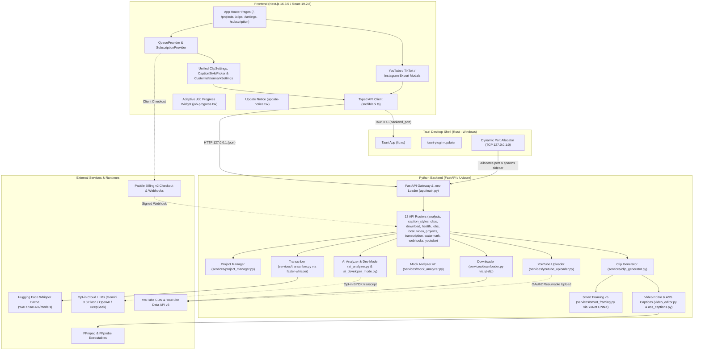

# Clip Robin — AI Context, Codebase Audit & Engineering Handbook

> **Notice for AI Models & Developers**: This document provides an exhaustive, authoritative reference for the Clip Robin codebase (Current Version: **v0.1.29**). It details the system architecture, component contracts, API endpoints, on-disk schemas, bug resolution tracking, performance optimizations, automated test suite inventory, and edge-case handling across both backend and frontend.
>
> **Do NOT delete or overwrite this file.** Maintain and update this context as the project evolves.

---

## 1. Executive Summary & Core Philosophy

**Clip Robin** is an open-source, local-first Windows desktop application designed to discover, extract, subtitle, and export short-form video clips (for YouTube Shorts, TikTok, and Instagram Reels) from long-form video content.

### Core Architectural Principles
1. **Local by Default**: Media extraction, audio ripping, transcription, active-speaker face tracking, clip slicing, and subtitle/watermark burn-in execute entirely on the user's local machine via FFmpeg, CTranslate2 (`faster-whisper`), OpenCV YuNet ONNX, and Python.
2. **AI Where It Matters (Opt-in Intelligence)**: Cloud LLM services (Google Gemini `gemini-3.8-flash` / `gemini-3.1-flash-lite`, OpenAI, DeepSeek) are reserved strictly for semantic analysis (identifying viral hooks, compelling arguments, punchlines, and virality scores). Users provide their own API keys via **AI Developer Mode** (BYOK) or environment variables; raw video never leaves the machine.
3. **Explicit Desktop Boundaries**: Built as a three-tier hybrid desktop architecture:
   - **Frontend**: Next.js 16 (`16.3.5`, React `19.2.8`, Tailwind CSS v4, TypeScript 5, static export `output: "export"`).
   - **Desktop Shell**: Tauri v2 (`2.12.3` Rust crate & `@tauri-apps/api`, NSIS Windows bundle, dynamic port IPC, signed updater).
   - **Local Backend**: FastAPI (Python 3.12+, Uvicorn, `faster-whisper`, `yt-dlp`, OpenCV YuNet ONNX, `httpx`, FFmpeg 7+/9+).

---

## 2. High-Level Architecture & System Topology



---

## 3. Repository File Structure & Module Index

```text
ClipRobin/
├── .github/
│   └── workflows/
│       └── release-tauri.yml          # Automated Windows NSIS signed release pipeline on tag push
├── backend/
│   ├── app/
│   │   ├── routes/
│   │   │   ├── __init__.py
│   │   │   ├── analysis.py            # GET /api/ai/status, POST /api/ai/config, /api/ai/developer-mode, /api/analyze
│   │   │   ├── caption_styles.py      # GET /api/caption-styles (6 styles x 5 animations registry)
│   │   │   ├── clips.py               # Generate clips, poll/cancel jobs, serve MP4s, top-line CRUD, Win32 Save As & ZIP
│   │   │   ├── download.py            # POST /api/download, GET /api/download/jobs/{id} (yt-dlp YouTube intake)
│   │   │   ├── health.py              # GET /api/health
│   │   │   ├── jobs.py                # GET /api/jobs/active (Aggregated download, transcription & generation jobs)
│   │   │   ├── local_video.py         # POST /api/local-video/transcribe, /from-path, GET /api/local-video/jobs/{id}
│   │   │   ├── projects.py            # GET /api/projects, PATCH /api/projects/{id}, DELETE /api/projects/{id}
│   │   │   ├── transcription.py       # POST /api/projects/{id}/transcribe (Re-transcribes missing or partial transcripts)
│   │   │   ├── watermark.py           # GET/DELETE /api/watermark, POST /upload, GET /image, POST /settings
│   │   │   ├── webhooks.py            # POST /api/webhooks/paddle, GET /api/webhooks/paddle/status
│   │   │   └── youtube.py             # /api/youtube/{status,config,auth-url,oauth/callback,disconnect,upload}
│   │   ├── services/
│   │   │   ├── __init__.py
│   │   │   ├── ai_analyzer.py         # Gemini (3.8-flash -> 3.1-flash-lite), OpenAI, and DeepSeek REST integrations
│   │   │   ├── ai_developer_mode.py   # Atomic local Gemini BYOK key storage & AI Developer Mode toggle
│   │   │   ├── ass_captions.py        # ASS subtitle compiler, 2-word chunks, karaoke & hardlinked font staging
│   │   │   ├── caption_styles.py      # 6 Styles x 5 Animations registry, aliases & script-aware font resolver
│   │   │   ├── clip_generator.py      # Incremental analysis cache, language forwarding & progressive MP4 rendering
│   │   │   ├── downloader.py          # Cancellable yt-dlp wrapper with FFmpeg path injection & Win32 window hiding
│   │   │   ├── mock_analyzer.py       # Deterministic duration-based transcript chunker (analyzer_version: 2)
│   │   │   ├── process_utils.py       # Win32 CREATE_NO_WINDOW & STARTF_USESHOWWINDOW subprocess helper
│   │   │   ├── project_manager.py     # O(1) os.scandir project allocation, metadata.json & clips path resolution
│   │   │   ├── smart_framing.py       # True 9:16 active-speaker director (YuNet ONNX + VAD + dual tracked/static cache)
│   │   │   ├── transcriber.py         # faster-whisper CTranslate2 transcription with bounded WAV & cancellation
│   │   │   ├── video_editor.py        # FFmpeg filtergraph builder, cached corner masks, custom watermark & opacity
│   │   │   └── youtube_uploader.py    # Google OAuth2 client, token refresh lock & chunked resumable Shorts uploader
│   │   ├── __init__.py
│   │   └── main.py                    # FastAPI app, zero-dependency .env loader, CORS & router mounting
│   ├── assets/
│   │   ├── caption_preview/           # Fixed word-timing fixture for deterministic preview renders
│   │   ├── fonts/                     # Bundled OFL fonts (Montserrat, Anton, Poppins, Noto Sans, Arabic, Devanagari)
│   │   └── models/                    # Bundled YuNet ONNX face detector (face_detection_yunet_2023mar.onnx)
│   ├── bin/                           # Optional bundled ffmpeg.exe & ffprobe.exe binaries (gitignored)
│   ├── scripts/
│   │   └── build_caption_previews.py  # Build-time 360x640 moving preview MP4, poster JPG & manifest generator
│   ├── tests/                         # Automated pytest suite (158 passing tests across 23 test files)
│   │   ├── __init__.py
│   │   ├── test_ai_analyzer.py
│   │   ├── test_ass_captions.py
│   │   ├── test_audit_regressions.py  # v0.1.28 & v0.1.29 security, caching, O(N) smoothing, partial transcript & framing tests
│   │   ├── test_caption_previews.py
│   │   ├── test_caption_styles.py
│   │   ├── test_clip_counter.py
│   │   ├── test_clip_generator.py
│   │   ├── test_mock_analyzer.py
│   │   ├── test_process_utils.py
│   │   ├── test_project_manager.py
│   │   ├── test_routes_analysis.py
│   │   ├── test_routes_clips.py
│   │   ├── test_routes_download.py
│   │   ├── test_routes_health.py
│   │   ├── test_routes_jobs.py
│   │   ├── test_routes_local_video.py
│   │   ├── test_routes_projects.py
│   │   ├── test_routes_watermark.py
│   │   ├── test_routes_webhooks.py
│   │   ├── test_smart_framing.py
│   │   ├── test_transcriber_shim.py
│   │   └── test_youtube.py
│   ├── data/
│   │   └── projects/                  # Default development project storage root (sibling to runtime configs)
│   ├── .env.example                   # Template for AI provider keys, Whisper overrides, YouTube & Paddle secrets
│   ├── icon.ico                       # Windows application icon for PyInstaller windowed sidecar
│   ├── requirements.txt               # References ../requirements/backend.txt
│   └── run.py                         # Uvicorn / PyInstaller bootstrapper reading CLIPROBIN_API_PORT
├── docs/
│   └── reports/                       # Historical engineering audit reports (playback, responsive-ui, settings-mismatch)
├── frontend/
│   ├── app/
│   │   ├── clips/
│   │   │   ├── loading.tsx            # Clips Studio route skeleton boundary
│   │   │   └── page.tsx               # Clips Studio player grid, modal viewer, top-line editor, social export & ZIP
│   │   ├── projects/
│   │   │   ├── loading.tsx            # Projects route skeleton boundary
│   │   │   └── page.tsx               # Project library, inline rename, regenerate panel, face-tracking toggle
│   │   ├── settings/page.tsx          # Persisted preferences, Gemini AI Developer Mode, YouTube OAuth, custom watermark
│   │   ├── subscription/page.tsx      # Free vs Pro plan management, Paddle checkout, license key activation
│   │   ├── favicon.ico
│   │   ├── globals.css                # Tailwind v4 @theme tokens, scrollbars & reduced-motion utilities
│   │   ├── job-progress.tsx           # Visibility-aware adaptive active job status widget
│   │   ├── layout.tsx                 # Root layout, SubscriptionProvider, QueueProvider, responsive sidebar
│   │   ├── page.tsx                   # Dashboard (Upload / YouTube intake, queue workflow, live 9:16 preview)
│   │   ├── sidebar-nav.tsx            # Responsive 3-tier navigation + subscription badge
│   │   ├── update-notice.tsx          # Tauri signed auto-update notification banner
│   │   └── window-init.tsx            # Tauri startup window maximization helper
│   ├── public/
│   │   ├── caption-previews/          # Pre-rendered 360x640 MP4 moving previews, JPG posters & manifest.json
│   │   ├── logo-mark.svg              # Brand bird logo mark
│   │   └── watermark.png              # Default fallback watermark asset
│   ├── scripts/
│   │   ├── __tests__/
│   │   │   ├── project-name-utils.test.mjs # Project name validation & duplicate-check unit tests (4 tests)
│   │   │   └── version-scripts.test.mjs    # Manifest version synchronization unit tests (2 tests)
│   │   ├── check-version.mjs          # Verifies package.json, Cargo.toml & tauri.conf.json match (0.1.29)
│   │   ├── set-version.mjs            # Updates version across all 3 manifests simultaneously
│   │   └── take_screenshots.mjs       # Playwright visual snapshot utility
│   ├── src/
│   │   ├── components/
│   │   │   ├── ui/                    # Shared primitives (badge, checkbox, icon-button, option-card, segmented-control, status-pill, toggle-row, tooltip)
│   │   │   ├── caption-style-picker.tsx     # Single-video responsive 2-pane modal picker with Pro gating
│   │   │   ├── clip-settings.tsx            # Unified clip settings (mode, duration, count, framing, face tracking, captions, watermark)
│   │   │   ├── custom-watermark-settings.tsx# Custom PNG/JPG/WebP brand logo uploader, position & opacity sync
│   │   │   ├── instagram-upload-modal.tsx   # Guided Instagram Reels export & caption copy modal
│   │   │   ├── live-moving-captions.tsx     # Visibility & reduced-motion aware live 9:16 caption preview
│   │   │   ├── paddle-sandbox-modal.tsx     # Sandbox checkout / webhook simulator for local development
│   │   │   ├── skeletons.tsx                # Shimmer loading skeletons across Dashboard, Projects & Clips
│   │   │   ├── subscription-badge.tsx       # Sidebar plan pill & upgrade trigger
│   │   │   ├── tiktok-upload-modal.tsx      # Guided TikTok export & caption copy modal
│   │   │   ├── upgrade-modal.tsx            # Pro feature comparison & Paddle checkout modal
│   │   │   ├── video-queue-view.tsx         # Multi-video batch queue view with live progress & cancellation
│   │   │   └── youtube-upload-modal.tsx     # Direct YouTube Shorts OAuth2 resumable upload modal
│   │   ├── hooks/
│   │   │   └── use-ai-developer-status.ts   # Event-driven & visibility-aware AI Developer Mode status hook
│   │   └── lib/
│   │       ├── api.ts                       # Typed HTTP client, Tauri port discovery, AbortSignal & custom events
│   │       ├── paddle.ts                    # Paddle Billing v2 client SDK loader & checkout event callbacks
│   │       ├── project-name-utils.ts        # Stateless filename-safe project rename validator
│   │       ├── queue-context.tsx            # Multi-video processing queue with AbortController & backend job cancel
│   │       └── subscription-context.tsx     # Free/Pro tier enforcement, license validation & webhook status sync
│   ├── src-tauri/
│   │   ├── capabilities/default.json  # Tauri v2 permissions for updater, process & core windowing
│   │   ├── nsis/installer-hooks.nsh   # Windows NSIS installer lifecycle hooks
│   │   ├── src/
│   │   │   ├── lib.rs                 # Ephemeral port binding, cliprobin-api sidecar spawn & cleanup
│   │   │   └── main.rs                # Desktop entry point
│   │   ├── Cargo.toml                 # Rust crate manifest (v0.1.29)
│   │   └── tauri.conf.json            # Tauri bundle & updater configuration (v0.1.29)
│   ├── package.json                   # Frontend manifest (v0.1.29)
│   ├── tsconfig.json
│   └── next.config.ts                 # Static export configuration (`output: "export"`)
├── requirements/
│   └── backend.txt                    # Pinned Python dependencies
├── clip_robin_watermark.png           # High-resolution brand watermark asset
├── watermark.png                      # Root default watermark image
├── .gitignore
├── ai.md                              # This engineering handbook
├── README.md                          # Product overview, setup & release workflow
├── website.md                         # Marketing & landing page blueprint
└── setup.ps1                          # One-command Windows development bootstrap script
```

---

## 4. API Surface, Environment Variables & On-Disk Data Contract

### 4.1 Complete Backend HTTP API Reference

| Method & Path | Module | Purpose |
| :--- | :--- | :--- |
| `GET /` | `app.main` | Root service welcome banner (`{"message": "Clip Robin API is running"}`). |
| `GET /api/health` | `routes.health` | Liveness probe (`{"status": "healthy"}`). |
| `GET /api/caption-styles` | `routes.caption_styles` | Lists all 6 caption styles, allowed animations, colors, and defaults. |
| `GET /api/jobs/active` | `routes.jobs` | Aggregated active download, transcription, and clip generation jobs. |
| `POST /api/download` | `routes.download` | Starts background `yt-dlp` YouTube video download (`202` queued). |
| `GET /api/download/jobs/{project_id}` | `routes.download` | Polls YouTube download progress, title, and status. |
| `POST /api/local-video/transcribe` | `routes.local_video` | Uploads local media file (`multipart/form-data`), creates project, queues Whisper. |
| `POST /api/local-video/from-path` | `routes.local_video` | Creates project from local disk path (hardlink/copy) and queues Whisper. |
| `GET /api/local-video/jobs/{project_id}` | `routes.local_video` | Polls transcription job progress and status. |
| `POST /api/projects/{id}/transcribe` | `routes.transcription` | Queues full transcription if missing or if existing transcript has `is_complete: false`. |
| `GET /api/projects` | `routes.projects` | Lists all projects with `title`, `source_type`, `clips`, `created_at`, and `status`. |
| `PATCH /api/projects/{id}` | `routes.projects` | Atomically updates project `title` inside `metadata.json` while preserving other fields. |
| `DELETE /api/projects/{id}` | `routes.projects` | Cancels active download/transcription/generation jobs and deletes project folder (`204`). |
| `POST /api/projects/{id}/generate-clips` | `routes.clips` | Starts progressive background clip rendering (`12, 15, 30, 60, 90`s; framing; style; face tracking). |
| `GET /api/projects/{id}/generation-jobs` | `routes.clips` | Returns latest generation job ordered chronologically (`created_seq`, `created_at`). |
| `GET /api/projects/{id}/generation-jobs/{job_id}` | `routes.clips` | Polls specific generation job status and progressive `ready_clips`. |
| `POST /api/projects/{id}/generation-jobs/{job_id}/cancel` | `routes.clips` | Signals `cancel_event` and cleans up partial/uncommitted render outputs. |
| `GET /api/projects/{id}/clips` | `routes.clips` | Lists rendered clips, `generation_options` (incl. `face_tracking`), and `source_duration`. |
| `GET /api/projects/{id}/clips/{filename}` | `routes.clips` | Streams rendered MP4 clip (`video/mp4`). |
| `POST /api/projects/{id}/clips/{clip_id}/top-line` | `routes.clips` | Burns or updates a custom <=15-word top-line hook on a single clip. |
| `DELETE /api/projects/{id}/clips/{clip_id}/top-line` | `routes.clips` | Removes top-line hook and re-renders the single clip cleanly. |
| `POST /api/projects/{id}/clips/{clip_id}/save-dialog` | `routes.clips` | Opens native Win32 `GetSaveFileNameW` Save As dialog and exports MP4. |
| `GET /api/projects/{id}/clips/download-all` | `routes.clips` | Streams a ZIP archive containing all rendered clips in the project. |
| `POST /api/projects/{id}/clips/download-all-dialog` | `routes.clips` | Opens native Save As dialog and writes ZIP archive directly to disk. |
| `GET /api/ai/status` | `routes.analysis` | Returns Gemini key configuration, YouTube auth status, and `ai_enabled` state. |
| `POST /api/ai/config` | `routes.analysis` | Validates and atomically persists local Gemini API key (`gemini_config.json`). |
| `POST /api/ai/developer-mode` | `routes.analysis` | Enables or disables AI Developer Mode (`ai_enabled`). |
| `POST /api/analyze` | `routes.analysis` | Evaluates a transcript with Gemini, OpenAI, or DeepSeek and optionally saves `analysis.json`. |
| `GET /api/watermark` | `routes.watermark` | Returns custom/default watermark availability, cache-busted `custom_url`, `position`, `opacity`. |
| `POST /api/watermark/settings` | `routes.watermark` | Persists watermark `position` (`top_right`, `top_left`, `bottom_right`, `bottom_left`, `center`) and `opacity` (`20–100`). |
| `POST /api/watermark/upload` | `routes.watermark` | Validates PNG/JPG/WebP magic bytes (<=10 MB) and saves custom brand logo. |
| `GET /api/watermark/image` | `routes.watermark` | Serves the active custom watermark image with `Cache-Control: no-cache`. |
| `DELETE /api/watermark` | `routes.watermark` | Deletes the custom watermark image and reverts to default watermark. |
| `GET /api/youtube/status` | `routes.youtube` | Returns Google OAuth client configuration and connected YouTube channel info. |
| `POST /api/youtube/config` | `routes.youtube` | Saves Google OAuth `client_id` and `client_secret`. |
| `POST /api/youtube/config/paste-json` | `routes.youtube` | Extracts credentials from pasted Google Cloud `client_secret_*.json`. |
| `GET /api/youtube/auth-url` | `routes.youtube` | Generates CSRF-state-protected Google OAuth2 consent URL. |
| `GET /api/youtube/oauth/callback` | `routes.youtube` | HTML-escaped OAuth2 callback page exchanging `code` for offline tokens. |
| `POST /api/youtube/disconnect` | `routes.youtube` | Clears stored YouTube OAuth tokens (`youtube_auth.json`). |
| `POST /api/youtube/upload` | `routes.youtube` | Streams rendered clip in 256 KB chunks to YouTube Data API v3 resumable upload. |
| `POST /api/webhooks/paddle` | `routes.webhooks` | Verifies HMAC-SHA256 `Paddle-Signature` and updates local subscription state. |
| `GET /api/webhooks/paddle/status` | `routes.webhooks` | Returns `active_plan` (`free`/`pro`), `license_key`, `environment`, and `configured`. |

### 4.2 Environment Variables

`backend/app/main.py` automatically loads `backend/.env` and root `.env` at startup using `os.environ.setdefault(...)`:

| Variable | Layer | Description |
| :--- | :--- | :--- |
| `CLIPROBIN_API_PORT` | Backend / Tauri | Loopback port bound by Uvicorn (`8000` in dev, dynamic `127.0.0.1:0` in Tauri). |
| `CLIPROBIN_PROJECTS_DIR` | Backend / Tauri | Root directory for projects (`backend/data/projects` in dev, `%APPDATA%/com.cliprobin.desktop/projects` in desktop). Sibling runtime configs (`gemini_config.json`, `youtube_*.json`, `subscriptions.json`, `watermarks/`) resolve under its parent directory. |
| `CLIPROBIN_FFMPEG_PATH` | Backend | Explicit override path to `ffmpeg` executable. |
| `CLIPROBIN_WATERMARK_PATH` | Backend | Explicit override path to fallback watermark image. |
| `WHISPER_MODEL` | Backend | `faster-whisper` model size override (default `base`). |
| `WHISPER_COMPUTE_TYPE` | Backend | CTranslate2 compute precision override (default `int8` on CPU). |
| `AI_PROVIDER` | Backend | Default cloud analyzer provider (`gemini`, `openai`, or `deepseek`). |
| `GEMINI_API_KEY` / `GEMINI_MODEL` | Backend | Google Gemini API key and optional model override (default chain: `gemini-3.8-flash` -> `gemini-3.1-flash-lite`). |
| `OPENAI_API_KEY` / `OPENAI_MODEL` | Backend | OpenAI API key and model override. |
| `DEEPSEEK_API_KEY` / `DEEPSEEK_MODEL` | Backend | DeepSeek API key and model override. |
| `YOUTUBE_CLIENT_ID` / `YOUTUBE_CLIENT_SECRET` | Backend | Optional env fallback for Google OAuth2 YouTube uploader credentials. |
| `PADDLE_ENVIRONMENT` | Backend | `sandbox` (default) or `production` (enforces mandatory webhook signature verification). |
| `PADDLE_WEBHOOK_SECRET` / `PADDLE_CLIENT_TOKEN` | Backend | Paddle Billing v2 webhook HMAC secret and server token indicator. |
| `NEXT_PUBLIC_API_URL` | Frontend | Optional HTTP API base URL override in web mode (defaults to `http://127.0.0.1:8000`). |
| `NEXT_PUBLIC_PADDLE_CLIENT_TOKEN` | Frontend | Paddle.js client-side checkout token. |
| `NEXT_PUBLIC_PADDLE_ENV` | Frontend | `sandbox` or `production` for Paddle.js initialization. |
| `NEXT_PUBLIC_PADDLE_PRO_MONTHLY_PRICE_ID` | Frontend | Paddle price ID (`pri_...`) for Pro monthly plan. |
| `NEXT_PUBLIC_PADDLE_PRO_YEARLY_PRICE_ID` | Frontend | Paddle price ID (`pri_...`) for Pro yearly plan. |

### 4.3 On-Disk Data Contract

All runtime data resolves relative to `$DATA_ROOT = Path(CLIPROBIN_PROJECTS_DIR).parent` (`backend/data` in dev, `%APPDATA%/com.cliprobin.desktop` in packaged desktop builds so PyInstaller `_MEIPASS` temp cleanup never loses user credentials or custom watermarks):

```text
$DATA_ROOT/
├── gemini_config.json              # Local Gemini API key & developer_mode boolean (atomic write)
├── youtube_config.json             # Google OAuth2 client_id & client_secret
├── youtube_auth.json               # YouTube access_token, refresh_token & channel profile
├── subscriptions.json              # Paddle webhook active_plan, license_key & event log
├── watermarks/
│   ├── custom_watermark.{png|jpg|webp} # Validated custom brand watermark asset
│   └── watermark_settings.json     # Persisted {"position": "...", "opacity": 20..100}
└── projects/
    └── project_001/
        ├── metadata.json           # {"title": "...", "source_type": "YouTube|Local Video", "duration": 184.2, "url": "..."}
        ├── source.mp4              # Primary media (.mp4, .mov, .mkv, .webm, .avi)
        ├── analysis.json           # analyzer_version: 2, clip candidates, per-clip overrides & generation_options
        ├── tracking_analysis.json  # v5 YuNet + VAD cache with both shots_tracked & shots_static + scanned_duration
        ├── transcription/
        │   ├── transcript.txt      # Plain-text timestamped transcript
        │   └── transcript.json     # Segments + word timestamps + language + is_complete + covered_duration
        └── clips/
            ├── clip_001.mp4        # Final vertical 720x1280 H.264 + AAC rendered clip
            └── ...
```

### JSON Schemas

#### 1. `transcription/transcript.json`
```json
{
  "language": "en",
  "language_probability": 0.985,
  "is_complete": true,
  "covered_duration": 184.2,
  "segments": [
    {
      "start": 0.0,
      "end": 4.12,
      "text": "Here is an interesting fact about programming.",
      "words": [
        { "start": 0.0, "end": 0.35, "text": "Here" },
        { "start": 0.36, "end": 0.52, "text": "is" }
      ]
    }
  ]
}
```

#### 2. `analysis.json`
```json
{
  "analyzer_version": 2,
  "clips": [
    {
      "id": "clip_001",
      "title": "The Golden Rule of Debugging",
      "start": 12.4,
      "end": 42.8,
      "score": 92,
      "reason": "Clear problem statement followed by a surprising solution.",
      "top_line": "",
      "framing_mode": "true_9_16",
      "caption_style": "robin",
      "caption_animation": "grow",
      "face_tracking": true
    }
  ],
  "generation_options": {
    "show_subtitles": true,
    "show_watermark": false,
    "framing_mode": "true_9_16",
    "caption_style": "robin",
    "caption_animation": "grow",
    "clip_duration_seconds": 30,
    "clip_count": 3,
    "generation_mode": "random",
    "face_tracking": true
  }
}
```

---

## 5. Codebase Bugs, Vulnerabilities & Implementation Status

> **Audit Status as of v0.1.29**: All 40 feature, security, correctness, and performance hardening milestones are implemented and verified across a **161-test backend `pytest` suite** (23 test files, ~`4.2s`) and **6-test frontend unit suite** (`node --test`), plus zero TypeScript/ESLint errors and a clean 6-route Next.js static export build.

### 🔴 Critical Severity (Showstoppers)

#### 1. AI Analyzer Schema Mismatch Causes `KeyError: 'id'` in Clip Generation `[RESOLVED]`
- **Files**: `backend/app/services/ai_analyzer.py` & `backend/app/services/clip_generator.py`.
- **Status**: **RESOLVED & VERIFIED**.
- **Fix**: `validate_analysis()` in `ai_analyzer.py` automatically synthesizes sequential IDs (`f"clip_{index:03d}"`) if the LLM output omits them. In addition, `clip_generator.py` uses fallback resolution `clip_id = clip.get("id") or f"clip_{index:03d}"` so it never raises `KeyError`.
- **Test**: `backend/tests/test_ai_analyzer.py::test_validate_analysis_injects_missing_clip_id`.

#### 2. AI Analyzer Rejects Real LLM Timestamps via Exact Floating-Point Equality `[RESOLVED]`
- **File**: `backend/app/services/ai_analyzer.py`.
- **Status**: **RESOLVED & VERIFIED**.
- **Fix**: Added boundary snapping with a tolerance window (`abs(candidate - boundary) <= TOLERANCE`) so LLM candidate timestamps matching transcript boundaries within 0.75s snap cleanly to exact segment floats without false-positive 422/502 rejections.
- **Test**: `backend/tests/test_ai_analyzer.py::test_validate_analysis_snaps_floating_point_boundaries`.

#### 3. Overlapping Transcript Segments Crash Analysis `[RESOLVED]`
- **Files**: `backend/app/services/ai_analyzer.py` & `backend/app/services/mock_analyzer.py`.
- **Status**: **RESOLVED & VERIFIED**.
- **Fix**: Segment normalization in both analyzers clamps overlapping segments dynamically (`start = max(start, previous_end)`). `validate_transcript()` clones normalized segments rather than mutating caller dicts in place.
- **Tests**: `backend/tests/test_ai_analyzer.py::test_validate_transcript_clamps_overlapping_segments` and `backend/tests/test_mock_analyzer.py`.

#### 4. `CLIPROBIN_PROJECTS_DIR` Environment Variable Ignored in Route Handlers & Config Stores `[RESOLVED]`
- **Files**: `backend/app/routes/analysis.py`, `backend/app/routes/transcription.py`, `backend/app/routes/projects.py`, `backend/app/routes/watermark.py`, `backend/app/routes/webhooks.py`, `backend/app/services/youtube_uploader.py`, `backend/app/services/ai_developer_mode.py`.
- **Status**: **RESOLVED & VERIFIED**.
- **Fix**: All project paths and sibling runtime config files (`gemini_config.json`, `youtube_config.json`, `youtube_auth.json`, `subscriptions.json`, `watermarks/`) resolve dynamically from `get_projects_dir()`, respecting `%APPDATA%` in Tauri builds and isolated `tmp_path` directories in automated tests.
- **Tests**: `backend/tests/test_project_manager.py` and `backend/tests/test_audit_regressions.py`.

#### 5. Hardcoded `source.mp4` Assumption Breaks MOV, MKV, and WebM Files `[RESOLVED]`
- **Files**: `backend/app/routes/transcription.py`, `backend/app/services/clip_generator.py`, `backend/app/routes/projects.py`.
- **Status**: **RESOLVED & VERIFIED**.
- **Fix**: Replaced hardcoded `source.mp4` checks with filtered `project_directory.glob("source.*")` excluding `.part`, `.ytdl`, `.tmp`, `.json`, and `.txt`.
- **Test**: `backend/tests/test_routes_local_video.py`.

---

### 🟠 High Severity (Functional & Concurrency Defects)

#### 6. Deleting Project During Processing Crashes Windows File System `[RESOLVED]`
- **File**: `backend/app/routes/projects.py`.
- **Status**: **RESOLVED & VERIFIED**.
- **Fix**: `_cancel_active_jobs()` signals `CANCEL_EVENTS` (clip generation), `TRANSCRIPTION_CANCEL_EVENTS` (Whisper), and `DOWNLOAD_CANCEL_EVENTS` (`yt-dlp`) before `_safe_rmtree()` removes the directory with retry and read-only permission clearing.
- **Test**: `backend/tests/test_routes_projects.py`.

#### 7. Progressive Clip Generation & Safe Staging `[RESOLVED & ENHANCED]`
- **Files**: `backend/app/services/clip_generator.py`, `backend/app/routes/clips.py`, `backend/app/routes/jobs.py`.
- **Status**: **RESOLVED & ENHANCED**.
- **Fix**: Slicing renders each clip to `.rendering_{clip_id}.mp4` inside `clips_directory` (excluded from `list_projects()` clip counts) and atomically renames to `{clip_id}.mp4` upon completion, streaming `ready_clips` snapshots under lock while preserving `.clips-backup-*` rollback on failure/cancellation.

#### 8. Video Filtergraph Architecture & Complex Graph Integration `[UPDATED]`
- **File**: `backend/app/services/video_editor.py`.
- **Status**: **UPDATED & STABILIZED**.
- **Implementation**: Modularized `_build_subtitle_filters()` and ASS burn-in filtergraphs written to script files (`-/filter_complex` / `-filter_complex_script`) with `-map [v] -map 0:a?` and `yuv420p` chroma alignment.

#### 9. Missing Audio Track in Video Crashes FFmpeg `[RESOLVED]`
- **File**: `backend/app/services/video_editor.py`.
- **Status**: **RESOLVED & VERIFIED**.
- **Fix**: `has_audio_stream()` probes via `ffprobe` first (cached by `(resolved_path, st_mtime_ns, st_size)`) before falling back to `ffmpeg -i`, passing `-an` cleanly for silent videos.

#### 10. Font File Resolution & Zero-Copy Staging `[RESOLVED & OPTIMIZED]`
- **Files**: `backend/app/services/video_editor.py`, `backend/app/services/ass_captions.py`.
- **Status**: **RESOLVED & OPTIMIZED**.
- **Fix**: `_copy_font_file()` and `stage_caption_fonts()` stage system and bundled OFL fonts using `os.link()` hardlinks first before falling back to `shutil.copyfile()`, eliminating repeated multi-MB font copies per rendered clip.

#### 11. Synchronous Blocking Routes in Background Processing `[RESOLVED]`
- **Files**: `backend/app/routes/download.py`, `backend/app/routes/clips.py`, `backend/app/routes/local_video.py`.
- **Status**: **RESOLVED & VERIFIED**.
- **Fix**: Long-running downloads, transcriptions, and renders execute in background tasks with thread-safe locks, cancellation events, and bounded LRU/FIFO job eviction (`MAX_COMPLETED_JOBS = 50`).

#### 12–15. Skeleton UI Smoothing, Window Maximization, Persisted Settings & Windows MIME Fallbacks `[RESOLVED]`
- **Status**: **RESOLVED & VERIFIED** across `skeletons.tsx`, `window-init.tsx`, `settings/page.tsx`, and extension-based video validation in `page.tsx`.

---

### 🟢 UI/UX Enhancements & Feature Milestones (v0.1.16 – v0.1.28)

#### 16–35. Core Studio Capabilities (v0.1.16 – v0.1.25) `[RESOLVED / IMPLEMENTED]`
- **16–20**: Pinned responsive sidebar, configurable watermark burn-in, Fast Interval vs AI Hook Finder modes, Top-Line headline hook editor (`<=15` words), and native Windows File Explorer Save As export for single MP4s and batch ZIPs.
- **21–24**: 1:1 Rounded Square (`660x660`), True 9:16 YuNet ONNX + VAD active-speaker framing, 16:9 Rounded Card (`672x378`), and Tauri/NSIS/PyInstaller brand icons & `--windowed` console suppression.
- **25–30**: 6 caption styles (`classic`, `robin`, `clean`, `punch`, `pill`, `karaoke`), 2-words-per-line high-contrast highlights, gap bridging, 0.42 MB pre-rendered moving previews in `CaptionStylePicker`, and transparent Top-Line hooks on True 9:16.
- **31–35**: Win32 `CREATE_NO_WINDOW` subprocess suppression, 14 smart-framing edge-case guards, dynamic clip counter (`12s, 15s, 30s, 60s, 90s`), container-query responsive UI, exclusive `<video>` playback coordination, YouTube Data API v3 Shorts OAuth uploader, and dual-tab Dashboard intake redesign.

#### 36. Multi-Video Batch Queue, Inline Project Renaming, TikTok/Instagram Flows & Face Tracking Toggle (v0.1.26) `[RESOLVED / IMPLEMENTED]`
- **Files**: `frontend/src/lib/queue-context.tsx`, `frontend/src/components/video-queue-view.tsx`, `frontend/src/lib/project-name-utils.ts`, `frontend/app/projects/page.tsx`, `frontend/app/clips/page.tsx`, `frontend/src/components/tiktok-upload-modal.tsx`, `frontend/src/components/instagram-upload-modal.tsx`, `backend/app/routes/projects.py`, `backend/app/services/smart_framing.py`.
- **Status**: **RESOLVED & VERIFIED**.
- **Features**:
  - **Multi-Video Processing Queue (`QueueProvider`)**: Users can queue multiple local video files and YouTube URLs consecutively with per-item step tracking, live progress bars, retry, and active cancellation (`AbortController` + backend `cancelClipGeneration` + cleanup).
  - **Inline Project Renaming**: `PATCH /api/projects/{id}` persists custom project titles in `metadata.json` with stateless illegal-character & Windows reserved-name validation (`project-name-utils.ts`).
  - **Face Tracking Toggle on True 9:16**: Independent `faceTracking` control across Dashboard, Projects, and Clips Studio allowing users to switch between dynamic active-speaker tracking and static centered/prominent framing.
  - **Guided TikTok & Instagram Reels Export Modals**: Dedicated social export modals alongside direct YouTube Shorts upload inside `ClipModalViewer`.

#### 37. Pro Subscription System, Paddle Billing v2, Custom Brand Watermarks & AI Developer Mode (v0.1.27) `[RESOLVED / IMPLEMENTED]`
- **Files**: `frontend/src/lib/subscription-context.tsx`, `frontend/src/lib/paddle.ts`, `frontend/app/subscription/page.tsx`, `frontend/src/components/upgrade-modal.tsx`, `frontend/src/components/paddle-sandbox-modal.tsx`, `frontend/src/components/custom-watermark-settings.tsx`, `backend/app/routes/webhooks.py`, `backend/app/routes/watermark.py`, `backend/app/routes/analysis.py`, `backend/app/services/ai_developer_mode.py`.
- **Status**: **RESOLVED & VERIFIED**.
- **Features**:
  - **Subscription & Feature Gating**: Free vs Pro plan architecture supporting Paddle Billing v2 overlay checkout (`@paddle/paddle-js`), HMAC-verified `/api/webhooks/paddle` synchronization, offline `ROBIN-PRO-*` license activation, and automatic Free-tier fallback sanitization across Dashboard, Projects, Clips, and Settings.
  - **Custom Brand Watermarks**: Upload custom PNG/JPG/WebP brand logos (`<=10 MB`) with configurable canvas position (`top_right`, `top_left`, `bottom_right`, `bottom_left`, `center`) and opacity (`20%–100%`) burned directly into rendered clips via FFmpeg `colorchannelmixer`.
  - **Local AI Developer Mode (BYOK)**: Self-serve Gemini API key configuration and toggle in `/settings` backed by `gemini_config.json`, unlocking Gemini `gemini-3.8-flash` / `gemini-3.1-flash-lite` semantic hook detection.

#### 38. Full-Stack Security, Reliability & Correctness Hardening (v0.1.28) `[RESOLVED & VERIFIED]`
- **Files**: Across 22 backend modules and 24 frontend modules; regression-tested in `backend/tests/test_audit_regressions.py` and `frontend/scripts/__tests__/project-name-utils.test.mjs`.
- **Status**: **RESOLVED & VERIFIED**.
- **Fixes Implemented**:
  - **Fixed `NameError: shutil` in `transcriber.py`**: Restored `import shutil` and added `cancel_event` checks before, during, and after Whisper segment iteration.
  - **Fixed PyInstaller Save-As Dialog Crash (`clips.py`)**: Replaced `[sys.executable, "-c", "import tkinter..."]` (which re-launched the FastAPI server binary in frozen builds) with native Win32 `ctypes.windll.comdlg32.GetSaveFileNameW` (`OPENFILENAMEW`).
  - **Fixed PyInstaller `_MEIPASS` Data Loss**: Moved `watermarks/`, `subscriptions.json`, `gemini_config.json`, `youtube_config.json`, and `youtube_auth.json` resolution to `get_projects_dir().parent` with atomic temp-file + `os.replace` writes.
  - **Security Hardening**: HTML-escaped reflected `error`, `channel_title`, and exception strings in `youtube_oauth_callback` (preventing reflected XSS); added OAuth `state` validation; blocked path traversal and glob metacharacters (`*`, `?`, `[`, `]`) in `/api/youtube/upload` and clip routes; removed SVG upload vector and added PNG/JPEG/WebP magic-byte validation + bounded `read(MAX_FILE_SIZE + 1)` in `/api/watermark/upload`; enforced fail-closed Paddle webhook verification when `PADDLE_ENVIRONMENT == "production"`.
  - **Partial Transcript & Mock Cache Integrity**: Recorded `"is_complete"` and `"covered_duration"` in `transcript.json` so early-exit transcripts are never reused for longer clip counts or full re-transcriptions; bumped `mock_analyzer.py` to `analyzer_version: 2` so caption/framing edits reuse cached analysis while preserving user `top_line` hooks across re-analysis.
  - **Chronological Job Ordering & Retry Recovery**: Added monotonic `created_seq` + `created_at` ordering in `get_latest_clip_generation_job` (replacing random UUID key order) and separated `pollIntervalId` from `retryTimeoutId` in `frontend/app/clips/page.tsx`.
  - **Stateless Project Rename Regex & Dynamic Desktop Port URLs**: Replaced stateful `/g` regex `.test()` in `project-name-utils.ts` and replaced hardcoded `127.0.0.1:8000` URLs in YouTube OAuth, custom watermark previews, and Paddle sandbox modals with dynamic Tauri-compatible `getApiBaseUrl()` / `resolveWatermarkImageUrl()`.

#### 39. Full-Stack Performance & Efficiency Optimizations (v0.1.28) `[RESOLVED & VERIFIED]`
- **Status**: **RESOLVED & VERIFIED** (Backend test suite runtime improved from `7.49s` to **`3.89s`** despite adding 7 new regression suites).
- **Optimizations Implemented**:
  - **$O(N)$ Camera Trajectory Smoothing (`smart_framing.py`)**: Replaced $O(N^2)$ sliding-window scan in `_smooth_and_simplify_segment` with `bisect_left` / `bisect_right` prefix sums ($O(N \log N)$ / $O(N)$), bounded `_scan_faces` FFmpeg decode with `-t {max_duration + 1.0}`, and cached both `"shots_tracked"` and `"shots_static"` in `tracking_analysis.json` so toggling Face Tracking ON/OFF is `0ms` instant without re-decoding video.
  - **Zero-Copy Hardlinks & Persistent Media Caches (`video_editor.py`, `ass_captions.py`, `local_video.py`)**: Cached 4× supersampled rounded-corner alpha masks in `tempfile.gettempdir() / "cliprobin_masks"`, cached `has_audio_stream` and `probe_video_duration` by `(resolved_path, st_mtime_ns, st_size)`, hardlinked (`os.link`) local video imports and staged fonts before falling back to `shutil.copyfile`, and bounded Whisper WAV extraction with `-t {max_duration + 5.0}`.
  - **Streaming & Connection Reuse (`youtube_uploader.py`, `ai_analyzer.py`)**: Streamed YouTube MP4 uploads in 256 KB file chunks instead of loading entire videos into RAM, and reused persistent `httpx.Client` connections across API calls and retries.
  - **Frontend CPU/GPU & Polling Efficiency**: Mounted only a single `<video>` preview element in `CaptionStylePicker` via `matchMedia`, paused `LiveMovingCaptions` `380ms` timer when hidden or `prefers-reduced-motion` is active, switched `job-progress.tsx`, `projects/page.tsx`, and `use-ai-developer-status.ts` to visibility-aware adaptive polling with equality bailouts and custom DOM event wakeups (`cliprobin:job-started`, `cliprobin:ai-status-changed`), disconnected `ProClipCard` `IntersectionObserver` once visible, and isolated `isActivePlaying` boolean props + memoized callbacks so play/pause changes only re-render the affected card.

#### 40. Clip Playback Cache-Busting, Long-Form Context Relocation & Split-Screen 9:16 Framing (v0.1.29) `[RESOLVED & VERIFIED]`
- **Files**: `backend/app/routes/clips.py`, `backend/app/services/clip_generator.py`, `backend/app/services/ai_analyzer.py`, `backend/app/services/smart_framing.py`, `backend/app/services/video_editor.py`, `frontend/src/lib/api.ts`, `frontend/app/clips/page.tsx`, `frontend/src/lib/subscription-context.tsx`, `backend/tests/test_audit_regressions.py`.
- **Status**: **RESOLVED & VERIFIED**.
- **Fixes Implemented**:
  - **Fixed "Clip Unavailable" / 416 Range Errors on Regenerated Clips**: Appended dynamic version tokens (`v={mtime_ns}_{size}`) to clips in `/api/projects/{id}/clips` and client media URLs (`clipUrl`), sent `Cache-Control: no-cache` in `serve_clip`, and added automatic video player retry and dynamic URL re-resolution upon regeneration in `frontend/app/clips/page.tsx`.
  - **Intro Teaser Soundbite Relocation (`_relocate_and_expand_clip_bounds`)**: Detected 4-second teaser soundbites selected from pre-roll intro highlight montages (<120s of video) and automatically relocated them to their full conversation exchange later in the transcript, expanding setup and payoff context.
  - **Split-Screen 9:16 Center Seam Clamp (`_clamp_split_screen_target`)**: Constrained horizontal 9:16 crop window on 50/50 two-speaker split screens strictly to the active speaker's half of the frame, preventing the vertical black divider bar from appearing in true 9:16 output.
  - **Incremental Tail-Resuming for Face Tracking**: Added `start_offset` and duration check fixes in `smart_framing.py` so partial tracking analyses resume from where they stopped rather than re-decoding the entire video.
  - **Burned-in Letterbox Auto-Detection (`_detect_letterbox_vertical_crop`)**: Added FFmpeg `cropdetect` helper to automatically crop out burned-in horizontal letterbox bars from 16:9 source segments in `true_9_16` mode.

---

## 6. Automated Test Suite Inventory

### Overview
- **Active Backend Automated Tests**: **161 passing tests** across **23 test files** in `backend/tests/` (`.\.venv\Scripts\python.exe -m pytest backend/tests` executes in ~`4.2s`).
- **Active Frontend Automated Tests**: **6 passing tests** across **2 test files** in `frontend/scripts/__tests__/` (`npm test` via `node --test`).
- **Static & Build Gates**:
  - `npx tsc --noEmit` -> **0 errors**
  - `npm run lint` -> **0 errors, 0 warnings**
  - `npm run version:check` -> **`All application manifests use version 0.1.29.`**
  - `npm run build` -> **6 static routes compiled cleanly** (`/`, `/clips`, `/projects`, `/settings`, `/subscription`, `/_not-found`)

### Backend Test Inventory (23 Files — 161 Passing Tests)

| Test File | Target Modules | Key Coverage |
| :--- | :--- | :--- |
| `tests/test_audit_regressions.py` | Full-stack v0.1.28 & v0.1.29 regressions | Chronological job sequence, mock v2 cache + `top_line` retention + language forwarding, partial transcript re-transcription, $O(N)$ `_smooth_and_simplify_segment` + dual `shots_tracked`/`shots_static` cache, isolated watermark settings + magic-byte validation, YouTube OAuth XSS escaping + path traversal block, isolated atomic `gemini_config.json`, intro teaser relocation, split-screen center-seam clamping, clip versioning + `no-cache`. |
| `tests/test_ai_analyzer.py` | `services.ai_analyzer` | Transcript validation, overlap clamping, Gemini/OpenAI/DeepSeek formatting, markdown JSON parsing, boundary snapping, ID & score synthesis. |
| `tests/test_ass_captions.py` | `services.ass_captions` | ASS time formatting, escaping, hex-to-ASS BGR conversion, safe vertical positioning across all 25+ style/animation pairs, top-line overlay, font hardlink staging, karaoke tags. |
| `tests/test_caption_previews.py` | `scripts.build_caption_previews` | SHA-256 manifest freshness, existence of all MP4 previews & JPG posters, total size ceiling (`<=10 MB`). |
| `tests/test_caption_styles.py` | `services.caption_styles` | 6 styles registry, legacy aliases, animation defaults, bundled OFL & RTL/Devanagari font resolution. |
| `tests/test_clip_counter.py` | `clip_generator`, `mock_analyzer`, `clips` | `12s` slicing, `max_clips`/`clip_count` enforcement, `source_duration` metadata/ffprobe probing. |
| `tests/test_clip_generator.py` | `services.clip_generator`, `video_editor` | Atomic `.clips-backup-*` rollback, progressive `.rendering_*.mp4` staging, watermark/top-line burn-in, special-character escaping, 16:9/1:1/9:16 filtergraphs, silent video `-an` handling. |
| `tests/test_mock_analyzer.py` | `services.mock_analyzer` | Deterministic duration chunking, trailing orphan prevention, `analyzer_version: 2` schema. |
| `tests/test_process_utils.py` | `services.process_utils` | Windows `CREATE_NO_WINDOW` and `SW_HIDE` subprocess flags. |
| `tests/test_project_manager.py` | `services.project_manager` | `os.scandir` sequential ID creation, path traversal rejection, `CLIPROBIN_PROJECTS_DIR` override, `.rendering_*` exclusion. |
| `tests/test_routes_analysis.py` | `routes.analysis` | `/api/analyze`, `/api/ai/status`, `/api/ai/config`, `/api/ai/developer-mode` validation & error codes. |
| `tests/test_routes_clips.py` | `routes.clips` | Duration/framing/style/animation validation, 409 duplicate job guard, top-line CRUD, Save-As dialog MP4 & ZIP export, `face_tracking` & `generation_options` hydration. |
| `tests/test_routes_download.py` | `routes.download` | YouTube host allowlist (`youtube.com`, `m.youtube.com`, `youtu.be`), failure cleanup, friendly local-file fallback message. |
| `tests/test_routes_health.py` | `routes.health` | `GET /api/health` returns `200` and `{"status": "healthy"}`. |
| `tests/test_routes_jobs.py` | `routes.jobs` | Aggregated active download, transcription, and generation job snapshots. |
| `tests/test_routes_local_video.py` | `routes.local_video` | Extension allowlist, multipart upload & `/from-path` transcription queueing, FIFO job eviction. |
| `tests/test_routes_projects.py` | `routes.projects` | Project listing, `PATCH` title rename in `metadata.json`, active job cancellation before `DELETE`. |
| `tests/test_routes_watermark.py` | `routes.watermark` | Custom watermark upload, retrieval, deletion, position/opacity settings, size/type checks. |
| `tests/test_routes_webhooks.py` | `routes.webhooks` | Paddle HMAC-SHA256 signature verification, Pro activation (`ROBIN-PRO-*`), cancellation/pause downgrade. |
| `tests/test_smart_framing.py` | `services.smart_framing` | YuNet ONNX resolution, IoU tracking, VAD correlation, piecewise crop expressions, 14 real-world failure modes. |
| `tests/test_transcriber_shim.py` | `services.transcriber` | CTranslate2 / `faster-whisper` transcription wrapper, bounded audio extraction, cancellation. |
| `tests/test_youtube.py` | `services.youtube_uploader`, `routes.youtube` | Google OAuth config/JSON parsing, auth URL state, token exchange/refresh, chunked resumable upload. |

---

## 7. Residual Edge Cases & Operational Notes

1. **Media & Codec Nuances**:
   - **Silent Videos**: Handled automatically via cached `has_audio_stream()` (`-an`).
   - **10-Bit HDR Footage**: Converted via `format=yuv420p`; extreme BT.2020 HDR sources without tonemapping may appear slightly desaturated compared to SDR sources.
   - **RTL & Indic Scripts**: Supported in all 5 ASS-backed styles (`robin`, `clean`, `punch`, `pill`, `karaoke`) via `transcript.json` `"language"` forwarding into `NotoSansArabic-Bold.ttf` / `NotoSansDevanagari-Bold.ttf`. Note that legacy `"classic"` uses FFmpeg `drawtext`, so non-Latin creators should prefer `"robin"` or `"clean"`.
2. **External Network Boundaries**:
   - **YouTube Anti-Bot Challenges**: If YouTube blocks `yt-dlp` on restricted networks, `routes/download.py` surfaces clear guidance to drop a local video file instead.
   - **Cloud LLM Rate Limits**: `ai_analyzer.py` implements exponential backoff for transient HTTP `429`/`5xx` responses and falls back automatically from `gemini-3.8-flash` to `gemini-3.1-flash-lite`.
3. **Storage & Lifecycle**:
   - **Project ID Allocation**: `create_project()` uses single-pass `os.scandir()` `max_num + 1`, avoiding ID reuse and $O(N)$ `exists()` probing.
   - **Disk Space**: High-bitrate exports write to `%APPDATA%/com.cliprobin.desktop/projects` in desktop builds; users with low `C:` free space can override `CLIPROBIN_PROJECTS_DIR`.

---

## 8. AI Pair Programming Rules of Engagement

When modifying or extending the Clip Robin codebase, all AI models and contributors must observe the following constraints:

1. **Maintain the Local-First Privacy Boundary**: Never transmit raw video, audio tracks, or local filesystem paths to external network endpoints unless explicitly initiated by the user (e.g., direct YouTube Shorts upload). Only sanitized text transcripts may be sent to user-configured LLM providers.
2. **Preserve Documentation Integrity**: Preserve existing docstrings, type annotations, and comments. Keep `ai.md`, `README.md`, `frontend/README.md`, and `website.md` synchronized when routes, versions, or schemas change.
3. **Cross-Platform & Frozen-Build Path Hygiene**: Always resolve runtime mutable files via `get_projects_dir()` / `CLIPROBIN_PROJECTS_DIR` (never write mutable state under `Path(__file__)`, which points to ephemeral `_MEIPASS` in PyInstaller builds). Use atomic temp-file + `os.replace()` for JSON persistence.
4. **Non-Blocking & Cancellable Execution**: Offload heavy media/network operations (`yt-dlp`, `faster-whisper`, `ffmpeg`, `cv2`) from request threads and honor `threading.Event` cancellation promptly.
5. **Version Manifest Synchronization**: Whenever bumping the application version, run `npm run version:set -- <x.y.z>` and `npm run version:check` inside `frontend/` so `package.json`, `src-tauri/Cargo.toml`, and `src-tauri/tauri.conf.json` stay strictly aligned.
