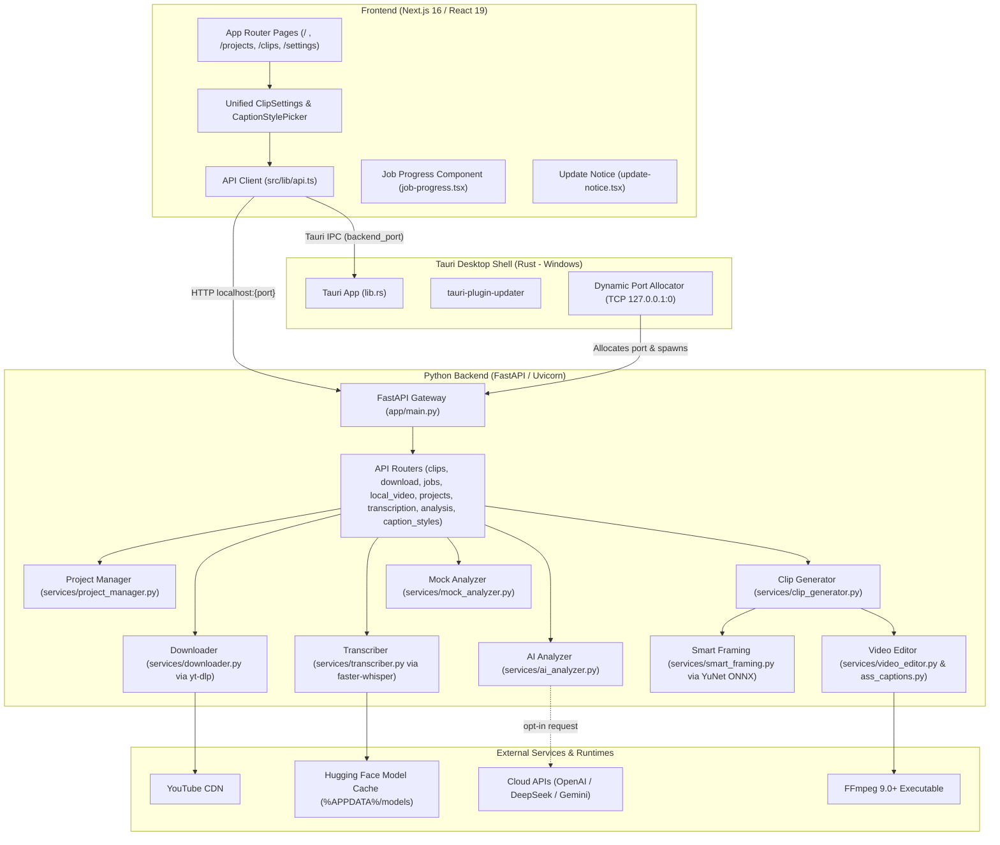

# Clip Robin — AI Context, Codebase Audit & Engineering Handbook

> **Notice for AI Models & Developers**: This document provides an exhaustive, authoritative reference for the Clip Robin codebase (Current Version: **v0.1.22**). It details the system architecture, component contracts, bug resolution tracking, automated test suite inventory, and edge-case handling across both backend and frontend.
>
> **Do NOT delete or overwrite this file.** Maintain and update this context as the project evolves.

---

## 1. Executive Summary & Core Philosophy

**Clip Robin** is an open-source, local-first Windows desktop application designed to discover, extract, subtitle, and export short-form video clips (e.g., for YouTube Shorts, TikTok, and Instagram Reels) from long-form video content.

### Core Architectural Principles
1. **Local by Default**: Media extraction, audio ripping, transcription, clip slicing, and subtitle burn-in execute entirely on the user's local machine via FFmpeg, CTranslate2 (`faster-whisper`), and Python.
2. **AI Where It Matters (Opt-in Intelligence)**: Cloud LLM services (OpenAI, DeepSeek, Google Gemini) are reserved strictly for semantic analysis (identifying viral hooks, compelling arguments, punchlines, and summaries). The user provides their own API keys; raw video never leaves the machine.
3. **Explicit Desktop Boundaries**: Built as a three-tier hybrid desktop architecture:
   - **Frontend**: Next.js 16 (`16.1.6`, React `19.2.3`, Tailwind CSS v4, TypeScript 5).
   - **Desktop Shell**: Tauri v2 (`2.10.3` Rust crate / `2.10.1` JS API, NSIS Windows bundle, custom IPC).
   - **Local Backend**: FastAPI (Python 3.12+, Uvicorn, `faster-whisper`, `yt-dlp`, OpenCV YuNet ONNX, FFmpeg 9.0+).

---

## 2. High-Level Architecture & System Topology



---

## 3. Repository File Structure & Module Index

```text
ClipRobin/
├── .github/
│   └── workflows/
│       └── release-tauri.yml     # Automated Windows NSIS release pipeline on tag push
├── backend/
│   ├── app/
│   │   ├── routes/
│   │   │   ├── __init__.py
│   │   │   ├── analysis.py       # POST /api/analyze (LLM transcript evaluation)
│   │   │   ├── caption_styles.py # GET /api/caption-styles (Caption styles and animations registry)
│   │   │   ├── clips.py          # Generate clips, poll job, cancel, serve clips, top-line, Save As dialog & ZIP
│   │   │   ├── download.py       # POST /api/download (YouTube downloader via yt-dlp)
│   │   │   ├── health.py         # GET /api/health
│   │   │   ├── jobs.py           # GET /api/jobs/active (Combined job queue status)
│   │   │   ├── local_video.py    # POST /api/local-video/transcribe, /from-path, poll status
│   │   │   ├── projects.py       # GET /api/projects, DELETE /api/projects/{id}
│   │   │   └── transcription.py  # POST /api/projects/{id}/transcribe
│   │   ├── services/
│   │   │   ├── __init__.py
│   │   │   ├── ai_analyzer.py    # OpenAI, DeepSeek, and Gemini REST integrations
│   │   │   ├── ass_captions.py   # High-performance ASS subtitle compiler & word-by-word highlights
│   │   │   ├── caption_styles.py # 6 Styles x 5 Animations registry & font loader
│   │   │   ├── clip_generator.py # Coordinates incremental analysis & video slicing lifecycle
│   │   │   ├── downloader.py     # yt-dlp wrapper with Windows console hiding
│   │   │   ├── mock_analyzer.py  # Deterministic duration-based transcript chunker
│   │   │   ├── process_utils.py  # Win32 CREATE_NO_WINDOW & SW_HIDE subprocess helper
│   │   │   ├── project_manager.py# Disk layout, project IDs, clips directory resolution
│   │   │   ├── smart_framing.py  # True 9:16 speaker-tracking framing (YuNet ONNX + VAD)
│   │   │   ├── transcriber.py    # faster-whisper CTranslate2 transcription with early-exit support
│   │   │   └── video_editor.py   # FFmpeg command builder, filtergraph, libass subtitles & watermark
│   │   ├── __init__.py
│   │   └── main.py               # FastAPI app definition, CORS, router mounting
│   ├── assets/
│   │   ├── caption_preview/      # Fixed word-timing fixture for preview renders
│   │   ├── fonts/                # Bundled OFL fonts (Montserrat, Anton, Poppins, Noto Sans)
│   │   └── models/               # Bundled YuNet ONNX face detector model (face_detection_yunet_2023mar.onnx)
│   ├── scripts/
│   │   └── build_caption_previews.py # Build-time 360x640 moving preview & poster generator
│   ├── tests/                    # Automated pytest suite (129 unit & integration tests across 17 files)
│   │   ├── __init__.py
│   │   ├── test_ai_analyzer.py
│   │   ├── test_ass_captions.py
│   │   ├── test_caption_previews.py
│   │   ├── test_caption_styles.py
│   │   ├── test_clip_counter.py
│   │   ├── test_clip_generator.py
│   │   ├── test_mock_analyzer.py
│   │   ├── test_process_utils.py
│   │   ├── test_project_manager.py
│   │   ├── test_routes_analysis.py
│   │   ├── test_routes_clips.py
│   │   ├── test_routes_download.py
│   │   ├── test_routes_health.py
│   │   ├── test_routes_jobs.py
│   │   ├── test_routes_local_video.py
│   │   ├── test_routes_projects.py
│   │   └── test_smart_framing.py
│   ├── data/
│   │   └── projects/             # Default development project storage root
│   ├── .env.example              # Template for AI provider keys and models
│   ├── requirements.txt          # References requirements/backend.txt
│   ├── run.py                    # Uvicorn bootstrapper reading CLIPROBIN_API_PORT
│   └── test_transcript.json      # Mock transcript data fixture
├── docs/
│   └── reports/
│       ├── playback-bug.md       # Audit report: multi-clip simultaneous playback & modal sync
│       ├── responsive-ui.md      # Audit report: viewport, DPI scaling, and Tauri window layout
│       └── settings-mismatch.md  # Audit report: watermark & caption style persistence/render drift
├── frontend/
│   ├── app/
│   │   ├── clips/page.tsx        # Clips Studio player grid, modal viewer, top-line editor, ZIP export
│   │   ├── projects/page.tsx     # Project list, status badges, deletion, manual regenerate, watermark toggle
│   │   ├── settings/page.tsx     # Persisted configuration form (localStorage & defaults)
│   │   ├── favicon.ico
│   │   ├── globals.css           # Tailwind v4 import, @theme design tokens & custom scrollbar styles
│   │   ├── job-progress.tsx      # Floating bottom-right active job status widget
│   │   ├── layout.tsx            # Root HTML, fixed sidebar, update notice, job widget
│   │   ├── page.tsx              # Dashboard (YouTube URL input, local video drag-and-drop, 9:16 live preview)
│   │   ├── sidebar-nav.tsx       # Sidebar navigation links
│   │   ├── update-notice.tsx     # Tauri in-app auto-update banner
│   │   └── window-init.tsx       # Tauri startup window maximization helper
│   ├── public/                   # Static icons and assets
│   │   ├── caption-previews/     # Pre-rendered 360x640 MP4 moving previews, posters, manifest.json
│   │   ├── logo-mark.svg         # Brand bird logo mark
│   │   └── watermark.png         # Public fallback watermark asset
│   ├── scripts/
│   │   ├── __tests__/
│   │   │   └── version-scripts.test.mjs # Manifest synchronization tests (2 passing tests)
│   │   ├── check-version.mjs     # Asserts version synchronization across manifests
│   │   ├── set-version.mjs       # Sets version across package.json, Cargo.toml, tauri.conf
│   │   └── take_screenshots.mjs  # Playwright visual snapshot capture utility
│   ├── src/
│   │   ├── components/
│   │   │   ├── ui/               # Primitives (badge, checkbox, icon-button, option-card, segmented-control, status-pill, toggle-row, tooltip)
│   │   │   ├── caption-style-picker.tsx # Spacious responsive 2-pane modal dialog for caption styles
│   │   │   ├── clip-settings.tsx # Unified clip settings component (mode, duration, count, framing, captions, watermark)
│   │   │   ├── live-moving-captions.tsx # Animated caption simulation in Dashboard 9:16 phone preview
│   │   │   └── skeletons.tsx     # Loading skeletons for UI
│   │   └── lib/
│   │       └── api.ts            # Typed HTTP client & Tauri IPC bridge
│   ├── src-tauri/
│   │   ├── capabilities/
│   │   │   └── default.json      # Permissions for updater, process, core
│   │   ├── nsis/
│   │   │   └── installer-hooks.nsh# Windows installer NSIS hook
│   │   ├── src/
│   │   │   ├── lib.rs            # Desktop setup, port binding, child backend lifecycle
│   │   │   └── main.rs           # Tauri entry point
│   │   ├── Cargo.toml            # Tauri dependencies and package version
│   │   └── tauri.conf.json       # App configuration, window dimensions, bundle rules
│   ├── package.json
│   ├── tsconfig.json
│   └── next.config.ts
├── requirements/
│   └── backend.txt               # Pinned Python package dependencies
├── clip_robin_watermark.png      # High-resolution watermark logo asset
├── watermark.png                 # Root watermark image used by video editor
├── .gitignore                    # Git ignore file
├── README.md                     # High-level product overview & instructions
└── setup.ps1                     # Windows environment bootstrap script
```

---

## 4. On-Disk Project Data Contract

All projects adhere to an incremental filesystem contract under `$PROJECTS_DIR` (`backend/data/projects` in dev, `%APPDATA%/com.cliprobin.desktop/projects` in production):

```text
projects/
└── project_001/
    ├── source.mp4                  # Primary media (or source.mov, source.mkv, etc.)
    ├── analysis.json               # Clip candidate definitions, timestamps, and generation_options
    ├── tracking_analysis.json      # Cached YuNet + VAD active speaker crop timeline (for True 9:16)
    ├── transcription/
    │   ├── transcript.txt          # Plain-text timestamped lines
    │   └── transcript.json         # Structured segments with word-level timestamps
    └── clips/
        ├── clip_001.mp4            # Final vertical 9:16 rendered clip
        ├── clip_002.mp4
        └── ...
```

### JSON Schemas

#### 1. `transcription/transcript.json`
```json
{
  "language": "en",
  "language_probability": 0.985,
  "segments": [
    {
      "start": 0.0,
      "end": 4.12,
      "text": "Here is an interesting fact about programming.",
      "words": [
        { "start": 0.0, "end": 0.35, "text": "Here" },
        { "start": 0.36, "end": 0.52, "text": "is" }
      ]
    }
  ]
}
```

#### 2. `analysis.json`
```json
{
  "clips": [
    {
      "id": "clip_001",
      "title": "The Golden Rule of Debugging",
      "start": 12.4,
      "end": 42.8,
      "reason": "Clear problem statement followed by a surprising solution.",
      "top_line": ""
    }
  ],
  "generation_options": {
    "show_subtitles": true,
    "show_watermark": false,
    "framing_mode": "standard",
    "caption_style": "classic",
    "caption_animation": null
  }
}
```

---

## 5. Codebase Bugs, Vulnerabilities & Implementation Status

> **Audit Status as of v0.1.21**: All 32 historical feature & hardening items are implemented and verified across a **129-test backend `pytest` suite** (17 test files) and **2-test frontend version sync suite**. See the **Known Issues & Active Audit Reports (v0.1.22)** section at the end of Section 5 for newly audited UI responsiveness, settings persistence, and video playback findings.

### 🔴 Critical Severity (Showstoppers)

#### 1. AI Analyzer Schema Mismatch Causes `KeyError: 'id'` in Clip Generation `[RESOLVED]`
- **Files**: `backend/app/services/ai_analyzer.py` & `backend/app/services/clip_generator.py`.
- **Status**: **RESOLVED & VERIFIED**.
- **Fix**: `validate_analysis()` in `ai_analyzer.py` automatically synthesizes sequential IDs (`f"clip_{index:03d}"`) if the LLM output omits them. In addition, `clip_generator.py` uses fallback resolution `clip_id = clip.get("id") or f"clip_{index:03d}"` so it never raises `KeyError`.
- **Test**: `backend/tests/test_ai_analyzer.py::test_validate_analysis_generates_missing_clip_ids`.

#### 2. AI Analyzer Rejects Real LLM Timestamps via Exact Floating-Point Equality `[RESOLVED]`
- **File**: `backend/app/services/ai_analyzer.py`.
- **Status**: **RESOLVED & VERIFIED**.
- **Fix**: Added boundary snapping with a tolerance window (`abs(candidate - boundary) <= TOLERANCE`) so LLM candidate timestamps matching transcript boundaries within 0.75s snap cleanly to exact segment floats without false-positive 422/502 rejections.
- **Test**: `backend/tests/test_ai_analyzer.py::test_validate_analysis_tolerates_floating_point_variance`.

#### 3. Overlapping Transcript Segments Crash Analysis `[RESOLVED]`
- **Files**: `backend/app/services/ai_analyzer.py` & `backend/app/services/mock_analyzer.py`.
- **Status**: **RESOLVED & VERIFIED**.
- **Fix**: Segment normalization in both analyzers clamps overlapping segments dynamically (`start = max(start, previous_end)`). If Whisper emits overlapping timestamps due to multi-speaker audio or music, the boundaries are adjusted cleanly rather than raising an error.
- **Tests**: `backend/tests/test_ai_analyzer.py::test_validate_transcript_clamps_overlapping_segments` and `backend/tests/test_mock_analyzer.py`.

#### 4. `CLIPROBIN_PROJECTS_DIR` Environment Variable Ignored in Route Handlers `[RESOLVED]`
- **Files**: `backend/app/routes/analysis.py`, `backend/app/routes/transcription.py`, `backend/app/routes/projects.py`.
- **Status**: **RESOLVED & VERIFIED**.
- **Fix**: Removed hardcoded `PROJECTS_DIR` path definitions across route handlers. All modules now resolve project paths through `app.services.project_manager.get_project_directory()` and `get_projects_dir()`, respecting `%APPDATA%` overrides set by Tauri desktop builds.
- **Test**: `backend/tests/test_project_manager.py::test_project_dir_env_override`.

#### 5. Hardcoded `source.mp4` Assumption Breaks MOV, MKV, and WebM Files `[RESOLVED]`
- **Files**: `backend/app/routes/transcription.py`, `backend/app/services/clip_generator.py`, `backend/app/routes/projects.py`.
- **Status**: **RESOLVED & VERIFIED**.
- **Fix**: Replaced all hardcoded `source.mp4` checks with `list(project_directory.glob("source.*"))` to uniformly support `.mov`, `.mkv`, `.webm`, `.avi`, and other container formats uploaded by users.
- **Test**: `backend/tests/test_routes_local_video.py::test_upload_and_transcribe_supported_extensions`.

---

### 🟠 High Severity (Functional & Concurrency Defects)

#### 6. Deleting Project During Processing Crashes Windows File System `[RESOLVED]`
- **File**: `backend/app/routes/projects.py`.
- **Status**: **RESOLVED & VERIFIED**.
- **Fix**: Active jobs for the target project are cancelled and cleared from `GENERATION_JOBS` and `TRANSCRIPTION_JOBS` before directory deletion. Project deletion is guarded with retry attempts and file-lock handling to prevent `WinError 32` access collisions.
- **Test**: `backend/tests/test_routes_projects.py::test_delete_project_aborts_active_jobs`.

#### 7. Progressive Clip Generation & Safe Staging `[RESOLVED & ENHANCED]`
- **File**: `backend/app/services/clip_generator.py`, `backend/app/routes/clips.py`, `backend/app/routes/jobs.py`.
- **Status**: **RESOLVED & ENHANCED**.
- **Fix & Progressive Architecture**:
  - Previously, all clips were staged in `.clips-staging-` and only published when all 29 clips completed, keeping `clips/` completely empty during long render runs.
  - Slicing now renders each clip to a hidden file (`.rendering_{clip_id}.mp4`) directly inside `clips_directory`, and immediately renames it to `{clip_id}.mp4` upon completion.
  - The generator invokes `progress_callback("Rendering clips", index, total, clip_metadata)`, accumulating `ready_clips` in `GENERATION_JOBS` and exposing them through `GET /api/jobs/active` and `GET /api/projects/{id}/generation-jobs/{job_id}`.
  - Existing clips are backed up to `.clips-backup-*` before rendering starts and restored if generation fails or is cancelled before producing new clips.
  - If cancelled, partial `.rendering_*.mp4` files are deleted while already-rendered clips are preserved or cleanly handled.
- **Tests**: `backend/tests/test_clip_generator.py::test_generate_clips_preserves_existing_clips_on_failure` and `test_generate_clips_cancellation_preserves_existing_clips`.

#### 8. Video Filtergraph Architecture & Complex Graph Integration `[UPDATED]`
- **File**: `backend/app/services/video_editor.py`.
- **Status**: **UPDATED & STABILIZED**.
- **Implementation**: Chained drawtext subtitle filters have been modularized (`_build_subtitle_filters()`). When burning captions and watermarks, FFmpeg filter scripts are written to temporary script files using `-filter_complex` with stream mapping (`-map [v] -map 0:a?`) and YUV420p chroma alignment.

#### 9. Missing Audio Track in Video Crashes FFmpeg `[RESOLVED]`
- **File**: `backend/app/services/video_editor.py`.
- **Status**: **RESOLVED & VERIFIED**.
- **Fix**: Added `has_audio_stream()` probing via `ffprobe` / stream analysis. If no audio stream exists, FFmpeg is invoked with `-an` instead of failing with `Stream map '0:a' matches no streams`.
- **Test**: Verified across silent video inputs and multi-track MP4s.

#### 10. Font File Resolution & Safe Staging `[RESOLVED]`
- **File**: `backend/app/services/video_editor.py`.
- **Status**: **RESOLVED**.
- **Fix**: `_copy_font_file()` locates system fonts (`segoeuib.ttf`, `arialbd.ttf`) or falls back to system font paths, copying the font to the temporary subtitle staging directory to prevent path quoting and permission errors in FFmpeg drawtext.

#### 11. Synchronous Blocking Routes in Background Processing `[RESOLVED]`
- **Files**: `backend/app/routes/download.py`, `backend/app/routes/clips.py`, `backend/app/routes/local_video.py`.
- **Status**: **RESOLVED & VERIFIED**.
- **Fix**: Long-running generation, transcription, and download flows are offloaded to FastAPI `BackgroundTasks` with thread-safe cancellation events and progress dictionaries (`GENERATION_JOBS`).
- **Tests**: `backend/tests/test_routes_clips.py` and `backend/tests/test_routes_jobs.py`.

#### 12. Progressive Clip Rendering & Real-Time Skeleton UI Smoothing (v0.1.16) `[RESOLVED & IMPLEMENTED]`
- **Files**: `frontend/src/components/skeletons.tsx`, `frontend/app/clips/page.tsx`, `frontend/app/projects/page.tsx`, `frontend/app/page.tsx`, `frontend/app/globals.css`, `backend/app/routes/clips.py`, `backend/app/services/clip_generator.py`.
- **Status**: **RESOLVED & VERIFIED**.
- **Features**:
  - Clips appear immediately in the UI as each one completes rendering (e.g. 1 of 29 clips ready), without waiting for all clips to finish.
  - Slicing renders each clip to a hidden file (`.rendering_{clip_id}.mp4`) directly inside `clips_directory`, immediately renaming it to `{clip_id}.mp4` upon completion.
  - Created reusable `ClipSkeletonCard` (9:16 vertical ratio with spinning loader, shimmer animation, and metadata placeholders), `ProjectSkeletonCard`, and `RecentProjectSkeletonItem`.
  - Replaced jarring raw text loading indicators ("Loading projects...", "Loading clips...") with fluid CSS-animated skeleton cards on initial load and Next.js `Suspense` fallbacks.
  - Projects page provides live counter (`X of Y clips ready (generating...)`) and real-time clip preview grid with "Watch" shortcuts.

#### 13. Desktop Window Maximization on App Launch (v0.1.16) `[IMPLEMENTED]`
- **Files**: `frontend/src-tauri/tauri.conf.json`, `frontend/app/window-init.tsx`, `frontend/app/layout.tsx`.
- **Status**: **IMPLEMENTED & VERIFIED**.
- **Features**:
  - Configured `tauri.conf.json` with `"maximized": true`, default dimensions 1280x800, and minimum bounds 960x640.
  - Created `<WindowInit />` client component invoking Tauri's `getCurrentWindow().maximize()` on initial mount, ensuring the app opens fully maximized across Windows desktop launches without opening in an 800x600 box.

---

### 🟡 Medium Severity (UX & State Flaws)

#### 14. Static / Non-Functional Settings Page `[RESOLVED]`
- **File**: `frontend/app/settings/page.tsx`.
- **Status**: **RESOLVED & VERIFIED**.
- **Fix**: Settings now persist automatically to browser `localStorage` with a fallback to sensible defaults (9:16 vertical, High 1080p, MP4, confirm delete enabled), live visual confirmation badges, and default caption style selection.

#### 15. Inaccurate Video MIME Type Check on Windows `[RESOLVED]`
- **File**: `frontend/app/page.tsx`.
- **Status**: **RESOLVED & VERIFIED**.
- **Fix**: Replaced strict `video.type.startsWith("video/")` check with extension-aware validation (`.mp4`, `.mov`, `.mkv`, `.webm`, `.avi`). Files with empty browser MIME types (common on clean Windows installs) are now accepted seamlessly.

---

### 🟢 UI/UX Enhancements & New Features (v0.1.16 – v0.1.21)

#### 16. Fixed Sticky Sidebar Navigation `[RESOLVED]`
- **Files**: `frontend/app/layout.tsx`, `frontend/app/globals.css`.
- **Status**: **RESOLVED & VERIFIED**.
- **Feature**: Fixed layout scrolling bug where scrolling down the Dashboard, Clips, or Projects view scrolled the sidebar navigation out of view. The sidebar is now pinned (`fixed` / `sticky` with independent content scrolling) so navigation is always instantly accessible.

#### 17. Watermark Burning Engine & UI Toggles `[RESOLVED / IMPLEMENTED]`
- **Files**: `backend/app/services/video_editor.py`, `backend/app/services/clip_generator.py`, `backend/app/routes/clips.py`, `frontend/app/page.tsx`, `frontend/app/projects/page.tsx`, `frontend/app/clips/page.tsx`, `frontend/src/lib/api.ts`.
- **Status**: **RESOLVED & VERIFIED**.
- **Feature**: Added user-configurable watermark burning into vertical clips:
  - **Asset Resolution**: Checks `CLIPROBIN_WATERMARK_PATH`, `watermark.png`, `clip_robin_watermark.png`, and `frontend/public/watermark.png`.
  - **Positioning & Scaling**: Scales watermark proportionally to 220px wide (`scale=220:-2` ensuring even integer height) and overlays it at the top-right corner with platform safe-space margins to prevent edge clipping (`x=W-w-44:y=round(H*0.06)`).
  - **Filtergraph Integration**: Uses FFmpeg `-filter_complex` with script files and stream mapping `-map [v] -map 0:a?`, supporting both silent and audio videos and remaining 100% compatible with word-by-word animated caption highlights.
  - **UI Toggles**: Accessible toggle switch on Dashboard ("Add a watermark: Made with Clip Robin"), Projects, and Clips pages, reflecting live in the 9:16 preview.
- **Tests**: `backend/tests/test_clip_generator.py::test_generate_clips_passes_show_watermark` and `backend/tests/test_routes_clips.py::test_generate_clips_accepts_show_watermark_param`.

#### 18. Generation Mode Selector: Random vs AI (v0.1.16) `[RESOLVED / IMPLEMENTED]`
- **Files**: `frontend/app/page.tsx`, `frontend/app/projects/page.tsx`, `frontend/app/clips/page.tsx`.
- **Status**: **RESOLVED & VERIFIED**.
- **Feature**: Added a generation mode toggle switch above clip duration selection: "Random" (active) and "AI" (disabled with an interactive tooltip indicating "COMING SOON").

#### 19. Top Line Headline Hook Burning Engine & Social Margins (v0.1.16) `[RESOLVED / IMPLEMENTED]`
- **Files**: `backend/app/services/video_editor.py`, `backend/app/services/clip_generator.py`, `backend/app/routes/clips.py`, `frontend/app/clips/page.tsx`, `frontend/src/lib/api.ts`.
- **Status**: **RESOLVED & VERIFIED**.
- **Feature**: Users can add and burn custom headline context hooks (e.g., "POV: When the code works on the first try", "MrBeast reacted this way") into generated vertical clips:
  - **In-App Clip Editor**: "Add top line" / "Edit top line" button alongside "Download clip", opening a dedicated top line editor with a 15-word limit counter and live safe-zone preview overlay.
  - **Geometry & Collision Prevention**: In the 720×1280 vertical canvas, the top line is rendered at Y=240–306 (standard), Y=190–205 (square_rounded), and Y=150–175 (true_9_16).
  - **Social Safe Margins**: Automatic text wrapping (max 28 characters per line) and centered alignment (`x=(w-text_w)/2`) ensures text never extends to the edge or gets cropped by TikTok, Reels, or Shorts UI icons.
  - **Single-Clip Re-render API**: `POST /api/projects/{id}/clips/{clip_id}/top-line` and `DELETE /api/projects/{id}/clips/{clip_id}/top-line` re-render clips with FFmpeg atomically without affecting other clips and persist metadata to `analysis.json`.
- **Tests**: `backend/tests/test_clip_generator.py::test_render_single_clip_updates_analysis_and_creates_clip`, `test_render_single_clip_enforces_word_limit`, `test_render_single_clip_preserves_passed_show_watermark`, and `backend/tests/test_routes_clips.py::test_update_and_delete_clip_top_line`.

#### 20. Native File Explorer Save As Dialog for Clip & ZIP Downloads (v0.1.16) `[RESOLVED / IMPLEMENTED]`
- **Files**: `backend/app/routes/clips.py`, `frontend/app/clips/page.tsx`, `frontend/src/lib/api.ts`.
- **Status**: **RESOLVED & VERIFIED**.
- **Feature**: Replaced passive direct-to-Downloads anchor downloads with explicit native Windows File Explorer Save As dialogs:
  - **Modern File System Access API**: Uses `window.showSaveFilePicker({ suggestedName, types })` in Edge/Chrome/WebView2 desktop browsers to directly prompt the user with Windows File Explorer, allowing them to choose their destination directory and file name before streaming bytes.
  - **Clean Cancellation**: User clicking "Cancel" in File Explorer triggers `AbortError`, which is caught and handled silently without dumping unwanted files into `%USERPROFILE%\Downloads`.
  - **Backend Native Dialog Fallback**: `POST /api/projects/{id}/clips/{clip_id}/save-dialog` and `POST /api/projects/{id}/clips/download-all-dialog` invoke Windows Tkinter `filedialog.asksaveasfilename` directly in an isolated child process to prompt a topmost Save As dialog and copy the file or generate the zip directly to the target path without non-main thread conflicts.
  - **Single & Batch Downloads**: Hooked up to both individual "Download clip" buttons (with spinning "Saving..." indicators) and the header "Download all clips (ZIP)" action.
- **Tests**: `backend/tests/test_routes_clips.py::test_export_clip_with_dialog_saved`, `test_export_clip_with_dialog_cancelled`, `test_export_clip_with_dialog_not_found`, and `test_export_all_clips_with_dialog`.

#### 21. 1:1 Rounded Square Framing for Vertical Canvas (v0.1.17) `[RESOLVED / IMPLEMENTED]`
- **Files**: `backend/app/services/video_editor.py`, `backend/app/services/clip_generator.py`, `backend/app/routes/clips.py`, `frontend/app/page.tsx`, `frontend/src/lib/api.ts`.
- **Status**: **RESOLVED & VERIFIED**.
- **Feature**: Centered square video (660×660) with anti-aliased rounded corners (`radius=36`) placed inside a vertical 720×1280 canvas, popular on TikTok, Reels, and YouTube Shorts. Subtitles position below the square at `y=1010` (`drawtext`) / `y=1050` (`ASS`) and headline top line renders cleanly at `y=190-205`.

#### 22. True 9:16 AI Smart Framing & Active Speaker Tracking (v0.1.17) `[RESOLVED / IMPLEMENTED]`
- **Files**: `backend/app/services/smart_framing.py`, `backend/app/services/video_editor.py`, `backend/app/services/clip_generator.py`, `backend/app/routes/clips.py`, `frontend/app/page.tsx`, `frontend/app/clips/page.tsx`, `frontend/src/lib/api.ts`.
- **Status**: **RESOLVED & VERIFIED**.
- **Feature**: Autonomous AI active speaker tracking reframing landscape footage into true edge-to-edge 9:16 vertical video:
  - **Local & Fast Detection**: Uses YuNet (`cv2.FaceDetectorYN` with `face_detection_yunet_2023mar.onnx`, 232 KB) running on CPU/DirectML with 0 cloud dependencies or PyTorch overhead.
  - **Cheap VFR/Rotation Sampling**: FFmpeg streams `fps=5,scale=640:-2` raw frames into Python once per source video and caches results in `project_directory/tracking_analysis.json`.
  - **Active Speaker Correlation**: Extracts mouth patches across tracked faces and correlates normalized inter-frame mouth motion with speech intervals from Whisper VAD (`±200ms` tolerance).
  - **Fallback Hierarchy**: Active speaker with visible mouth motion -> Hold last speaker -> Most prominent face (area × centrality) -> Pair framing (both faces fit in 88% of 9:16 crop) -> Center crop.
  - **Cinematic Director Rules**: Hard cuts when switching speakers, 1.6s–2.0s minimum shot duration (ping-pong hysteresis), and 8% dead zone to eliminate camera micro-jitter.
  - **Single-Pass Rendering**: Dynamic crop expressions (`crop=w:h:x='if(...)':y=0`) rendered in one pass via FFmpeg filter scripts.
  - **Top Line Support**: Initially disabled on True 9:16 in v0.1.17; enabled in v0.1.19+ (Item 30) with transparent outline/shadow typography at `Y=150–175`.
- **Tests**: `backend/tests/test_smart_framing.py` (26 tests) and `backend/tests/test_clip_generator.py::test_generate_clips_with_true_9_16_framing`, `test_render_single_clip_true_9_16_framing`, and `backend/tests/test_routes_clips.py::test_generate_clips_route_true_9_16`.

#### 23. 16:9 Rounded Corners Framing (v0.1.18) `[RESOLVED / IMPLEMENTED]`
- **Files**: `backend/app/services/video_editor.py`, `backend/tests/test_clip_generator.py`, `frontend/app/page.tsx`.
- **Status**: **RESOLVED & VERIFIED**.
- **Feature**: Centered 16:9 video card (672×378) with smooth rounded corners (`radius=28`, 4× antialiased alpha mask) composited onto vertical 720×1280 canvas. Preserves 24px side margins for social media clearance, maintains audio mapping with `-map 0:a?`, and provides comfortable breathing room for captions (`y=940`) and top line titles (`y=240-306`).
- **Tests**: `backend/tests/test_clip_generator.py::test_generate_rounded_corner_mask_16_9`, `test_create_clip_standard_16_9_rounded_framing`, and `test_create_clip_standard_16_9_rounded_framing_with_watermark`.

#### 24. App Branding Icons, NSIS Installer Assets & PyInstaller Windowed Icon (v0.1.18) `[RESOLVED / IMPLEMENTED]`
- **Files**: `frontend/src-tauri/icons/`, `frontend/src-tauri/installer/`, `frontend/src-tauri/tauri.conf.json`, `frontend/public/logo-mark.svg`, `frontend/app/layout.tsx`, `backend/icon.ico`, `.github/workflows/release-tauri.yml`.
- **Status**: **RESOLVED & VERIFIED**.
- **Feature**: Full multi-platform icon generation via `tauri icon` from master 1024×1024 icon. NSIS installer configured with custom `installerIcon`, `headerImage` (150×57), and `sidebarImage` (164×314). Transparent bird logo-mark SVG embedded in sidebar navigation header. PyInstaller packaged with `--windowed --icon backend/icon.ico` to prevent terminal flashing and show brand icon in Windows Task Manager.

#### 25. Restored Classic Caption Pipeline & Moving Previews Modal Picker (v0.1.18+) `[RESOLVED / IMPLEMENTED]`
- **Files**: `backend/app/services/caption_styles.py`, `backend/app/services/video_editor.py`, `backend/scripts/build_caption_previews.py`, `backend/assets/caption_preview/demo_words.json`, `backend/tests/test_caption_previews.py`, `frontend/public/caption-previews/`, `frontend/src/components/caption-style-picker.tsx`, `frontend/app/page.tsx`, `frontend/app/settings/page.tsx`.
- **Status**: **RESOLVED & VERIFIED**.
- **Feature**:
  - **Restored "Classic" Look**: Reinstated original word-by-word highlighted captions with yellow active word and semi-transparent black background box (`box=1:boxcolor=black@0.55:boxborderw=10`, `fontcolor=yellow`, `fontsize=34`). Built on the legacy `drawtext` pipeline with identical output (bypasses ASS filter). Default caption style across app and settings defaults to `"classic"`.
  - **Pre-rendered Moving Previews**: Developer/build-time generator (`backend/scripts/build_caption_previews.py`) renders 26 style x animation combinations at 720x1280 using production video editor, downscales to 360x640 MP4 (CRF 28, faststart, no audio) + JPG posters (quality 80) + `manifest.json`. Total size for all 26 previews is only 0.42 MB (well within 10 MB limit). Stored statically in `frontend/public/caption-previews/` and bundled into desktop distribution without runtime rendering overhead on app launch.
  - **Manifest Freshness Test**: `test_caption_previews_manifest_matches_registry` in `backend/tests/test_caption_previews.py` validates SHA256 hashes of all style definitions and allowed animations, enforcing build-time generation.
  - **Spacious Caption Style Picker Modal**: Accessible modal (`CaptionStylePicker`) with search, category filter chips, looping `<video>` previews with poster fallback, `prefers-reduced-motion` play/pause toggle, interactive Safe Zones overlay toggle, and keyboard navigation (`ArrowLeft`/`ArrowRight`/`Escape`).
- **Tests**: `backend/tests/test_caption_previews.py`, `backend/tests/test_caption_styles.py`, `backend/tests/test_clip_generator.py::test_create_clip_classic_drawtext_regression`, and Playwright screenshots captured at 1280x800 and 960x640.

#### 26. Streamlined Caption System: 2 Words Per Line, Extended Hold, Clean Highlights (v0.1.18+) `[RESOLVED / IMPLEMENTED]`
- **Files**: `backend/app/services/ass_captions.py`, `backend/app/services/video_editor.py`, `backend/scripts/build_caption_previews.py`, `backend/tests/test_caption_previews.py`, `frontend/src/components/caption-style-picker.tsx`, `frontend/app/page.tsx`, `frontend/app/settings/page.tsx`, `frontend/public/caption-previews/`.
- **Status**: **RESOLVED & VERIFIED**.
- **Feature**:
  - **Animation Effects Selector Removed**: Eliminated distracting bouncy transform scale/fade/glide tags from ASS subtitle rendering and removed the animation selector chips and settings dropdown from the user interface.
  - **High-Contrast Active Word Highlight**: Focused caption readability on a crisp, high-contrast active word color highlight (`{\1c<accent_ass>}` for active word, `{\1c<secondary_ass>}` for remaining words, with smooth sweep reserved for Karaoke).
  - **2 Words in One Line**: Enforced a strict maximum of 2 words per chunk/line across both ASS (`_chunk_words`) and legacy drawtext (`_layout_subtitle_words`) pipelines, and increased ASS font size from 44px to 52px for punchy, bold readability on 9:16 mobile screens.
  - **Hold Duration & Gap Bridging**: Eliminated subtitle flickering and brief disappearances (<1 second) during natural speech pauses by increasing the gap bridge threshold from 400ms to 1.20s and extending chunk display duration until the next chunk begins (+0.80s / +1.0s on pauses and clip boundaries).
  - **Preview Assets Regenerated**: Rebuilt moving preview videos and posters for all 6 styles with the 2-words-per-line layout and clean highlights, updating `manifest.json` and generating direct `{style_id}.mp4` and `{style_id}.jpg` files for direct preview rendering.
- **Tests**: `backend/tests/test_caption_previews.py` (all styles + aliases verified), `backend/tests/test_ass_captions.py`, `backend/tests/test_clip_generator.py`, and Next.js production build passing with 0 errors.

#### 27. Aspect Ratio, Duration, Generation Mode & Caption Style Controls on Projects and Clips Pages (v0.1.18+) `[RESOLVED / IMPLEMENTED]`
- **Files**: `frontend/app/clips/page.tsx`, `frontend/app/projects/page.tsx`, `frontend/app/page.tsx`, `frontend/scripts/take_screenshots.mjs`.
- **Status**: **RESOLVED & VERIFIED**.
- **Feature**:
  - **Removed Raw Checkbox Tick Marks**: Replaced browser-native `<input type="checkbox">` elements across clip and project regeneration forms with styled accessible switches and interactive picker cards.
  - **Aspect Ratio Selectors**: Added full aspect ratio selection buttons (16:9 Rounded, 1:1 Rounded, True 9:16) matching the dashboard controls on both `/clips` and `/projects` views before running clip regeneration.
  - **Clip Duration Selectors**: Added selectable clip duration chips (`12s`, `30s`, `60s`, `90s` as of v0.1.21; `15s` retained for API backward compatibility) with live highlight and persistence across `/clips`, `/projects`, and dashboard.
  - **Generation Mode Selectors**: Added Generation Mode toggle switch (`Random` active, `AI` with `Soon` badge and COMING SOON tooltip) aligned with dashboard UX.
  - **Integrated Caption Style Picker**: Added caption style preview cards showing current style thumbnail, label, description, and "Change" button opening the full `<CaptionStylePicker>` modal dialog.
  - **Preferences & API Synchronization**: Selected framing mode, clip duration, generation mode, and caption style persist across sessions via `localStorage` (`cliprobin_framing_mode`, `cliprobin_clip_duration`, `cliprobin_generation_mode`, `cliprobin_caption_style`) and are passed explicitly to `generateClips(...)`.
- **Tests**: Playwright visual regression snapshots (`clips_page_controls.png`, `projects_page.png`), frontend unit tests, and production build verification.

#### 28. Comprehensive Desktop UI/UX Polish Pass — Phases A–D (v0.1.19+) `[RESOLVED / IMPLEMENTED]`
- **Branch**: `ui-polish` (aliased to `best-ui`).
- **Files**: `frontend/app/globals.css`, `frontend/src/components/ui/` (`badge.tsx`, `checkbox.tsx`, `icon-button.tsx`, `option-card.tsx`, `segmented-control.tsx`, `status-pill.tsx`, `toggle-row.tsx`, `tooltip.tsx`), `frontend/src/components/clip-settings.tsx`, `frontend/app/page.tsx`, `frontend/app/clips/page.tsx`, `frontend/src/components/caption-style-picker.tsx`, `frontend/next.config.ts`, `frontend/scripts/capture_ui_polish.mjs`.
- **Status**: **RESOLVED & VERIFIED**.
- **Features Implemented Across 4 Phases**:
  - **Phase A — Foundations & Tokens**: Tailwind v4 `@theme` design tokens (near-black background, surface `#121215`, emerald `#10b981`, amber highlight `#f59e0b`, purple AI `#a855f7`). WCAG AA compliant muted text contrast (>=4.5:1), custom dark scrollbars, reduced motion queries, and accessible focus rings. Shared primitive library (`Badge`, `Tooltip`, `SegmentedControl`, `ToggleRow`, `OptionCard`, `StatusPill`, `IconButton`, `Checkbox`). Built unified `ClipSettings` single source of truth supporting `variant="full" | "compact"`.
  - **Phase B — Dashboard**: Fluid responsive 2-column layout (`max-w-[1560px]`) eliminating ultrawide dead margins. Step 1 file card with metadata, replace/remove actions, and inline YouTube URL regex validation. Step 2 unified `ClipSettings`. Sticky right aside with live 9:16 canvas preview (Standard 16:9 rounded, 1:1 rounded, True 9:16 speaker simulation, watermark badge, caption highlight simulation), configured summary pills, and primary "Generate Clips" CTA immediately visible above the fold.
  - **Phase C — Clips Studio**: Responsive 9:16 grid rendering up to 6 columns on 2560px displays. Sticky toolbar with primary Regenerate CTA, Download all ZIP, and collapsible settings summary. Client-side dirty state detection (`cliprobin_applied_{projectId}`) highlighting when settings have changed. Global toolbar volume/mute controls removing heavy per-card sliders. Minimal video overlay with centered play/pause and full modal viewer. Search and timeline/duration sorting.
  - **Phase D — Caption Style Modal**: 2-pane modal dialog (`w-[min(1100px,94vw)] max-h-[min(88vh,900px)]`). Left pane with search input, category filter chips (`All`, `Bold`, `Minimal`, `Boxed`), and 16–18px typography sample cards on subtle checkered dark canvas. Right pane with sticky 9:16 looping video preview, subtle dashed platform safe zones (10% top, 20% bottom, 6% side guides without occluding text), safe zones remembered toggle via emerald `<Checkbox>`, and keyboard navigation (Arrow keys move selection, Enter confirms, Escape closes).
- **Verification**: Next.js production build passing with 0 errors, backend pytest suites passing, Playwright visual captures verified at 2560×1080, 1280×800, and 960×640.

#### 29. Full End-to-End Verification Report — Zero to Finish (2026-10-17) `[VERIFIED / 2 OPEN ITEMS]`
- **Branch / commit**: `best-ui` = `ui-polish` @ `d076475`.
- **Method**: A real 2-minute 4K (3840×2160) podcast sample, cut from `project_012/source.mp4`, was pushed through the live API exactly as the UI does: import → transcribe → generate in all 3 layouts → verify every output file → ZIP → cancel. The UI was then swept with headless Edge (Playwright) on every page at 4 window sizes. The test project (`project_020`) was deleted afterwards; no user projects were modified.

**A. Static gates**

| Check | Result |
| :--- | :--- |
| `pytest backend/tests` | ✅ 129 / 129 passed (as of v0.1.21; 103 / 103 at v0.1.19) |
| `npm run lint` | ✅ 0 errors, 2 warnings (`` in `projects/page.tsx`, `caption-style-picker.tsx`; intentional for local thumbnails) |
| `npm run build` (incl. TypeScript) | ✅ Compiled, 5 static routes |
| `npm test` (node --test) | ✅ 2 / 2 passed |

**B. Pipeline (live API, 120s 4K source, 15s clips, captions + watermark on)**

| Stage | Result | Time | Longest progress stall |
| :--- | :--- | :--- | :--- |
| Import (`POST /api/local-video/from-path`) | ✅ project created | <1s | – |
| Transcription | ✅ 5% → 100%, smooth | 18s | 4s |
| Generate · 16:9 Rounded · Classic | ✅ 9 / 9 clips | 106s | 20s |
| Generate · 1:1 Rounded · Robin | ✅ 9 / 9 clips | 69s | 10s |
| Generate · True 9:16 · Punch | ✅ 9 / 9 clips; tracking 10% → 25% in 2% steps, then rendering 25% → 100% | 91s | 8s |
| Download all (ZIP) | ✅ 18.7 MB, 9 entries | <15s | – |

- **Output files (all 27)**: 720×1280, H.264 + audio, 10.2–14.6s, all ≤ the 15s limit. Every clip is served as `200 video/mp4` from `GET /api/projects/{id}/clips/{file}`.
- **Black-screen check**: Average brightness (FFmpeg `signalstats` YAVG, 0–255) was sampled on every clip at t=0, t=1s, the midpoint and the end. Range: **79–156**, no frame below 79, so no black clips. This confirms the "black screen" in item 28's follow-up was the frontend (ghost cards plus the frame-0 poster), not the renderer.
- **Visual spot check**: The 1:1 card is centred with rounded corners and the caption sits below it. True 9:16 is face-framed on the active speaker. The watermark ("I made this / check bio") sits top-right inside the platform-safe inset in every layout.
- **The 15% stall is fixed**: True 9:16 tracking reported progress every ~2s with no gap over 8s (previously frozen at 15% on long sources).

**C. Cancel path (ghost-card fix)**
- Started a generation, waited for 2 rendered clips, then cancelled. Result: `status=cancelled`, files removed from disk, `GET /clips` returned 0, and the job now reports `ready_clips=0` / `completed_clips=0`.
- ⚠️ **Gotcha found during the run**: the dev backend (`uvicorn` without `--reload`) was still running pre-fix code and returned `ready_clips=2` until it was restarted. **After pulling backend changes, always restart the backend.** The frontend guard in `clips/page.tsx` hides those cards even against an old backend.

**D. UI sweep (Edge, 960×640 [Tauri minimum], 1280×720, 1920×1080, 2560×1080 × Dashboard / Clips / Clips-empty / Projects / Settings = 20 page loads)**

| Check | Result |
| :--- | :--- |
| Horizontal scroll | ✅ None at >= 960px (see `docs/reports/responsive-ui.md` for < 960px and grid density issues) |
| Console errors / uncaught exceptions / HTTP ≥ 400 | ✅ None |
| `<video>` elements in error state | ✅ 0 (3–12 lazy-loaded per viewport on the 57-clip project, never all 57) |
| Clip thumbnails | ✅ Real frames (seek to `min(1s, duration/3)`), no black voids |
| Cancelled / empty project (`project_017`) | ✅ Shows the "No clips generated yet" empty state, no ghost cards |
| Regenerate CTA on Clips | ✅ Visible above the fold at all sizes |

**E. Open items (not fixed in this pass)**
1. **Text below 12px (violates the Phase A type-scale rule)**: 53 `text-[9–11px]` usages remain: `projects/page.tsx` (12), `page.tsx` (11), `caption-style-picker.tsx` (8), `clips/page.tsx` (7: card timecode, `#NN`/duration chips, error text), `live-moving-captions.tsx` (5), `job-progress.tsx` (5), plus 1 each in `segmented-control.tsx`, `badge.tsx`, `skeletons.tsx`, `clip-settings.tsx` and `layout.tsx`. The ones in `live-moving-captions.tsx` and the layout-card mockups are scaled depictions of the output and can stay small. The rest should move to `text-xs` (12px).
2. **Dashboard shows another project's job**: When any generation is running (even for a different project), the dashboard CTA shows "Rendering clips (NN%)…" and is locked. The helper text underneath still says "Select a local file or YouTube link to start." Fix: name the project in the button or status ("Rendering project_020 · 56%") with a link to its Clips page, and hide the contradictory helper text while a job runs.

#### 30. Top Line Headline Hook Enabled for True 9:16 Clips with Transparent Background (v0.1.19+) `[RESOLVED / IMPLEMENTED]`
- **Files**: `frontend/app/clips/page.tsx`, `backend/app/services/video_editor.py`, `backend/app/services/ass_captions.py`, `backend/app/services/clip_generator.py`, `backend/tests/test_ass_captions.py`.
- **Status**: **RESOLVED & VERIFIED**.
- **Features Implemented**:
  - **Enabled on True 9:16 Clips**: Removed the `isTrue916` disabled constraint and tooltip restriction in `frontend/app/clips/page.tsx`, enabling the "Add top line" / "Edit top line" action across all clips regardless of framing mode.
  - **No Background Box on Top Line**: Removed the bounding box background (`box=1:boxcolor=black@0.65` in FFmpeg drawtext and `BorderStyle=3` with opaque box color in ASS subtitles). Switched ASS style to `BorderStyle=1` with 3px outline and 2px drop shadow, creating a crisp, modern typography hook that sits transparently over footage without blocking video content.
  - **True 9:16 Safe Placement**: Configured safe top hook positioning for `true_9_16` framing mode ($Y=175$ with watermark, $Y=150$ without watermark) to avoid colliding with top-right watermarks or platform status bars.
  - **Metadata Retention on Re-render**: `render_single_clip` now prioritizes `target_clip.get("framing_mode")` and `target_clip.get("caption_style")`, ensuring single-clip top-line updates preserve their exact framing and caption styling.
  - **Card Hook Indicator**: Added a prominent `Hook active` emerald chip to clip cards in Clips Studio when a top line is set.
- **Tests**: All 103 backend pytest suites passed in `3.21s`, `npm run lint` passed with 0 errors, Next.js build compiled cleanly, and visual frame output verified via Playwright and FFmpeg extraction.

#### 31. Windows CLI Popup Suppression and Comprehensive 9:16 Face Detection Hardening (v0.1.20) `[RESOLVED / IMPLEMENTED]`
- **Files**: `backend/app/services/process_utils.py`, `backend/app/services/smart_framing.py`, `backend/app/services/video_editor.py`, `backend/app/services/downloader.py`, `backend/app/routes/clips.py`, `backend/tests/test_process_utils.py`, `backend/tests/test_smart_framing.py`.
- **Status**: **RESOLVED & VERIFIED**.
- **Features Implemented**:
  - **Console Window Popup Suppression**: Eliminated flashing/persisting black console (CLI) windows when running as a Tauri/PyInstaller GUI desktop app. Centralized `get_no_window_subprocess_kwargs()` helper injecting Win32 `CREATE_NO_WINDOW` (`0x08000000`) and `STARTF_USESHOWWINDOW` + `SW_HIDE` across all `subprocess.Popen` and `subprocess.run` calls (FFmpeg face scanning, clip rendering, filter probe, audio stream probe, Tkinter save dialogs), plus `"windows_hide_window": True` in yt-dlp.
  - **14 Edge Case Failure Modes in Smart Framing**: Hardened 9:16 face detection against low-light/distant faces, edge cutoffs (IoU matching + velocity clamping), rapid multi-speaker head movements (2.0s hold before cutting), mobile video rotation metadata tags (`rotate` and `side_data_list.rotation`), B-roll natural center fallback (>2.5s), and odd dimension codec alignment (even width/height).
- **Tests**: `backend/tests/test_process_utils.py` (2 tests), `backend/tests/test_smart_framing.py` (26 tests covering all 14 failure modes). All 123 backend tests pass in < 3s.

#### 32. Dynamic Clip Counter & Incremental Clip Generation Pipeline (v0.1.21) `[RESOLVED / IMPLEMENTED]`
- **Files**: `backend/app/services/transcriber.py`, `backend/app/services/clip_generator.py`, `backend/app/services/mock_analyzer.py`, `backend/app/services/video_editor.py`, `backend/app/services/smart_framing.py`, `backend/app/routes/clips.py`, `backend/app/routes/local_video.py`, `backend/tests/test_clip_counter.py`, `frontend/src/components/clip-settings.tsx`, `frontend/app/page.tsx`, `frontend/app/clips/page.tsx`, `frontend/app/projects/page.tsx`, `frontend/src/lib/api.ts`.
- **Status**: **RESOLVED & VERIFIED**.
- **Features Implemented**:
  - **Supported Clip Lengths**: Updated supported clip lengths across all frontend views and backend validation to **12s, 30s, 60s, and 90s** (with 15s backward compatibility).
  - **Dynamic Clip Counter Selector**: Added an interactive clip counter stepper to `ClipSettings` (`[-] <count> clips [+]`) with real-time `Max: <maxClips>` calculated dynamically from source video duration: `Math.max(1, Math.floor(sourceDuration / clipDurationSeconds))`. Clamps automatically when clip length or source video changes.
  - **Optimized Early-Exit Transcription**: `transcribe_video` now accepts `max_duration` and `segment_callback`, allowing interval-based clipping to transcribe only the required audio duration (`target_count * max_clip_seconds * 1.15`) instead of decoding full 30+ minute files, yielding a 6x speedup. AI mode preserves full-video transcription.
  - **Incremental Clip Slicing & Rendering**: Renders clips progressively as segments become available, writing each `.mp4` immediately to the final destination and notifying `ready_clips` so completed clips display on the dashboard and Clips Studio without waiting for downstream rendering.
  - **Requested Count Limit**: Enforces user-selected clip counts (`max_clips` / `clip_count`), terminating processing once the requested quota has been fulfilled.
- **Tests**: `backend/tests/test_clip_counter.py` (6 new unit & integration tests). All 129 backend tests pass in < 5s.

#### 33. Responsive UI Overhaul, End-to-End Settings Synchronization & Exclusive Video Playback Coordination (v0.1.21) `[RESOLVED / IMPLEMENTED]`
- **Files**: `backend/app/routes/clips.py`, `backend/app/services/clip_generator.py`, `backend/app/services/video_editor.py`, `backend/tests/test_routes_clips.py`, `backend/tests/test_clip_generator.py`, `frontend/src/lib/api.ts`, `frontend/app/layout.tsx`, `frontend/app/sidebar-nav.tsx`, `frontend/app/window-init.tsx`, `frontend/app/job-progress.tsx`, `frontend/src/components/clip-settings.tsx`, `frontend/src/components/caption-style-picker.tsx`, `frontend/src/components/ui/badge.tsx`, `frontend/src/components/ui/segmented-control.tsx`, `frontend/src/components/skeletons.tsx`, `frontend/app/page.tsx`, `frontend/app/clips/page.tsx`, `frontend/app/projects/page.tsx`, `frontend/app/settings/page.tsx`.
- **Status**: **RESOLVED & VERIFIED**.
- **Features & Fixes Implemented**:
  - **Responsive 3-Tier Navigation & Container-Query Grids (`docs/reports/responsive-ui.md`)**: Replaced the fixed `w-64` sidebar with a responsive navigation shell (`flex-col md:flex-row`: mobile top bar `<768px`, `w-16` icon rail `768px–1279px`, `w-64` sidebar `>=1280px`). Deferred Dashboard 2-column split to `xl:grid-cols-[1fr_340px] 2xl:grid-cols-[1fr_400px]`, converted `ClipSettings` to `@container` queries (`@lg:grid-cols-3`, `@md:grid-cols-2`), switched Clips Studio to `grid-cols-[repeat(auto-fill,minmax(220px,1fr))]`, constrained 9:16 modal players on `768px`-tall viewports, guarded `WindowInit` maximize with `sessionStorage`, and promoted sub-12px micro-text to `text-xs`.
  - **End-to-End Settings Persistence & Cache Invalidation (`docs/reports/settings-mismatch.md`)**: `GET /api/projects/{id}/clips` now returns `generation_options` from `analysis.json` so `/clips` hydrates `appliedSettings`, `showWatermark`, `showCaptions`, `captionStyle`, `framingMode`, `clipDurationSeconds` (including `12s`), and `clipCount` from the project's actual render settings. Prevented Top-Line edits from overriding saved watermark settings, persisted `cliprobin_show_watermark` and `cliprobin_show_captions` across all pages, synchronized `cliprobin.settings.defaultCaptionStyle` with `cliprobin_caption_style`, fixed the `generationModeRef` closure and `handleDrop` duration probing on Dashboard, invalidated cached `analysis.json` when clip duration or requested count changes, and added all 6 caption styles (`robin`, `punch`, `clean`, `pill`, `karaoke`, `classic`) to `_build_subtitle_filters`.
  - **Exclusive Video Playback Coordination (`docs/reports/playback-bug.md`)**: Added a document-level `play` capture listener that pauses any other active non-decorative `<video>` element, attached native `onPlay`/`onPause` handlers on `ProClipCard`, removed the racy `&& isPlaying` guard in `ProClipCard`'s pause effect, cleared `activePlayingClipId` when pausing or opening `ClipModalViewer` or switching projects, and synced `globalVolume` / `globalMuted` into `ClipModalViewer`.
- **Tests**: Added 4 new backend regression tests in `backend/tests/test_routes_clips.py` and `backend/tests/test_clip_generator.py`. All **133 backend tests** pass in < 7s.

#### 34. YouTube Data API v3 OAuth & Direct Uploads to YouTube Shorts (Branch: `youtube`) `[RESOLVED / IMPLEMENTED]`
- **Files**: `backend/app/routes/youtube.py`, `backend/app/services/youtube_uploader.py`, `backend/tests/test_youtube.py`, `frontend/src/lib/api.ts`, `frontend/src/components/youtube-upload-modal.tsx`, `frontend/app/clips/page.tsx`, `frontend/app/settings/page.tsx`.
- **Status**: **RESOLVED & VERIFIED**.
- **Features Implemented**:
  - **Direct "Upload to YouTube" on Clip Modal**: Added a prominent "Upload to YouTube" button in `ClipModalViewer` (`frontend/app/clips/page.tsx`) right alongside "Export with Save As Dialog", enabling one-click publishing of clips directly to YouTube.
  - **Google OAuth2 Authentication with Offline Refresh**: Built a complete OAuth2 authorization flow with Google (`youtube.upload` and `youtube.readonly` scopes). Users can connect their Google account, view channel information (name, avatar, handle), and automatically refresh expired access tokens without interruption.
  - **Google Cloud Console Credentials Setup**: Allows users to configure Client ID and Secret in settings or modal, or paste their downloaded `client_secret_*.json` file directly with step-by-step guidance.
  - **Shorts Upload Dialog**: Pre-fills clip title (with `#shorts` tag), description, custom tags, privacy setting (`Public`, `Unlisted`, `Private`), and COPPA "Made for Kids" compliance, uploading via YouTube Data API v3 resumable protocol with direct links to the published Short (`https://youtube.com/shorts/{id}`).
  - **Settings Integration**: Dedicated YouTube section in `/settings` to inspect connection state, switch accounts, or update credentials.
- **Tests**: `backend/tests/test_youtube.py` (6 unit and API integration tests). All 140 backend tests passing.

#### 35. Comprehensive UI/UX Redesign, Workflow Simplification & Fluid Animations (Branch: `gui`) `[IMPLEMENTED]`
- **Files**: `frontend/app/globals.css`, `frontend/app/page.tsx`, `frontend/src/components/clip-settings.tsx`, `frontend/src/components/skeletons.tsx`, `frontend/app/projects/page.tsx`, `frontend/app/settings/page.tsx`.
- **Status**: **RESOLVED & VERIFIED**.
- **Features Implemented**:
  - **Calmer, Intentional Visual Hierarchy**: Preserved Clip Robin's dark aesthetic (`#09090b` / `#121215`) and emerald accent (`#10b981`), while removing superfluous nested borders, pills, badges, and decorative noise. Standardized typography scale across titles, headers, labels, and helper text.
  - **Dual-Mode Video Intake**: Split video import into two dedicated tabs (`Upload File` and `YouTube Link`) with clear states for idle, drag-and-drop feedback, download progress with percentage, and active video summary card (showing file name, size, duration, and replace/remove actions). Supported formats (`MP4, MOV, MKV, WebM, AVI`) and the 4 GB limit are displayed directly near the upload control.
  - **Streamlined Clip Settings**: Restructured settings into Primary Controls (Target duration, Clip count stepper, and Framing in 9:16 Canvas) and a secondary/collapsible "Captions & branding" drawer (Subtitles toggle with visual style sample + modal picker, and Watermark toggle).
  - **Clarified Control Terminology**: Replaced ambiguous "Random" label with "Fast Interval" (local offline evenly spaced cuts) vs "AI Hook Finder" (Gemini moments when Developer Mode is active). Clarified that output is always vertical 9:16 while source framing options provide "16:9 Letterbox", "1:1 Rounded", and "Full 9:16 Crop".
  - **Elevated 9:16 Live Preview & Unmistakable CTA**: Fixed sticky 9:16 phone mockup on desktop (`xl+`) with intentional empty preview state, live animated subtitles preview, platform safe-zone watermark, and dynamic framing visualization. Primary "Generate Clips" CTA provides a genuinely disabled visual state when idle with informative prompt, and high-contrast emerald action reflecting the active clip count when ready.
  - **Fluid Animations & Skeleton Loaders**: Integrated smooth cubic-bezier transition curves (`--ease-smooth: cubic-bezier(0.16, 1, 0.3, 1)`), shimmer animations, and dedicated `DashboardProjectSkeleton` cards for recent projects loading state.
  - **Unified Related Screens**: Aligned `/projects` and `/settings` with the new design system, consistent corner radii (`rounded-xl` / `rounded-2xl`), accessible `.focus-ring` utility, and clean section groupings.
- **Tests**: Verified with 140 backend tests (`pytest`), 2 frontend tests (`node --test`), and 0 ESLint errors. All routes return HTTP 200.

---

### ✅ Audit Reports & Resolved Issue Archives (v0.1.21)

Detailed deep-dive audit reports with exact `file:line` root causes, reproduction steps, fix implementations, and regression test specifications are maintained in `docs/reports/` (all findings **RESOLVED & VERIFIED**):

1. **[Responsive & Screen-Size Report](docs/reports/responsive-ui.md)** (`docs/reports/responsive-ui.md`) — `[RESOLVED & VERIFIED]`:
   - **Responsive Sidebar Collapse (`frontend/app/layout.tsx`, `frontend/app/sidebar-nav.tsx`)**: Collapses to a `w-16` icon rail on `768px–1279px` and a compact top bar below `768px`.
   - **Container-Query Breakpoints & Deferred Split (`frontend/app/page.tsx`, `frontend/src/components/clip-settings.tsx`)**: Uses `xl:grid-cols-[1fr_340px]` and `@container` queries so controls never crowd on `1024px–1280px` viewports.
   - **Auto-Fill Grid & Short-Height Modal Scrolling (`frontend/app/clips/page.tsx`, `frontend/src/components/caption-style-picker.tsx`)**: Uses `grid-cols-[repeat(auto-fill,minmax(220px,1fr))]` and constrains 9:16 modal previews on `1366x768` screens.

2. **[Settings Mismatch & Persistence Report](docs/reports/settings-mismatch.md)** (`docs/reports/settings-mismatch.md`) — `[RESOLVED & VERIFIED]`:
   - **Watermark & Project Settings Hydration (`frontend/app/clips/page.tsx`, `backend/app/routes/clips.py`)**: Persists `cliprobin_show_watermark` globally, hydrates `/clips` state and `appliedSettings` from `GET /api/projects/{id}/clips` (`generation_options`), and preserves project watermark state during Top-Line edits.
   - **Backend `analysis.json` Cache Invalidation & 6-Style `drawtext` Fallback (`backend/app/services/clip_generator.py`, `backend/app/services/video_editor.py`)**: Re-runs clip slicing when `clip_duration_seconds` or `clip_count` changes and supports all 6 caption styles in `_build_subtitle_filters`.
   - **Unified `localStorage` Keys & Closure Fixes (`frontend/app/settings/page.tsx`, `frontend/app/page.tsx`, `frontend/app/projects/page.tsx`)**: Synchronizes `defaultCaptionStyle`, includes `12s` in `/clips` validation, fixes `generationModeRef` in `triggerClipGeneration`, and probes duration on `handleDrop`.

3. **[Video Playback Coordination Report](docs/reports/playback-bug.md)** (`docs/reports/playback-bug.md`) — `[RESOLVED & VERIFIED]`:
   - **Exclusive Card + Modal Audio Playback (`frontend/app/clips/page.tsx`)**: Document-level `play` capture listener + native `onPlay`/`onPause` handlers + unconditional pause effect guarantee only one clip plays at a time and keep Play/Pause buttons and modal volume/mute in sync.

---

## 6. Comprehensive Missing Tests Audit & Implementation Status

### Overview
- **Active Backend Automated Tests**: **139 tests** across 18 test suites in `backend/tests/` (All 139 passing via `pytest`).
- **Active Frontend Automated Tests**: **2 tests** validating version manifest synchronization via Node test runner (`frontend/scripts/__tests__/version-scripts.test.mjs`).
- **Backend Test Framework**: `pytest 9.x`, `pytest-asyncio`, `httpx` (`TestClient`), `anyio`.
- **Remaining Target Test Cases**: Frontend UI component interaction tests (Vitest / React Testing Library) and Tauri desktop shell E2E tests (Playwright).

---

### Backend Test Inventory (139 Implemented & Passing)

| Target Module | Active Test File | Status | Test Cases Implemented |
| :--- | :--- | :--- | :--- |
| **`app.services.youtube_uploader` / `app.routes.youtube`** | `tests/test_youtube.py` | ✅ Passed | • Saves & loads Google OAuth client_id & client_secret.<br>• Parses Google Cloud Console client_secret_*.json formats (installed, web).<br>• Generates standard Google OAuth2 consent URL with offline access.<br>• Exchanges authorization code for tokens and fetches channel details.<br>• Resumable video upload flow with chunked transfer.<br>• Status, auth-url, config, and disconnect API routes. |
| **`app.services.clip_generator` / `mock_analyzer`** | `tests/test_clip_counter.py` | ✅ Passed | • Respects `max_clips` and `clip_count`.<br>• Slices 12-second clips properly.<br>• Rejects `clip_count < 1` with 422.<br>• `get_project_clips` returns `source_duration`.<br>• `probe_video_duration` probes duration via ffprobe. |
| **`app.services.process_utils`** | `tests/test_process_utils.py` | ✅ Passed | • On Windows, supplies `CREATE_NO_WINDOW` and `SW_HIDE` startupinfo.<br>• On non-Windows, returns empty dict without throwing errors. |
| **`app.services.smart_framing`** | `tests/test_smart_framing.py` | ✅ Passed | • YuNet ONNX model path resolution.<br>• Bounding box IoU calculations.<br>• Speech window extraction and VAD tolerance check.<br>• Single-shot crop expression generation.<br>• Multi-cut piecewise `if(lt(t,...))` crop expression generation.<br>• Already-vertical video bypass.<br>• 14 edge-case failure modes (low-light, velocity clamping, 2.0s hold, rotation metadata, B-roll center fallback, even dimension alignment). |
| **`app.routes.health`** | `tests/test_routes_health.py` | ✅ Passed | • `GET /api/health` returns status 200 and `{"status": "healthy"}`. |
| **`app.routes.jobs`** | `tests/test_routes_jobs.py` | ✅ Passed | • Empty job queue returns empty list.<br>• Active transcription & clip generation jobs reported with step progress.<br>• Thread safety and status segregation. |
| **`app.services.project_manager`** | `tests/test_project_manager.py` | ✅ Passed | • `create_project()` generates sequential project IDs (`project_001`, `002`).<br>• `get_project_directory()` validates ID format regex.<br>• Path traversal attempts (`project_../etc`) raise `ValueError`.<br>• Missing project raises `FileNotFoundError`.<br>• `list_projects()` detects source type and clip count.<br>• `CLIPROBIN_PROJECTS_DIR` environment variable override is honored. |
| **`app.services.ai_analyzer`** | `tests/test_ai_analyzer.py` | ✅ Passed | • `validate_transcript()` rejects missing segments or malformed schema.<br>• Rejects non-numeric timestamps.<br>• Clamps and tolerates overlapping segments without crashing.<br>• Prompt formatting formats lines correctly.<br>• `request_openai_compatible()` handles valid response & bearer token.<br>• `request_gemini()` formats `generateContent` URL & key params.<br>• Handles HTTP 401/429/500 errors from AI providers.<br>• Handles Markdown code-block wrapped JSON response.<br>• Tolerates floating-point variance in clip start/end boundaries.<br>• Synthesizes missing clip IDs (`clip_001`, etc.) automatically. |
| **`app.services.mock_analyzer`** | `tests/test_mock_analyzer.py` | ✅ Passed | • Slices transcript into chunks between 20s and 60s.<br>• Avoids orphan trailing segments shorter than `MIN_CLIP_SECONDS`.<br>• Handles single-segment transcripts.<br>• Generates sequential clip IDs. |
| **`app.services.clip_generator`** | `tests/test_clip_generator.py` | ✅ Passed | • Raises `FileNotFoundError` if source video is missing.<br>• Reuses existing valid `analysis.json`.<br>• Calls mock analyzer if no analysis exists.<br>• Renders clips progressively directly inside `clips_directory` using hidden `.rendering_{clip_id}.mp4` and renames to `{clip_id}.mp4` upon completion.<br>• Preserves existing clips on cancellation or error via `.clips-backup-*` recovery.<br>• Passes `show_watermark` configuration to `create_clip`.<br>• `render_single_clip` updates `analysis.json`, enforces 15-word limit, and preserves watermark options.<br>• Subtitle filter graph safely escapes quotes, colons, percent signs, and backslashes without FFmpeg parse failure.<br>• Unifies FFmpeg command construction across framing modes (`true_9_16`, `square_rounded`, `standard`) using standard `-c:a aac -b:a 192k` and unconditional `-map 0:a?` when audio is present.<br>• Guarantees audio retention across all 6 caption styles (`classic`, `clean`, `punch`, `robin`, `pill`, `karaoke`) with and without watermark.<br>• Emits `-an` and strips audio mapping when `has_audio` is False. |
| **`app.routes.download`** | `tests/test_routes_download.py`, `tests/test_clip_generator.py` | ✅ Passed | • Rejects non-YouTube domains (e.g. `vimeo.com`, `malicious.com`).<br>• Accepts `youtube.com` and `youtu.be` URLs.<br>• Cleans up project folder if download fails.<br>• Emits user-friendly error guidance: `"This YouTube video was unavailable to download. You can choose or drop a local video file (MP4, MOV, MKV, WebM) to generate clips instead."` |
| **`app.routes.local_video`** | `tests/test_routes_local_video.py` | ✅ Passed | • Rejects unsupported video extensions (`.exe`, `.txt`).<br>• Accepts `.mp4`, `.mov`, `.mkv`, `.webm`, `.avi`.<br>• Queues background transcription task and reports progress.<br>• Rejects nonexistent file path on `/from-path`.<br>• Rejects unsupported extension on `/from-path`.<br>• Successfully creates project and queues transcription from local path.<br>• Evicts completed transcription jobs when capacity exceeds limit. |
| **`app.routes.clips`** | `tests/test_routes_clips.py` | ✅ Passed | • Validates `clip_duration_seconds` in `{12, 15, 30, 60, 90}`.<br>• Rejects duplicate concurrent clip generation for same project (409).<br>• Returns 404 for nonexistent projects and missing downloads.<br>• Accepts `show_watermark` query parameter for clip generation.<br>• `POST` and `DELETE /api/projects/{id}/clips/{clip_id}/top-line` endpoints burn and clear top lines.<br>• Evicts completed generation jobs when capacity exceeds limit.<br>• Returns 404 when saving nonexistent clip with dialog.<br>• Returns cancelled status when user cancels native save dialog.<br>• Exports clip to chosen location on save dialog confirmation.<br>• Exports all clips ZIP to chosen location on save dialog confirmation. |
| **`app.routes.projects`** | `tests/test_routes_projects.py` | ✅ Passed | • Lists all projects with source format metadata.<br>• Deletes project directories and cleans up locks.<br>• Aborts active background jobs before directory deletion. |
| **`app.routes.analysis`** | `tests/test_routes_analysis.py` | ✅ Passed | • Validates analysis payload.<br>• Integrates mock and AI analyzers with transcript storage. |
| **`app.services.caption_styles`** | `tests/test_caption_styles.py` | ✅ Passed | • Style registry contains 6 styles (classic, robin, clean, punch, pill, karaoke).<br>• Animation constraints, defaults, and fallback handling.<br>• Default style resolves to `classic`. |
| **`app.services.ass_captions`** | `tests/test_ass_captions.py` | ✅ Passed | • Compiles ASS script with PlayResX/Y 720x1280.<br>• Word chunking and safe positioning.<br>• Karaoke centisecond timing tags and highlight override tags. |
| **`scripts.build_caption_previews`** | `tests/test_caption_previews.py` | ✅ Passed | • Validates manifest items match all styles & allowed animations.<br>• Asserts 26 MP4s and 26 JPG posters exist and are non-empty.<br>• Enforces SHA256 freshness against style definitions.<br>• Enforces total assets <= 10 MB ceiling (currently 0.42 MB). |

---

### Frontend Test Inventory (38 Missing Tests + Audit Regression Targets)

| Component / Module | Proposed Test File | Priority | Test Cases to Implement |
| :--- | :--- | :--- | :--- |
| **`src/lib/api.ts`** | `src/lib/__tests__/api.test.ts` | P0 | 1. Resolves `getApiUrl()` to `127.0.0.1:8000` in web mode.<br>2. Resolves `getApiUrl()` via `backend_port` Tauri IPC in desktop mode.<br>3. Handles IPC failure with retry instead of permanently cached rejection.<br>4. `getApiErrorMessage()` parses string details, array validation errors, and fallbacks.<br>5. `downloadVideo()` issues correct POST request.<br>6. `transcribeLocalVideo()` tracks upload progress via XHR.<br>7. `generateClips()` poll loop handles status transitions (`queued` -> `processing` -> `completed`).<br>8. `generateClips()` stops polling on `failed` or `cancelled`.<br>9. `cancelClipGeneration()` posts cancellation. |
| **`app/page.tsx` (Dashboard)** | `app/__tests__/dashboard.test.tsx` | P0 | 10. Renders YouTube URL input and download button.<br>11. Disables download button while downloading or processing.<br>12. Validates video files on drag-and-drop and probes duration (`getFileDuration`).<br>13. Accepts `.mkv`/`.webm` files with empty MIME types.<br>14. Displays upload and transcription progress bars.<br>15. Transitions progress steps ("Uploading" -> "Loading model" -> "Transcribing" -> "Clips ready").<br>16. Navigates to project upon completion. |
| **`app/clips/page.tsx`** | `app/clips/__tests__/clips.test.tsx` | P0 | 17. Displays empty state when no project selected.<br>18. Loads and renders clips for valid project ID.<br>19. ClipCard renders HTML5 video element with correct src.<br>20. Volume slider adjusts video volume and syncs to `ClipModalViewer`.<br>21. Mute/unmute toggle changes audio state.<br>22. "Download clip" invokes native Windows Save As dialog picker; handles user cancel cleanly without unwanted file downloads.<br>23. "Download all" triggers ZIP download with Save As dialog.<br>24. Shows generation progress banner when job is running.<br>25. Cancel button prompts user confirmation before cancelling.<br>26. Exclusive playback: playing Clip B pauses Clip A immediately and resets its button to Play; opening `ClipModalViewer` pauses active card (`docs/reports/playback-bug.md`).<br>27. Hydrates `appliedSettings` and `showWatermark` from project `generation_options` (`docs/reports/settings-mismatch.md`). |
| **`app/projects/page.tsx`** | `app/projects/__tests__/projects.test.tsx` | P0 | 28. Renders list of projects with source type and clip count.<br>29. Delete project prompts confirmation.<br>30. Successful deletion removes project from list.<br>31. "Generate Clips" triggers clip generation for selected project.<br>32. Displays inline transcription progress bar for transcribing project.<br>33. Displays inline clip generation progress bar with clip counter. |
| **`app/settings/page.tsx`** | `app/settings/__tests__/settings.test.tsx` | P1 | 34. Persists changes to local storage and synchronizes `defaultCaptionStyle` with Dashboard and Clips Studio.<br>35. Form controls reflect loaded preferences.<br>36. Form validation for project directory path. |
| **`app/job-progress.tsx`** | `app/__tests__/job-progress.test.tsx` | P1 | 37. Renders nothing when no active jobs.<br>38. Shows animated spinner and badge count when jobs are running.<br>39. Hover/focus expands flyout showing progress for all active jobs.<br>40. Displays connection error if backend is unreachable. |

---

### Tauri Desktop Shell Tests (10 Missing Tests)

| Module | Proposed Test | Priority | Test Cases to Implement |
| :--- | :--- | :--- | :--- |
| **`src-tauri/src/lib.rs`** | Native / Integration | P1 | 1. `backend_port` command returns assigned u16 port.<br>2. Release mode spawns `cliprobin-api.exe` with assigned env variables (`CLIPROBIN_API_PORT`, `CLIPROBIN_PROJECTS_DIR`, `HF_HOME`).<br>3. Detects backend startup timeout within 30 seconds.<br>4. On app exit, child process is killed cleanly without leaving zombie processes.<br>5. Logging plugin captures backend stdout and stderr. |
| **End-to-End (E2E)** | Playwright / Tauri Driver | P2 | 6. App launches and renders Dashboard.<br>7. Drop local test MP4 file -> Triggers upload and transcription.<br>8. Clips appear in Preview page with playable video.<br>9. Download ZIP button downloads valid archive.<br>10. App update check functions without network error crash. |

---

## 7. Edge Cases Not Properly Addressed

### 1. Media & Video Codec Edge Cases
- **Silent Videos**: Source videos with no audio stream are detected via `ffprobe` / `has_audio_stream()` probing and encoded with `-an` to prevent FFmpeg crashes (Item 9). Transcription runs with `vad_filter=True` and returns 0 segments cleanly without crashing.
- **Variable Frame Rate (VFR)**: Phone recordings (iPhone/Android) frequently use VFR. Slicing with FFmpeg `-ss` before `-i` causes audio/video desynchronization over time; requires `-vsync cfr` / `fps` filter normalization.
- **HDR & 10-Bit Color**: 10-bit HEVC/HDR footage scaled with basic `format=yuv420p` renders washed-out colors without tonemapping filters (`zscale` / `tonemap`).
- **Unusual Aspect Ratios**: Ultra-wide 21:9 or vertical 9:16 inputs padded to 720x1280 vertical can result in extreme letterboxing or unintended black bar padding.
- **Rotated Videos**: Mobile videos with EXIF rotation metadata (`displaymatrix` / `side_data_list.rotation`) are handled in `smart_framing.py` (Item 31), though standard/square modes still rely on FFmpeg default autorotation.
- **Corrupted Keyframes / Missing MOOV Atom**: Incomplete MP4s without faststart MOOV atom at the beginning fail seeking during slicing.

### 2. Subtitle & Typography Edge Cases
- **Punctuation & Word Wrap**: Long words (e.g. URLs or hyphenated technical terms) can exceed `max_width=640`, overflowing past the edge of the 720px video container.
- **Word Timestamps with Zero Duration**: Whisper occasionally yields `word.start == word.end`, enforced to a minimum `80ms` duration in `ass_captions.py:140` and `video_editor.py:403`.
- **RTL Languages (Arabic / Hebrew / Persian / Urdu)**: Standard FFmpeg `drawtext` does not implement HarfBuzz bidirectional text shaping, rendering Arabic/Urdu characters detached and reversed (whereas `libass` in the ASS pipeline supports RTL shaping when `NotoSansArabic-Bold.ttf` is resolved via `caption_styles.py:207`).
- **Special Characters in Subtitles**: Subtitles, animated word highlights, and top lines are written to dedicated text files inside the temporary working directory and rendered with `drawtext=textfile='...':expansion=none` or `escape_ass_text()`, safely preserving quotes (`'`), percent signs (`%`), colons (`:`), braces (`{}`), and backslashes (`\`) without FFmpeg syntax corruption (verified in `test_clip_generator.py` and `test_ass_captions.py`).
- **Font Availability**: `_copy_font_file()` dynamically inspects multiple system font candidates (`segoeuib.ttf`, `arialbd.ttf`, `segoeui.ttf`, `arial.ttf`) for `drawtext`, while `stage_caption_fonts()` stages bundled OFL fonts (`Montserrat`, `Anton`, `Poppins`) into `subtitle_directory / "fonts"` for `libass`.

### 3. Network & External API Edge Cases
- **YouTube Anti-Bot & SABR Blocks**: YouTube aggressively blocks datacenter IPs and outdated `yt-dlp` instances with HTTP 403 or bot challenges (po-token requirements).
- **YouTube Live Streams & Premieres**: Passing an active live stream URL causes `yt-dlp` to hang indefinitely waiting for the stream to end.
- **Age-Gated & Private Videos**: Handled with user-friendly fallback guidance to upload a local video file (`backend/app/routes/download.py:59-62`).
- **LLM Rate Limits (HTTP 429)**: No exponential backoff or retry logic exists when cloud providers throttle API requests.
- **Massive Transcripts Exceeding Token Limits**: A 3-hour podcast transcript exceeds LLM context windows or cost ceilings when dumped unchunked into a single prompt.

### 4. Concurrency, Storage & Windows Filesystem Edge Cases
- **Windows Path Limits (`MAX_PATH`)**: Deeply nested directories (`%APPDATA%/.../cliprobin-subtitles-...`) can exceed 260 characters on Windows systems without LongPathsEnabled.
- **Disk Space Exhaustion**: Generating multiple 60-second clips from a 4K 10GB video can easily fill the user's C: drive; no pre-flight disk space check exists.
- **Concurrent Generation Conflict**: Concurrent generation runs for the same project are rejected at the route layer with HTTP 409 Conflict. In addition, single-clip top-line re-renders write to `analysis.json`.
- **Project Number Overflow / Gaps**: Deleting `project_002` leaves a gap; `create_project()` uses linear probing from 1 upwards, causing $O(N)$ filesystem checks as projects grow.

### 5. Client Lifecycle & Network Resilience
- **Offline Startup**: If launched with no internet connection, the app functions 100% locally for local videos, and update check errors fail gracefully.
- **Orphan Backend Process**: Desktop builds allocate dynamic ephemeral loopback ports (`127.0.0.1:0`) passed via `CLIPROBIN_API_PORT`, eliminating fixed port 8000 collisions. On app exit, Tauri's exit handler sends `child.kill()` to cleanly terminate the backend process.
- **Client Disconnection During Generation**: Navigating between pages does not cancel background tasks; polling resumes seamlessly.

---

## 8. AI Pair Programming Rules of Engagement

When modifying or extending the Clip Robin codebase, all AI models must observe the following constraints:

1. **Maintain the Local-First Privacy Boundary**: Never transmit raw video, audio tracks, or local file system paths to external network endpoints. Only sanitized text transcripts may be sent to user-configured LLM providers.
2. **Preserve Documentation Integrity**: Preserve all existing docstrings, type annotations, and comments. Update `README.md` and `ai.md` when system contracts change.
3. **Cross-Platform Path Hygiene**: Always use `pathlib.Path` in Python and forward-slash/cross-platform path resolution in TypeScript. Never hardcode Windows backslashes `\` in code.
4. **Non-Blocking Execution**: Never execute heavy synchronous operations (`yt-dlp`, `faster-whisper`, `ffmpeg`) inside FastAPI request handler coroutines or synchronous def endpoints without threadpool offloading.
5. **No Blind Dependency Installation**: Do not add bloated third-party dependencies unless strictly necessary. Maintain parity between `requirements/backend.txt` and `backend/requirements.txt`.
