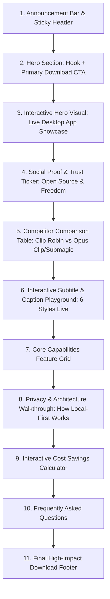

# Clip Robin — Landing Page Strategy & Implementation Plan

> **File:** `website.md`  
> **Status:** Strategic Blueprint  
> **Target Audience:** Content Creators, Podcasters, Streamers, Video Editors, Developers, and Social Media Marketers  
> **Primary Goal:** Convert visitors into software downloads (Windows desktop app) and GitHub stars  

---

## 1. What the Project Is

**Clip Robin** is an open-source, local-first Windows desktop application that automatically discovers, extracts, reframes, captions, and exports viral short-form video clips (for **TikTok, YouTube Shorts, and Instagram Reels**) from long-form video content (podcasts, streams, interviews, webinars, and YouTube videos).

### The Core Problem It Solves
Creators spend hours manually scrubbing through hours of footage, finding interesting moments, cropping them to 9:16 vertical video, and typing subtitles. While cloud AI services exist to automate this, they introduce three painful friction points:
1. **Aggressive Recurring Costs:** Cloud services charge monthly subscription fees ($15 to $79+/month) based on minute quotas, where a single 1-hour podcast consumes an entire month's allowance.
2. **Loss of Privacy & Slow Uploads:** Gigabytes of private or unreleased raw video footage must be uploaded to third-party cloud servers.
3. **Vendor Lock-in & Video Expiration:** Projects and rendered videos are often deleted or locked behind a paywall when a subscription lapses.

### Clip Robin’s Solution: "Local by Default, AI Where It Matters"
- **Desktop Architecture:** Powered by a lightweight **Tauri v2** shell, **Next.js 16** frontend, and a high-performance **Python/FastAPI** local backend.
- **Heavy Media Lifting Happens Locally:** Local audio extraction, local transcription using **CTranslate2 / `faster-whisper`**, smart face-detection reframing using **OpenCV YuNet ONNX**, and video rendering with **FFmpeg** all run directly on the user’s PC hardware for **$0.00**.
- **Opt-in, Cost-Effective Cloud Intelligence:** Semantic hook scoring, title/description generation, and virality ranking can run completely offline with mock analysis, or connect to **OpenAI, DeepSeek, or Google Gemini** using the creator's own API keys (Bring Your Own Key / BYOK). This turns a $30/month bill into **$0.02** of direct API usage.

---

## 2. Competitor Analysis & Market Positioning

### Leading Competitors in the Market

| Competitor | Platform Type | Pricing Model | Major Drawbacks | Clip Robin Advantage |
| :--- | :--- | :--- | :--- | :--- |
| **Opus Clip** (`opus.pro`) | Cloud Web SaaS | • **Free:** 60 mins/mo (watermarked, clips expire in 3 days)<br>• **Starter:** \$15/mo for 150 mins<br>• **Pro:** \$29/mo for 300 mins | • Consumes credits per minute of source video (a 60-min podcast burns 60 credits even for 1 clip)<br>• Forced cloud uploads<br>• Watermarks on free plan | **100% Free & Unlimited** source video processing on your local machine. No watermarks, no expiring clips. |
| **Submagic** (`submagic.co`) | Cloud Web SaaS | • **Starter:** \$19/mo (~15 videos, max 2 min/video)<br>• **Pro:** \$39/mo (~40 videos, max 5 min/video)<br>• **Business:** \$69/mo | • Strict duration caps per video<br>• High subscription pricing<br>• Expensive credit burn for basic features | **No duration caps**, process full 3-hour podcasts locally without spending credits or fees. |
| **Klap** (`klap.app`) | Cloud Web SaaS | • **Basic:** \$29/mo (10 videos)<br>• **Pro:** \$79/mo (30 videos) | • Expensive for individual creators<br>• All media stored on third-party servers | **100% Local Privacy.** Source media never leaves the creator's storage drive. |
| **Vizard.ai / Munch** | Cloud Web SaaS | • \$16 - \$49+/mo | • Targeted at enterprise marketing teams with locked workflows | **Open-source & transparent.** Inspectable code, modifiable subtitle styles, and offline capability. |

### Strategic Value Proposition
> **"Why pay $30/month to upload your gigabytes of footage to the cloud when your own computer can transcribe, track faces, and cut clips for free?"**

Clip Robin bridges the gap between **high-end automated SaaS** and **local, privacy-respecting open-source software** (similar to what *OBS Studio* did for streaming or *Blender* did for 3D modeling).

---

## 3. Brand Identity & Project Color Palette

Clip Robin's visual design communicates **precision engineering, modern developer/creator elegance, speed, and privacy**. The palette is anchored around a high-contrast dark mode with vibrant Emerald Green (freedom/speed) and energetic accent accents.

### Official Color Tokens

| Semantic Role | Token / Name | Hex Code | Purpose & Usage on Website |
| :--- | :--- | :--- | :--- |
| **Background (Deep)** | Canvas Background | `#09090b` | Page background, high-contrast dark aesthetic (Zinc 950). |
| **Surface (Card)** | Surface Card | `#121215` | Feature cards, interactive modules, modal containers. |
| **Surface Raised** | Surface Raised | `#18181c` | Hover states, dropdowns, sticky navbar, preview docks. |
| **Surface Active** | Surface Active | `#202026` | Active tabs, pressed buttons, bordered badge backgrounds. |
| **Subtle Border** | Border Subtle | `#27272a` | Clean hairline dividers, card outlines, subtle gridlines. |
| **Border Hover** | Border Highlight | `#3f3f46` | Card borders on hover, active input outlines. |
| **Primary Accent** | Emerald Brand Green | `#10b981` | **Primary CTA buttons (Download for Windows)**, active icons, glowing halos, badges, success states. |
| **Accent Hover** | Emerald Dark | `#059669` | Hover state for primary buttons and interactive links. |
| **Accent Subtle** | Emerald Tint | `rgba(16, 185, 129, 0.12)` | Pill backgrounds, active navigation chips, subtle glows. |
| **Highlight Accent** | Amber / Gold | `#f59e0b` | Virality scores, hook highlights, star metrics, warning tags. |
| **AI / Intelligence** | Electric Purple | `#a855f7` | Semantic analysis tags, model switches (OpenAI/Gemini/DeepSeek), AI hook badges. |
| **Foreground Text** | Bright White | `#ffffff` / `#f4f4f5` | Headlines, primary copy, active button text. |
| **Muted Text** | Zinc Muted | `#a1a1aa` | Subheadings, feature descriptions, documentation links. |
| **Dim Text** | Zinc Dim | `#71717a` | Footnotes, minor metadata, keyboard shortcut badges. |

### Typography & Aesthetics
- **Font Stack:** `Inter`, system-ui, sans-serif (Clean, modern, highly legible).
- **Style Accents:** Subtle radial gradients (`radial-gradient(ellipse at top, #10b98115, transparent 70%)`), glassmorphic border effects (`backdrop-blur-md`), and micro-interactions.

---

## 4. Best Form & Structure for the Landing Page

The most effective format for Clip Robin is a **high-converting, developer/creator developer-tools landing page** (styled with the precision of Linear, Raycast, and Cursor). 

### Page Architecture & Flow



---

### Section-by-Section Wireframe & Copywriting Plan

#### Section 1: Sticky Navigation Bar
- **Left:** Clip Robin Logo (`logo-mark.svg`) + "Clip Robin" wordmark + `v0.1.25 Beta` badge.
- **Center:** Navigation Links (`Features`, `Compare`, `Captions`, `Architecture`, `Docs`).
- **Right:**
  - **GitHub Star Button:** Link to repository with live star count.
  - **Download Button (Small):** Emerald button: `Download Free`.

#### Section 2: Hero Section (The Core Hook)
- **Tagline Pill:** `⚡ 100% Local-First Desktop App for Windows` (with pulsing emerald dot).
- **Headline (H1):**  
  **Turn Hours of Video into Viral Shorts.**  
  <span style="color: #10b981;">100% Free. Completely Local. Zero Cloud Limits.</span>
- **Subheadline (P):**  
  Extract, reframe, caption, and export high-performing 9:16 vertical clips on your own computer. No monthly subscriptions, no video uploads, no watermarks, and no expiring clips.
- **CTA Cluster:**
  - **Primary CTA:** Huge Emerald Button:  
    `⬇ Download for Windows (x64)`  
    *Sub-label:* Free & Open Source • Windows 10/11 • v0.1.25
  - **Secondary CTA:** Ghost Button with GitHub Octocat:  
    `★ Star on GitHub`
- **Zero-Friction Bullets below CTA:**
  - `✓ No credit card required`
  - `✓ Unlimited video length`
  - `✓ Your raw footage never leaves your PC`

#### Section 3: Interactive Hero Visual (The App in Action)
- A high-definition mock desktop window rendering the actual Clip Robin interface:
  - Long-form YouTube / local video input card on the left.
  - Sliced 9:16 vertical video cards with virality scores (`Score: 92/100`), hooks (`"The #1 mistake beginners make..."`), and active animated karaoke captions.
  - A realistic Windows window header with minimize, maximize, and close controls.

#### Section 4: The Direct Competitor Comparison (The Deciding Factor)
A clean side-by-side comparison table highlighting the customer pain points with Opus Clip and Submagic:

| Feature / Guarantee | Clip Robin | Opus Clip / Submagic / Klap |
| :--- | :---: | :---: |
| **Monthly Subscription** | **$0 / month** | \$15 – \$79 / month |
| **Video Processing Quotas** | **Unlimited Minutes** | 60 – 300 minutes cap |
| **Privacy & Security** | **100% Local on your PC** | Uploads raw video to cloud |
| **Watermarks** | **Zero Watermarks Ever** | Watermarked on free tiers |
| **Clip Expiration** | **Forever Saved on Local Disk** | Clips expire/delete after 3 days |
| **AI Hook Analysis Cost** | **Pennies (Direct API Key / BYOK)** | Heavily marked-up credits |
| **Code Transparency** | **Open Source (MIT / Inspectable)** | Closed proprietary black box |

#### Section 5: Interactive Caption & Animation Gallery
Clip Robin already ships with **6 distinctive ASS subtitle styles** and **5 animations** (stored in `frontend/public/caption-previews/`):
- **Styles:** `Robin`, `Clean`, `Punch`, `Karaoke`, `Pill`, `Classic`.
- **Animations:** `Pop`, `Glide`, `Fade`, `Grow`, `Sweep`.
- **Website Implementation:** An interactive widget on the landing page where users click between tabs (`Robin`, `Karaoke`, `Punch`, etc.) and instantly see the pre-rendered 9:16 preview video or animation clip playing with word-by-word highlights and TikTok safe-zone overlays.

#### Section 6: Core Features (The Engine Under the Hood)
1. **Local Whisper Transcription:** Powered by `faster-whisper` and CTranslate2. Transcribe hours of audio in minutes with word-level accuracy without sending a byte over the internet.
2. **AI Virality & Hook Detection:** Connect OpenAI GPT-4o, Google Gemini, or DeepSeek with your own API key to rank topics and extract viral hooks for less than a cent per video.
3. **Smart 9:16 Vertical Reframing:** Face-tracking and speaker centering powered by OpenCV YuNet ONNX to keep the subject locked in frame.
4. **Fast FFmpeg Batch Export:** Render in high-bitrate H.264/MP4 with burned-in subtitles, and download clips individually or as a complete `.ZIP` archive.
5. **Direct Social Upload Modals:** Pre-configured flows for YouTube Shorts, TikTok, and Instagram Reels.

#### Section 7: "How It Works" (3 Simple Steps)
1. **Drop or Paste:** Paste any YouTube URL or drag-and-drop a local video file (MP4, MKV, MOV).
2. **Configure & Analyze:** Select clip lengths (15s, 30s, 60s, 90s) and caption styles. Let the local engine or opt-in AI scan for viral moments.
3. **Review & Export:** Preview clips with moving captions, tweak cut points, and export directly to your disk.

#### Section 8: Interactive Cost Savings Calculator
- A clean interactive slider: *"How many hours of video do you clip per month?"* (1 to 20 hours).
- **Opus Clip / Cloud Clipper cost:** Displays `$29 - $120+ / month` ($348 - $1,440 / year).
- **Clip Robin cost:** Displays `$0.00` (or `~$0.25` in raw LLM tokens if AI hooks are enabled).
- **Annual Savings Callout:** Displays **"You save up to $1,400+ every year"**.

#### Section 9: Frequently Asked Questions (FAQ)
- *Do I need an expensive graphics card (GPU) to run Clip Robin?*  
  No. Clip Robin is optimized with multi-threaded CPU processing. If you have an NVIDIA GPU, it automatically takes advantage of CUDA acceleration for ultra-fast rendering and transcription.
- *Is Clip Robin really completely free?*  
  Yes. The application and all local processing (transcription, cutting, reframing, and subtitling) are 100% free and open source. If you choose to enable cloud AI for clip hook generation, you can provide your own API key (paying direct wholesale rates of pennies per hour).
- *Can I use it offline?*  
  Yes. Media inspection, local transcription, smart framing, and video rendering require zero internet connectivity.
- *What platforms are supported?*  
  Currently built for Windows 10 & 11 (64-bit). macOS and Linux builds are on the roadmap.

#### Section 10: High-Impact Download Footer
- Big headline: **"Take Control of Your Video Workflow Today."**
- Large Emerald `Download Clip Robin for Windows` button.
- Checksums / SHA-256 links, release notes link, GitHub repository link, and Discord/Community link.

---

## 5. Visual Asset & Media Strategy

To make the landing page visually stunning and trustworthy:

1. **Leverage Existing Repository Assets:**
   - App Icon: `frontend/public/clip-robin-icon.png` / `Clip Robin - App Icon.png`
   - Vector Logo: `frontend/public/logo-mark.svg`
   - Pre-rendered Caption Previews: `frontend/public/caption-previews/*.mp4` and `*.jpg` (Instant interactive playback without heavy video hosting costs).
2. **App Window Frame:** Render the real Next.js UI inside an SVG mockup of a Windows 11 dark window frame with subtle drop shadows (`shadow-2xl shadow-emerald-500/10`).
3. **Mermaid Flowchart Diagram:** Embed the local-first processing architecture to visually reassure creators and tech-savvy users about privacy and zero cloud uploads.

---

## 6. Recommended Technical Implementation for the Website

### Option A: Static Next.js Landing Page (Recommended)
- Build a dedicated marketing route or standalone Next.js site using the existing Tailwind CSS design system (`globals.css`).
- Deploy for free on **GitHub Pages**, **Vercel**, or **Cloudflare Pages**.
- Direct download button pointing to the latest GitHub Release asset:
  ```text
  https://github.com/<owner>/ClipRobin/releases/latest/download/ClipRobin-Setup.exe
  ```

### Option B: Single-File Lightweight HTML/Tailwind CDN
- A blazing-fast, single-file `index.html` using Tailwind CSS and lightweight vanilla JS.
- Zero build step, instant deployment on GitHub Pages (`gh-pages`).

---

## 7. Next Steps & Execution Checklist

- [ ] Confirm landing page deployment target (e.g., GitHub Pages under `docs/` or separate marketing repository).
- [ ] Review copywriting and value propositions in this plan.
- [ ] Wire the primary download button to the automated GitHub release pipeline (`release-tauri.yml`).
- [ ] Implement the interactive caption style switcher using existing preview assets in `frontend/public/caption-previews/`.
